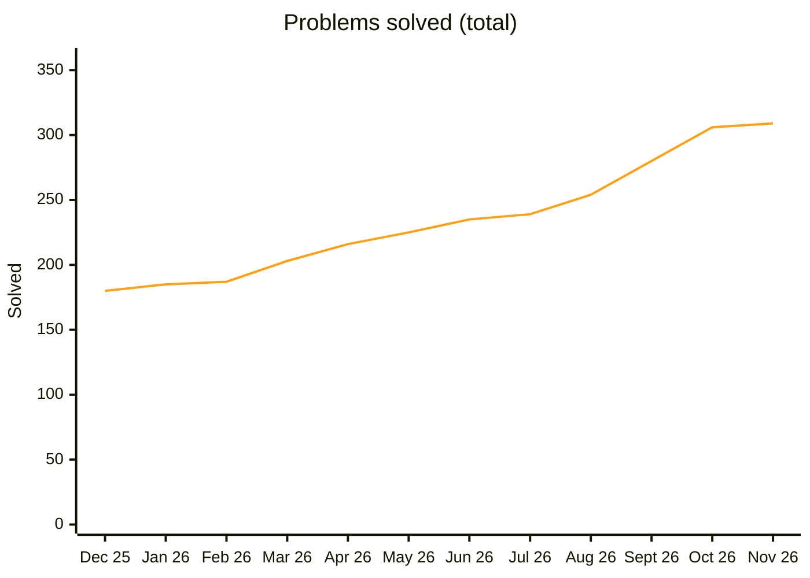

# Java-DSA
Java DSA

<!-- leetstash:stats:start -->

  

<b><a href="#ls-activity">Activity</a> &nbsp;·&nbsp; <a href="#ls-recent">Recent</a> &nbsp;·&nbsp; <a href="#ls-progress">Progress</a> &nbsp;·&nbsp; <a href="#ls-skills">Skills</a> &nbsp;·&nbsp; <a href="#ls-languages">Languages</a> &nbsp;·&nbsp; <a href="#ls-problems">All problems</a></b>

⏳ 486 solved problems still being imported from LeetCode.

## 🔥 Activity

<a href="#ls-top">↑ Back to top</a>

## 🕒 Recent activity

| Date | Problem | Difficulty | Solution |
|---|---|---|---|
| 5 Nov 2026 | [Find the Distance Value Between Two Arrays](https://leetcode.com/problems/find-the-distance-value-between-two-arrays/) | 🟢 Easy | [Java](https://github.com/Ved-u/Java-DSA/blob/main/Java/Binary%20Search/1385-find-the-distance-value-between-two-arrays.md) |
| 2 Nov 2026 | [Minimum Queen Moves to Reach Target](https://leetcode.com/problems/minimum-queen-moves-to-reach-target/) | 🟢 Easy | [Java](https://github.com/Ved-u/Java-DSA/blob/main/Java/Math/4061-minimum-queen-moves-to-reach-target.md) |
| 1 Nov 2026 | [Minimum Value of Merged Integers](https://leetcode.com/problems/minimum-value-of-merged-integers/) | 🟢 Easy | [Java](https://github.com/Ved-u/Java-DSA/blob/main/Java/Uncategorized/4097-minimum-value-of-merged-integers.md) |
| 30 Oct 2026 | [Maximum Difference by Remapping a Digit](https://leetcode.com/problems/maximum-difference-by-remapping-a-digit/) | 🟢 Easy | [Java](https://github.com/Ved-u/Java-DSA/blob/main/Java/Greedy/2566-maximum-difference-by-remapping-a-digit.md) |
| 29 Oct 2026 | [Number of Days Between Two Dates](https://leetcode.com/problems/number-of-days-between-two-dates/) | 🟢 Easy | [Java](https://github.com/Ved-u/Java-DSA/blob/main/Java/Math/1360-number-of-days-between-two-dates.md) |
| 28 Oct 2026 | [Binary Digit Score](https://leetcode.com/problems/binary-digit-score/) | 🟢 Easy | [Java](https://github.com/Ved-u/Java-DSA/blob/main/Java/Uncategorized/4092-binary-digit-score.md) |
| 27 Oct 2026 | [Create Grid With Exactly One Path](https://leetcode.com/problems/create-grid-with-exactly-one-path/) | 🟢 Easy | [Java](https://github.com/Ved-u/Java-DSA/blob/main/Java/Uncategorized/3963-create-grid-with-exactly-one-path.md) |
| 25 Oct 2026 | [Difference Between Peaks and Valleys](https://leetcode.com/problems/difference-between-peaks-and-valleys/) | 🟢 Easy | [Java](https://github.com/Ved-u/Java-DSA/blob/main/Java/Uncategorized/4088-difference-between-peaks-and-valleys.md) |
| 24 Oct 2026 | [Count Days Spent Together](https://leetcode.com/problems/count-days-spent-together/) | 🟢 Easy | [Java](https://github.com/Ved-u/Java-DSA/blob/main/Java/Math/2409-count-days-spent-together.md) |
| 23 Oct 2026 | [Double Modular Exponentiation](https://leetcode.com/problems/double-modular-exponentiation/) | 🟡 Medium | [Java](https://github.com/Ved-u/Java-DSA/blob/main/Java/Simulation/2961-double-modular-exponentiation.md) |

<a href="#ls-top">↑ Back to top</a>

## 📈 Progress over time

<a href="#ls-top">↑ Back to top</a>

## 🧠 Skills

_Topic coverage: a problem counts toward every topic it's tagged with._

| Topic | Solved | 🟢 Easy | 🟡 Medium | 🔴 Hard | |
|---|---|---|---|---|---|
| Array | **405** | 276 | 120 | 9 | `████████████████` |
| String | **239** | 174 | 63 | 2 | `█████████░░░░░░░` |
| Math | **160** | 127 | 32 | 1 | `██████░░░░░░░░░░` |
| Hash Table | **152** | 109 | 42 | 1 | `██████░░░░░░░░░░` |
| Sorting | **98** | 63 | 33 | 2 | `████░░░░░░░░░░░░` |
| Two Pointers | **94** | 53 | 39 | 2 | `████░░░░░░░░░░░░` |
| Simulation | **93** | 63 | 30 | 0 | `████░░░░░░░░░░░░` |
| Tree | **60** | 31 | 29 | 0 | `██░░░░░░░░░░░░░░` |
| Binary Tree | **57** | 29 | 28 | 0 | `██░░░░░░░░░░░░░░` |
| Bit Manipulation | **56** | 40 | 15 | 1 | `██░░░░░░░░░░░░░░` |
| Counting | **54** | 40 | 14 | 0 | `██░░░░░░░░░░░░░░` |
| Greedy | **53** | 27 | 26 | 0 | `██░░░░░░░░░░░░░░` |
| Depth-First Search | **51** | 29 | 22 | 0 | `██░░░░░░░░░░░░░░` |
| Matrix | **45** | 23 | 21 | 1 | `██░░░░░░░░░░░░░░` |
| Linked List | **44** | 12 | 32 | 0 | `██░░░░░░░░░░░░░░` |

78 more topics

| Topic | Solved | 🟢 Easy | 🟡 Medium | 🔴 Hard | |
|---|---|---|---|---|---|
| Stack | **43** | 20 | 21 | 2 | `██░░░░░░░░░░░░░░` |
| Binary Search | **35** | 19 | 13 | 3 | `█░░░░░░░░░░░░░░░` |
| Dynamic Programming | **29** | 9 | 16 | 4 | `█░░░░░░░░░░░░░░░` |
| Enumeration | **28** | 25 | 3 | 0 | `█░░░░░░░░░░░░░░░` |
| Prefix Sum | **27** | 15 | 12 | 0 | `█░░░░░░░░░░░░░░░` |
| Binary Search Tree | **23** | 9 | 14 | 0 | `█░░░░░░░░░░░░░░░` |
| Breadth-First Search | **22** | 15 | 7 | 0 | `█░░░░░░░░░░░░░░░` |
| Sliding Window | **20** | 12 | 7 | 1 | `█░░░░░░░░░░░░░░░` |
| Number Theory | **18** | 10 | 8 | 0 | `█░░░░░░░░░░░░░░░` |
| Heap (Priority Queue) | **17** | 9 | 6 | 2 | `█░░░░░░░░░░░░░░░` |
| Design | **16** | 6 | 9 | 1 | `█░░░░░░░░░░░░░░░` |
| Divide and Conquer | **16** | 4 | 11 | 1 | `█░░░░░░░░░░░░░░░` |
| Recursion | **16** | 10 | 5 | 1 | `█░░░░░░░░░░░░░░░` |
| Uncategorized | **13** | 12 | 1 | 0 | `█░░░░░░░░░░░░░░░` |
| Monotonic Stack | **10** | 2 | 6 | 2 | `█░░░░░░░░░░░░░░░` |
| Backtracking | **9** | 2 | 4 | 3 | `█░░░░░░░░░░░░░░░` |
| Queue | **7** | 3 | 3 | 1 | `█░░░░░░░░░░░░░░░` |
| String Matching | **7** | 7 | 0 | 0 | `█░░░░░░░░░░░░░░░` |
| Bracket Sequences | **6** | 3 | 3 | 0 | `█░░░░░░░░░░░░░░░` |
| Counting Sort | **6** | 4 | 2 | 0 | `█░░░░░░░░░░░░░░░` |
| Brainteaser | **5** | 3 | 2 | 0 | `█░░░░░░░░░░░░░░░` |
| Trie | **5** | 2 | 3 | 0 | `█░░░░░░░░░░░░░░░` |
| Bucket Sort | **4** | 0 | 4 | 0 | `█░░░░░░░░░░░░░░░` |
| Floyd's Cycle Finding Algorithm | **4** | 2 | 2 | 0 | `█░░░░░░░░░░░░░░░` |
| Game Theory | **4** | 3 | 1 | 0 | `█░░░░░░░░░░░░░░░` |
| Hash Function | **4** | 3 | 1 | 0 | `█░░░░░░░░░░░░░░░` |
| Memoization | **4** | 3 | 1 | 0 | `█░░░░░░░░░░░░░░░` |
| Quicksort | **4** | 2 | 2 | 0 | `█░░░░░░░░░░░░░░░` |
| Algorithm X | **3** | 0 | 0 | 3 | `█░░░░░░░░░░░░░░░` |
| Bubble Sort | **3** | 2 | 1 | 0 | `█░░░░░░░░░░░░░░░` |
| Combinatorics | **3** | 2 | 1 | 0 | `█░░░░░░░░░░░░░░░` |
| Data Stream | **3** | 1 | 1 | 1 | `█░░░░░░░░░░░░░░░` |
| Geometry | **3** | 2 | 1 | 0 | `█░░░░░░░░░░░░░░░` |
| Graph Theory | **3** | 2 | 1 | 0 | `█░░░░░░░░░░░░░░░` |
| Interactive | **3** | 2 | 0 | 1 | `█░░░░░░░░░░░░░░░` |
| Merge Sort | **3** | 0 | 3 | 0 | `█░░░░░░░░░░░░░░░` |
| Pigeonhole Principle | **3** | 1 | 2 | 0 | `█░░░░░░░░░░░░░░░` |
| Polygons | **3** | 3 | 0 | 0 | `█░░░░░░░░░░░░░░░` |
| Prime Factorization | **3** | 1 | 2 | 0 | `█░░░░░░░░░░░░░░░` |
| Sieve Theory | **3** | 1 | 2 | 0 | `█░░░░░░░░░░░░░░░` |
| Binary Lifting | **2** | 0 | 2 | 0 | `█░░░░░░░░░░░░░░░` |
| Concurrency | **2** | 1 | 1 | 0 | `█░░░░░░░░░░░░░░░` |
| Doubly-Linked List | **2** | 1 | 1 | 0 | `█░░░░░░░░░░░░░░░` |
| DP on Trees | **2** | 2 | 0 | 0 | `█░░░░░░░░░░░░░░░` |
| Euclidean Algorithm | **2** | 2 | 0 | 0 | `█░░░░░░░░░░░░░░░` |
| Greatest Common Divisor | **2** | 2 | 0 | 0 | `█░░░░░░░░░░░░░░░` |
| Impartial Game | **2** | 2 | 0 | 0 | `█░░░░░░░░░░░░░░░` |
| Lowest Common Ancestor | **2** | 0 | 2 | 0 | `█░░░░░░░░░░░░░░░` |
| Ordered Set | **2** | 2 | 0 | 0 | `█░░░░░░░░░░░░░░░` |
| Primality Test | **2** | 1 | 1 | 0 | `█░░░░░░░░░░░░░░░` |
| Quickselect | **2** | 0 | 2 | 0 | `█░░░░░░░░░░░░░░░` |
| Radix Sort | **2** | 0 | 2 | 0 | `█░░░░░░░░░░░░░░░` |
| Range Minimum/Maximum Query | **2** | 0 | 0 | 2 | `█░░░░░░░░░░░░░░░` |
| Segment Tree | **2** | 1 | 1 | 0 | `█░░░░░░░░░░░░░░░` |
| Ternary Search | **2** | 0 | 1 | 1 | `█░░░░░░░░░░░░░░░` |
| Binary Indexed Tree | **1** | 1 | 0 | 0 | `█░░░░░░░░░░░░░░░` |
| Boyer–Moore Majority Vote Algorithm | **1** | 1 | 0 | 0 | `█░░░░░░░░░░░░░░░` |
| Boyer–Moore String-Search Algorithm | **1** | 1 | 0 | 0 | `█░░░░░░░░░░░░░░░` |
| Brute-Force Search | **1** | 0 | 1 | 0 | `█░░░░░░░░░░░░░░░` |
| Cartesian Tree | **1** | 0 | 1 | 0 | `█░░░░░░░░░░░░░░░` |
| Complete Knapsack | **1** | 0 | 1 | 0 | `█░░░░░░░░░░░░░░░` |
| Dancing Links | **1** | 0 | 0 | 1 | `█░░░░░░░░░░░░░░░` |
| Database | **1** | 1 | 0 | 0 | `█░░░░░░░░░░░░░░░` |
| Iterator | **1** | 0 | 1 | 0 | `█░░░░░░░░░░░░░░░` |
| Knapsack Problem | **1** | 0 | 1 | 0 | `█░░░░░░░░░░░░░░░` |
| Knuth–Morris–Pratt Algorithm | **1** | 1 | 0 | 0 | `█░░░░░░░░░░░░░░░` |
| Longest Common Subsequence | **1** | 0 | 1 | 0 | `█░░░░░░░░░░░░░░░` |
| Longest Increasing Subsequence | **1** | 1 | 0 | 0 | `█░░░░░░░░░░░░░░░` |
| Minimax | **1** | 1 | 0 | 0 | `█░░░░░░░░░░░░░░░` |
| Monotonic Queue | **1** | 0 | 0 | 1 | `█░░░░░░░░░░░░░░░` |
| Newton's Method | **1** | 1 | 0 | 0 | `█░░░░░░░░░░░░░░░` |
| Nim Game | **1** | 1 | 0 | 0 | `█░░░░░░░░░░░░░░░` |
| Prime Number Sieve | **1** | 0 | 1 | 0 | `█░░░░░░░░░░░░░░░` |
| Rolling Hash | **1** | 1 | 0 | 0 | `█░░░░░░░░░░░░░░░` |
| Shortest Path | **1** | 0 | 1 | 0 | `█░░░░░░░░░░░░░░░` |
| Timsort | **1** | 0 | 1 | 0 | `█░░░░░░░░░░░░░░░` |
| Union-Find | **1** | 0 | 1 | 0 | `█░░░░░░░░░░░░░░░` |
| Z Algorithm | **1** | 1 | 0 | 0 | `█░░░░░░░░░░░░░░░` |

<a href="#ls-top">↑ Back to top</a>

## 💻 Languages

| Language | Problems | |
|---|---|---|
| Java | 309 | `████████████████` |
| Python | 1 | `█░░░░░░░░░░░░░░░` |

<a href="#ls-top">↑ Back to top</a>

## 📚 All problems

**Jump to:** <a href="#ls-topic-math">Math</a>&nbsp;(95) · <a href="#ls-topic-hash-table">Hash Table</a>&nbsp;(84) · <a href="#ls-topic-string">String</a>&nbsp;(68) · <a href="#ls-topic-two-pointers">Two Pointers</a>&nbsp;(66) · <a href="#ls-topic-simulation">Simulation</a>&nbsp;(63) · <a href="#ls-topic-tree">Tree</a>&nbsp;(53) · <a href="#ls-topic-array">Array</a>&nbsp;(51) · <a href="#ls-topic-greedy">Greedy</a>&nbsp;(50) · <a href="#ls-topic-bit-manipulation">Bit Manipulation</a>&nbsp;(49) · <a href="#ls-topic-dynamic-programming">Dynamic Programming</a>&nbsp;(29) · <a href="#ls-topic-linked-list">Linked List</a>&nbsp;(27) · <a href="#ls-topic-binary-search">Binary Search</a>&nbsp;(26) · <a href="#ls-topic-stack">Stack</a>&nbsp;(23) · <a href="#ls-topic-sliding-window">Sliding Window</a>&nbsp;(16) · <a href="#ls-topic-divide-and-conquer">Divide and Conquer</a>&nbsp;(15) · <a href="#ls-topic-sorting">Sorting</a>&nbsp;(14) · <a href="#ls-topic-uncategorized">Uncategorized</a>&nbsp;(13) · <a href="#ls-topic-heap-priority-queue">Heap (Priority Queue)</a>&nbsp;(12) · <a href="#ls-topic-matrix">Matrix</a>&nbsp;(11) · <a href="#ls-topic-backtracking">Backtracking</a>&nbsp;(8) · <a href="#ls-topic-string-matching">String Matching</a>&nbsp;(4) · <a href="#ls-topic-trie">Trie</a>&nbsp;(4) · <a href="#ls-topic-design">Design</a>&nbsp;(3) · <a href="#ls-topic-recursion">Recursion</a>&nbsp;(3) · <a href="#ls-topic-concurrency">Concurrency</a>&nbsp;(2) · <a href="#ls-topic-depth-first-search">Depth-First Search</a>&nbsp;(2) · <a href="#ls-topic-database">Database</a>&nbsp;(1) · <a href="#ls-topic-graph-theory">Graph Theory</a>&nbsp;(1) · <a href="#ls-topic-queue">Queue</a>&nbsp;(1) · <a href="#ls-topic-segment-tree">Segment Tree</a>&nbsp;(1)

_Grouped by topic folder. Click a topic to expand it._

<b>Math</b> · 95 problems · 🟢 79 🟡 16 🔴 0

| # | Problem | Level | Solution | Approaches | Best runtime | Time | First solved |
|---|---|---|---|---|---|---|---|
| 7 | [Reverse Integer](https://leetcode.com/problems/reverse-integer/) | 🟡 | [Java](https://github.com/Ved-u/Java-DSA/blob/main/Java/Math/0007-reverse-integer.md) | 1 | 1 ms, beats 100.0% | - | 20 Feb 2024 |
| 9 | [Palindrome Number](https://leetcode.com/problems/palindrome-number/) | 🟢 | [Java](https://github.com/Ved-u/Java-DSA/blob/main/Java/Math/0009-palindrome-number.md) | 3 | 4 ms, beats 100.0% | - | 28 Jan 2024 |
| 12 | [Integer to Roman](https://leetcode.com/problems/integer-to-roman/) | 🟡 | [Java](https://github.com/Ved-u/Java-DSA/blob/main/Java/Math/0012-integer-to-roman.md) | 2 | 3 ms, beats 99.9% | - | 5 Mar 2024 |
| 13 | [Roman to Integer](https://leetcode.com/problems/roman-to-integer/) | 🟢 | [Java](https://github.com/Ved-u/Java-DSA/blob/main/Java/Math/0013-roman-to-integer.md) | 1 | 6 ms, beats 29.0% | - | 9 Nov 2024 |
| 48 | [Rotate Image](https://leetcode.com/problems/rotate-image/) | 🟡 | [Java](https://github.com/Ved-u/Java-DSA/blob/main/Java/Math/0048-rotate-image.md) | 1 | 0 ms, beats 100.0% | - | 16 Jun 2024 |
| 66 | [Plus One](https://leetcode.com/problems/plus-one/) | 🟢 | ⏳ not imported yet | - | - | - | - |
| 168 | [Excel Sheet Column Title](https://leetcode.com/problems/excel-sheet-column-title/) | 🟢 | ⏳ not imported yet | - | - | - | - |
| 171 | [Excel Sheet Column Number](https://leetcode.com/problems/excel-sheet-column-number/) | 🟢 | ⏳ not imported yet | - | - | - | - |
| 172 | [Factorial Trailing Zeroes](https://leetcode.com/problems/factorial-trailing-zeroes/) | 🟡 | ⏳ not imported yet | - | - | - | - |
| 204 | [Count Primes](https://leetcode.com/problems/count-primes/) | 🟡 | ⏳ not imported yet | - | - | - | - |
| 263 | [Ugly Number](https://leetcode.com/problems/ugly-number/) | 🟢 | ⏳ not imported yet | - | - | - | - |
| 292 | [Nim Game](https://leetcode.com/problems/nim-game/) | 🟢 | [Java](https://github.com/Ved-u/Java-DSA/blob/main/Java/Math/0292-nim-game.md) | 1 | 0 ms, beats 100.0% | - | 31 Mar 2026 |
| 319 | [Bulb Switcher](https://leetcode.com/problems/bulb-switcher/) | 🟡 | [Java](https://github.com/Ved-u/Java-DSA/blob/main/Java/Math/0319-bulb-switcher.md) | 2 | 0 ms, beats 100.0% | - | 4 Sept 2024 |
| 492 | [Construct the Rectangle](https://leetcode.com/problems/construct-the-rectangle/) | 🟢 | ⏳ not imported yet | - | - | - | - |
| 504 | [Base 7](https://leetcode.com/problems/base-7/) | 🟢 | ⏳ not imported yet | - | - | - | - |
| 507 | [Perfect Number](https://leetcode.com/problems/perfect-number/) | 🟢 | ⏳ not imported yet | - | - | - | - |
| 628 | [Maximum Product of Three Numbers](https://leetcode.com/problems/maximum-product-of-three-numbers/) | 🟢 | ⏳ not imported yet | - | - | - | - |
| 728 | [Self Dividing Numbers](https://leetcode.com/problems/self-dividing-numbers/) | 🟢 | ⏳ not imported yet | - | - | - | - |
| 812 | [Largest Triangle Area](https://leetcode.com/problems/largest-triangle-area/) | 🟢 | ⏳ not imported yet | - | - | - | - |
| 989 | [Add to Array-Form of Integer](https://leetcode.com/problems/add-to-array-form-of-integer/) | 🟢 | ⏳ not imported yet | - | - | - | - |
| 1037 | [Valid Boomerang](https://leetcode.com/problems/valid-boomerang/) | 🟢 | [Java](https://github.com/Ved-u/Java-DSA/blob/main/Java/Math/1037-valid-boomerang.md) | 1 | 0 ms, beats 100.0% | - | 22 Jun 2026 |
| 1154 | [Day of the Year](https://leetcode.com/problems/day-of-the-year/) | 🟢 | [Java](https://github.com/Ved-u/Java-DSA/blob/main/Java/Math/1154-day-of-the-year.md) | 1 | 7 ms, beats 96.1% | - | 4 Aug 2024 |
| 1281 | [Subtract the Product and Sum of Digits of an Integer](https://leetcode.com/problems/subtract-the-product-and-sum-of-digits-of-an-integer/) | 🟢 | [Java](https://github.com/Ved-u/Java-DSA/blob/main/Java/Math/1281-subtract-the-product-and-sum-of-digits-of-an-integer.md) | 1 | 0 ms, beats 100.0% | - | 25 Jan 2024 |
| 1295 | [Find Numbers with Even Number of Digits](https://leetcode.com/problems/find-numbers-with-even-number-of-digits/) | 🟢 | [Java](https://github.com/Ved-u/Java-DSA/blob/main/Java/Math/1295-find-numbers-with-even-number-of-digits.md) | 1 | 1 ms, beats 99.7% | - | 9 Aug 2024 |
| 1304 | [Find N Unique Integers Sum up to Zero](https://leetcode.com/problems/find-n-unique-integers-sum-up-to-zero/) | 🟢 | [Java](https://github.com/Ved-u/Java-DSA/blob/main/Java/Math/1304-find-n-unique-integers-sum-up-to-zero.md) | 1 | 0 ms, beats 100.0% | - | 9 Feb 2024 |
| 1317 | [Convert Integer to the Sum of Two No-Zero Integers](https://leetcode.com/problems/convert-integer-to-the-sum-of-two-no-zero-integers/) | 🟢 | [Java](https://github.com/Ved-u/Java-DSA/blob/main/Java/Math/1317-convert-integer-to-the-sum-of-two-no-zero-integers.md) | 3 | 13 ms, beats 5.6% | - | 14 Sept 2025 |
| 1360 | [Number of Days Between Two Dates](https://leetcode.com/problems/number-of-days-between-two-dates/) | 🟢 | [Java](https://github.com/Ved-u/Java-DSA/blob/main/Java/Math/1360-number-of-days-between-two-dates.md) | 1 | - | - | 29 Oct 2026 |
| 1390 | [Four Divisors](https://leetcode.com/problems/four-divisors/) | 🟡 | ⏳ not imported yet | - | - | - | - |
| 1492 | [The kth Factor of n](https://leetcode.com/problems/the-kth-factor-of-n/) | 🟡 | ⏳ not imported yet | - | - | - | - |
| 1512 | [Number of Good Pairs](https://leetcode.com/problems/number-of-good-pairs/) | 🟢 | ⏳ not imported yet | - | - | - | - |
| 1523 | [Count Odd Numbers in an Interval Range](https://leetcode.com/problems/count-odd-numbers-in-an-interval-range/) | 🟢 | ⏳ not imported yet | - | - | - | - |
| 1588 | [Sum of All Odd Length Subarrays](https://leetcode.com/problems/sum-of-all-odd-length-subarrays/) | 🟢 | ⏳ not imported yet | - | - | - | - |
| 1716 | [Calculate Money in Leetcode Bank](https://leetcode.com/problems/calculate-money-in-leetcode-bank/) | 🟢 | ⏳ not imported yet | - | - | - | - |
| 1812 | [Determine Color of a Chessboard Square](https://leetcode.com/problems/determine-color-of-a-chessboard-square/) | 🟢 | ⏳ not imported yet | - | - | - | - |
| 1822 | [Sign of the Product of an Array](https://leetcode.com/problems/sign-of-the-product-of-an-array/) | 🟢 | ⏳ not imported yet | - | - | - | - |
| 1925 | [Count Square Sum Triples](https://leetcode.com/problems/count-square-sum-triples/) | 🟢 | [Java](https://github.com/Ved-u/Java-DSA/blob/main/Java/Math/1925-count-square-sum-triples.md) | 1 | 242 ms, beats 10.4% | - | 9 Dec 2025 |
| 1952 | [Three Divisors](https://leetcode.com/problems/three-divisors/) | 🟢 | [Java](https://github.com/Ved-u/Java-DSA/blob/main/Java/Math/1952-three-divisors.md) | 1 | 0 ms, beats 100.0% | - | 17 Aug 2024 |
| 1979 | [Find Greatest Common Divisor of Array](https://leetcode.com/problems/find-greatest-common-divisor-of-array/) | 🟢 | [Java](https://github.com/Ved-u/Java-DSA/blob/main/Java/Math/1979-find-greatest-common-divisor-of-array.md) | 1 | 0 ms, beats 100.0% | - | 7 Aug 2024 |
| 2119 | [A Number After a Double Reversal](https://leetcode.com/problems/a-number-after-a-double-reversal/) | 🟢 | ⏳ not imported yet | - | - | - | - |
| 2125 | [Number of Laser Beams in a Bank](https://leetcode.com/problems/number-of-laser-beams-in-a-bank/) | 🟡 | ⏳ not imported yet | - | - | - | - |
| 2235 | [Add Two Integers](https://leetcode.com/problems/add-two-integers/) | 🟢 | ⏳ not imported yet | - | - | - | - |
| 2409 | [Count Days Spent Together](https://leetcode.com/problems/count-days-spent-together/) | 🟢 | [Java](https://github.com/Ved-u/Java-DSA/blob/main/Java/Math/2409-count-days-spent-together.md) | 2 | - | - | 24 Oct 2026 |
| 2413 | [Smallest Even Multiple](https://leetcode.com/problems/smallest-even-multiple/) | 🟢 | ⏳ not imported yet | - | - | - | - |
| 2427 | [Number of Common Factors](https://leetcode.com/problems/number-of-common-factors/) | 🟢 | ⏳ not imported yet | - | - | - | - |
| 2469 | [Convert the Temperature](https://leetcode.com/problems/convert-the-temperature/) | 🟢 | ⏳ not imported yet | - | - | - | - |
| 2485 | [Find the Pivot Integer](https://leetcode.com/problems/find-the-pivot-integer/) | 🟢 | ⏳ not imported yet | - | - | - | - |
| 2520 | [Count the Digits That Divide a Number](https://leetcode.com/problems/count-the-digits-that-divide-a-number/) | 🟢 | ⏳ not imported yet | - | - | - | - |
| 2535 | [Difference Between Element Sum and Digit Sum of an Array](https://leetcode.com/problems/difference-between-element-sum-and-digit-sum-of-an-array/) | 🟢 | ⏳ not imported yet | - | - | - | - |
| 2544 | [Alternating Digit Sum](https://leetcode.com/problems/alternating-digit-sum/) | 🟢 | [Java](https://github.com/Ved-u/Java-DSA/blob/main/Java/Math/2544-alternating-digit-sum.md) | 3 | 0 ms, beats 100.0% | - | 9 Feb 2024 |
| 2651 | [Calculate Delayed Arrival Time](https://leetcode.com/problems/calculate-delayed-arrival-time/) | 🟢 | [Java](https://github.com/Ved-u/Java-DSA/blob/main/Java/Math/2651-calculate-delayed-arrival-time.md) | 1 | 0 ms, beats 100.0% | - | 26 Jan 2024 |
| 2652 | [Sum Multiples](https://leetcode.com/problems/sum-multiples/) | 🟢 | [Java](https://github.com/Ved-u/Java-DSA/blob/main/Java/Math/2652-sum-multiples.md) | 2 | 2 ms, beats 96.8% | - | 25 Jan 2024 |
| 2769 | [Find the Maximum Achievable Number](https://leetcode.com/problems/find-the-maximum-achievable-number/) | 🟢 | [Java](https://github.com/Ved-u/Java-DSA/blob/main/Java/Math/2769-find-the-maximum-achievable-number.md) | 1 | - | - | 17 Aug 2026 |
| 2806 | [Account Balance After Rounded Purchase](https://leetcode.com/problems/account-balance-after-rounded-purchase/) | 🟢 | [Java](https://github.com/Ved-u/Java-DSA/blob/main/Java/Math/2806-account-balance-after-rounded-purchase.md) | 1 | 0 ms, beats 100.0% | - | 9 Aug 2024 |
| 2843 | [  Count Symmetric Integers](https://leetcode.com/problems/count-symmetric-integers/) | 🟢 | [Java](https://github.com/Ved-u/Java-DSA/blob/main/Java/Math/2843-count-symmetric-integers.md) | 1 | 1493 ms, beats 5.2% | - | 9 Aug 2024 |
| 2894 | [Divisible and Non-divisible Sums Difference](https://leetcode.com/problems/divisible-and-non-divisible-sums-difference/) | 🟢 | ⏳ not imported yet | - | - | - | - |
| 2965 | [Find Missing and Repeated Values](https://leetcode.com/problems/find-missing-and-repeated-values/) | 🟢 | ⏳ not imported yet | - | - | - | - |
| 3024 | [Type of Triangle](https://leetcode.com/problems/type-of-triangle/) | 🟢 | ⏳ not imported yet | - | - | - | - |
| 3099 | [Harshad Number](https://leetcode.com/problems/harshad-number/) | 🟢 | ⏳ not imported yet | - | - | - | - |
| 3190 | [Find Minimum Operations to Make All Elements Divisible by Three](https://leetcode.com/problems/find-minimum-operations-to-make-all-elements-divisible-by-three/) | 🟢 | ⏳ not imported yet | - | - | - | - |
| 3232 | [Find if Digit Game Can Be Won](https://leetcode.com/problems/find-if-digit-game-can-be-won/) | 🟢 | ⏳ not imported yet | - | - | - | - |
| 3233 | [Find the Count of Numbers Which Are Not Special](https://leetcode.com/problems/find-the-count-of-numbers-which-are-not-special/) | 🟡 | ⏳ not imported yet | - | - | - | - |
| 3270 | [Find the Key of the Numbers](https://leetcode.com/problems/find-the-key-of-the-numbers/) | 🟢 | ⏳ not imported yet | - | - | - | - |
| 3274 | [Check if Two Chessboard Squares Have the Same Color](https://leetcode.com/problems/check-if-two-chessboard-squares-have-the-same-color/) | 🟢 | ⏳ not imported yet | - | - | - | - |
| 3289 | [The Two Sneaky Numbers of Digitville](https://leetcode.com/problems/the-two-sneaky-numbers-of-digitville/) | 🟢 | ⏳ not imported yet | - | - | - | - |
| 3300 | [Minimum Element After Replacement With Digit Sum](https://leetcode.com/problems/minimum-element-after-replacement-with-digit-sum/) | 🟢 | ⏳ not imported yet | - | - | - | - |
| 3345 | [Smallest Divisible Digit Product I](https://leetcode.com/problems/smallest-divisible-digit-product-i/) | 🟢 | ⏳ not imported yet | - | - | - | - |
| 3432 | [Count Partitions with Even Sum Difference](https://leetcode.com/problems/count-partitions-with-even-sum-difference/) | 🟢 | ⏳ not imported yet | - | - | - | - |
| 3512 | [Minimum Operations to Make Array Sum Divisible by K](https://leetcode.com/problems/minimum-operations-to-make-array-sum-divisible-by-k/) | 🟢 | ⏳ not imported yet | - | - | - | - |
| 3516 | [Find Closest Person](https://leetcode.com/problems/find-closest-person/) | 🟢 | ⏳ not imported yet | - | - | - | - |
| 3536 | [Maximum Product of Two Digits](https://leetcode.com/problems/maximum-product-of-two-digits/) | 🟢 | ⏳ not imported yet | - | - | - | - |
| 3550 | [Smallest Index With Digit Sum Equal to Index](https://leetcode.com/problems/smallest-index-with-digit-sum-equal-to-index/) | 🟢 | [Java](https://github.com/Ved-u/Java-DSA/blob/main/Java/Math/3550-smallest-index-with-digit-sum-equal-to-index.md) | 1 | - | - | 24 Sept 2026 |
| 3591 | [Check if Any Element Has Prime Frequency](https://leetcode.com/problems/check-if-any-element-has-prime-frequency/) | 🟢 | ⏳ not imported yet | - | - | - | - |
| 3602 | [Hexadecimal and Hexatrigesimal Conversion](https://leetcode.com/problems/hexadecimal-and-hexatrigesimal-conversion/) | 🟢 | ⏳ not imported yet | - | - | - | - |
| 3622 | [Check Divisibility by Digit Sum and Product](https://leetcode.com/problems/check-divisibility-by-digit-sum-and-product/) | 🟢 | [Java](https://github.com/Ved-u/Java-DSA/blob/main/Java/Math/3622-check-divisibility-by-digit-sum-and-product.md) | 1 | - | - | 22 Aug 2026 |
| 3658 | [GCD of Odd and Even Sums](https://leetcode.com/problems/gcd-of-odd-and-even-sums/) | 🟢 | [Java](https://github.com/Ved-u/Java-DSA/blob/main/Java/Math/3658-gcd-of-odd-and-even-sums.md) | 2 | 0 ms, beats 100.0% | - | 5 Apr 2026 |
| 3663 | [Find The Least Frequent Digit](https://leetcode.com/problems/find-the-least-frequent-digit/) | 🟢 | [Java](https://github.com/Ved-u/Java-DSA/blob/main/Java/Math/3663-find-the-least-frequent-digit.md) | 1 | 1 ms, beats 100.0% | - | 5 Sept 2025 |
| 3697 | [Compute Decimal Representation](https://leetcode.com/problems/compute-decimal-representation/) | 🟢 | [Java](https://github.com/Ved-u/Java-DSA/blob/main/Java/Math/3697-compute-decimal-representation.md) | 1 | 6 ms, beats 11.0% | - | 5 May 2026 |
| 3736 | [Minimum Moves to Equal Array Elements III](https://leetcode.com/problems/minimum-moves-to-equal-array-elements-iii/) | 🟢 | [Java](https://github.com/Ved-u/Java-DSA/blob/main/Java/Math/3736-minimum-moves-to-equal-array-elements-iii.md) | 1 | 1 ms, beats 99.9% | - | 8 Nov 2025 |
| 3754 | [Concatenate Non-Zero Digits and Multiply by Sum I](https://leetcode.com/problems/concatenate-non-zero-digits-and-multiply-by-sum-i/) | 🟢 | [Java](https://github.com/Ved-u/Java-DSA/blob/main/Java/Math/3754-concatenate-non-zero-digits-and-multiply-by-sum-i.md) | 2 | 3 ms, beats 18.9% | - | 23 Nov 2025 |
| 3765 | [Complete Prime Number](https://leetcode.com/problems/complete-prime-number/) | 🟡 | [Java](https://github.com/Ved-u/Java-DSA/blob/main/Java/Math/3765-complete-prime-number.md) | 1 | 5 ms, beats 19.8% | - | 6 Dec 2025 |
| 3783 | [Mirror Distance of an Integer](https://leetcode.com/problems/mirror-distance-of-an-integer/) | 🟢 | [Java](https://github.com/Ved-u/Java-DSA/blob/main/Java/Math/3783-mirror-distance-of-an-integer.md) | 1 | 1 ms, beats 99.8% | - | 26 Dec 2025 |
| 3870 | [Count Commas in Range](https://leetcode.com/problems/count-commas-in-range/) | 🟢 | [Java](https://github.com/Ved-u/Java-DSA/blob/main/Java/Math/3870-count-commas-in-range.md) | 1 | - | - | 8 Sept 2026 |
| 3875 | [Construct Uniform Parity Array I](https://leetcode.com/problems/construct-uniform-parity-array-i/) | 🟢 | [Java](https://github.com/Ved-u/Java-DSA/blob/main/Java/Math/3875-construct-uniform-parity-array-i.md) | 1 | - | - | 2 Sept 2026 |
| 3895 | [Count Digit Appearances](https://leetcode.com/problems/count-digit-appearances/) | 🟡 | ⏳ not imported yet | - | - | - | - |
| 3899 | [Angles of a Triangle](https://leetcode.com/problems/angles-of-a-triangle/) | 🟡 | ⏳ not imported yet | - | - | - | - |
| 3908 | [Valid Digit Number](https://leetcode.com/problems/valid-digit-number/) | 🟢 | ⏳ not imported yet | - | - | - | - |
| 3918 | [Sum of Primes Between Number and Its Reverse](https://leetcode.com/problems/sum-of-primes-between-number-and-its-reverse/) | 🟡 | ⏳ not imported yet | - | - | - | - |
| 3945 | [Digit Frequency Score](https://leetcode.com/problems/digit-frequency-score/) | 🟢 | [Java](https://github.com/Ved-u/Java-DSA/blob/main/Java/Math/3945-digit-frequency-score.md) | 1 | - | - | 14 Aug 2026 |
| 3968 | [Maximum Manhattan Distance After All Moves](https://leetcode.com/problems/maximum-manhattan-distance-after-all-moves/) | 🟡 | ⏳ not imported yet | - | - | - | - |
| 3982 | [Sum of Integers with Maximum Digit Range](https://leetcode.com/problems/sum-of-integers-with-maximum-digit-range/) | 🟢 | ⏳ not imported yet | - | - | - | - |
| 3986 | [Number of Elapsed Seconds Between Two Times](https://leetcode.com/problems/number-of-elapsed-seconds-between-two-times/) | 🟢 | ⏳ not imported yet | - | - | - | - |
| 3996 | [Even Number of Knight Moves](https://leetcode.com/problems/even-number-of-knight-moves/) | 🟢 | ⏳ not imported yet | - | - | - | - |
| 4010 | [Maximize Pair Strength Using GCD](https://leetcode.com/problems/maximize-pair-strength-using-gcd/) | 🟢 | ⏳ not imported yet | - | - | - | - |
| 4034 | [Minimum Bishop Moves to Reach Target](https://leetcode.com/problems/minimum-bishop-moves-to-reach-target/) | 🟡 | [Java](https://github.com/Ved-u/Java-DSA/blob/main/Java/Math/4034-minimum-bishop-moves-to-reach-target.md) | 1 | - | - | 1 Sept 2026 |
| 4061 | [Minimum Queen Moves to Reach Target](https://leetcode.com/problems/minimum-queen-moves-to-reach-target/) | 🟢 | [Java](https://github.com/Ved-u/Java-DSA/blob/main/Java/Math/4061-minimum-queen-moves-to-reach-target.md) | 1 | - | - | 2 Nov 2026 |

<b>Hash Table</b> · 84 problems · 🟢 68 🟡 16 🔴 0

| # | Problem | Level | Solution | Approaches | Best runtime | Time | First solved |
|---|---|---|---|---|---|---|---|
| 1 | [Two Sum](https://leetcode.com/problems/two-sum/) | 🟢 | [Java](https://github.com/Ved-u/Java-DSA/blob/main/Java/Hash%20Table/0001-two-sum.md) | 6 | 0 ms, beats 100.0% | - | 28 Jan 2024 |
| 36 | [Valid Sudoku](https://leetcode.com/problems/valid-sudoku/) | 🟡 | [Java](https://github.com/Ved-u/Java-DSA/blob/main/Java/Hash%20Table/0036-valid-sudoku.md) | 1 | 1 ms, beats 100.0% | - | 21 Nov 2024 |
| 73 | [Set Matrix Zeroes](https://leetcode.com/problems/set-matrix-zeroes/) | 🟡 | ⏳ not imported yet | - | - | - | - |
| 128 | [Longest Consecutive Sequence](https://leetcode.com/problems/longest-consecutive-sequence/) | 🟡 | ⏳ not imported yet | - | - | - | - |
| 205 | [Isomorphic Strings](https://leetcode.com/problems/isomorphic-strings/) | 🟢 | ⏳ not imported yet | - | - | - | - |
| 217 | [Contains Duplicate](https://leetcode.com/problems/contains-duplicate/) | 🟢 | ⏳ not imported yet | - | - | - | - |
| 242 | [Valid Anagram](https://leetcode.com/problems/valid-anagram/) | 🟢 | [Java](https://github.com/Ved-u/Java-DSA/blob/main/Java/Hash%20Table/0242-valid-anagram.md) | 4 | 15 ms, beats 25.6% | - | 14 Nov 2024 |
| 290 | [Word Pattern](https://leetcode.com/problems/word-pattern/) | 🟢 | [Java](https://github.com/Ved-u/Java-DSA/blob/main/Java/Hash%20Table/0290-word-pattern.md) | 1 | 1 ms, beats 86.5% | - | 1 Apr 2026 |
| 383 | [Ransom Note](https://leetcode.com/problems/ransom-note/) | 🟢 | [Java](https://github.com/Ved-u/Java-DSA/blob/main/Java/Hash%20Table/0383-ransom-note.md) | 1 | 20 ms, beats 7.4% | - | 11 Dec 2025 |
| 442 | [Find All Duplicates in an Array](https://leetcode.com/problems/find-all-duplicates-in-an-array/) | 🟡 | ⏳ not imported yet | - | - | - | - |
| 448 | [Find All Numbers Disappeared in an Array](https://leetcode.com/problems/find-all-numbers-disappeared-in-an-array/) | 🟢 | ⏳ not imported yet | - | - | - | - |
| 500 | [Keyboard Row](https://leetcode.com/problems/keyboard-row/) | 🟢 | ⏳ not imported yet | - | - | - | - |
| 575 | [Distribute Candies](https://leetcode.com/problems/distribute-candies/) | 🟢 | ⏳ not imported yet | - | - | - | - |
| 599 | [Minimum Index Sum of Two Lists](https://leetcode.com/problems/minimum-index-sum-of-two-lists/) | 🟢 | ⏳ not imported yet | - | - | - | - |
| 748 | [Shortest Completing Word](https://leetcode.com/problems/shortest-completing-word/) | 🟢 | ⏳ not imported yet | - | - | - | - |
| 771 | [Jewels and Stones](https://leetcode.com/problems/jewels-and-stones/) | 🟢 | ⏳ not imported yet | - | - | - | - |
| 791 | [Custom Sort String](https://leetcode.com/problems/custom-sort-string/) | 🟡 | ⏳ not imported yet | - | - | - | - |
| 804 | [Unique Morse Code Words](https://leetcode.com/problems/unique-morse-code-words/) | 🟢 | ⏳ not imported yet | - | - | - | - |
| 884 | [Uncommon Words from Two Sentences](https://leetcode.com/problems/uncommon-words-from-two-sentences/) | 🟢 | ⏳ not imported yet | - | - | - | - |
| 961 | [N-Repeated Element in Size 2N Array](https://leetcode.com/problems/n-repeated-element-in-size-2n-array/) | 🟢 | ⏳ not imported yet | - | - | - | - |
| 1002 | [Find Common Characters](https://leetcode.com/problems/find-common-characters/) | 🟢 | ⏳ not imported yet | - | - | - | - |
| 1160 | [Find Words That Can Be Formed by Characters](https://leetcode.com/problems/find-words-that-can-be-formed-by-characters/) | 🟢 | [Java](https://github.com/Ved-u/Java-DSA/blob/main/Java/Hash%20Table/1160-find-words-that-can-be-formed-by-characters.md) | 2 | 5 ms, beats 93.0% | - | 28 Jun 2024 |
| 1189 | [Maximum Number of Balloons](https://leetcode.com/problems/maximum-number-of-balloons/) | 🟢 | [Java](https://github.com/Ved-u/Java-DSA/blob/main/Java/Hash%20Table/1189-maximum-number-of-balloons.md) | 1 | 3 ms, beats 73.6% | - | 22 Jun 2026 |
| 1331 | [Rank Transform of an Array](https://leetcode.com/problems/rank-transform-of-an-array/) | 🟢 | [Java](https://github.com/Ved-u/Java-DSA/blob/main/Java/Hash%20Table/1331-rank-transform-of-an-array.md) | 1 | 32 ms, beats 52.4% | - | 12 Jul 2026 |
| 1347 | [Minimum Number of Steps to Make Two Strings Anagram](https://leetcode.com/problems/minimum-number-of-steps-to-make-two-strings-anagram/) | 🟡 | [Java](https://github.com/Ved-u/Java-DSA/blob/main/Java/Hash%20Table/1347-minimum-number-of-steps-to-make-two-strings-anagram.md) | 1 | 7 ms, beats 89.0% | - | 16 Apr 2024 |
| 1365 | [How Many Numbers Are Smaller Than the Current Number](https://leetcode.com/problems/how-many-numbers-are-smaller-than-the-current-number/) | 🟢 | ⏳ not imported yet | - | - | - | - |
| 1436 | [Destination City](https://leetcode.com/problems/destination-city/) | 🟢 | ⏳ not imported yet | - | - | - | - |
| 1452 | [People Whose List of Favorite Companies Is Not a Subset of Another List](https://leetcode.com/problems/people-whose-list-of-favorite-companies-is-not-a-subset-of-another-list/) | 🟡 | ⏳ not imported yet | - | - | - | - |
| 1460 | [Make Two Arrays Equal by Reversing Subarrays](https://leetcode.com/problems/make-two-arrays-equal-by-reversing-subarrays/) | 🟢 | ⏳ not imported yet | - | - | - | - |
| 1624 | [Largest Substring Between Two Equal Characters](https://leetcode.com/problems/largest-substring-between-two-equal-characters/) | 🟢 | ⏳ not imported yet | - | - | - | - |
| 1636 | [Sort Array by Increasing Frequency](https://leetcode.com/problems/sort-array-by-increasing-frequency/) | 🟢 | ⏳ not imported yet | - | - | - | - |
| 1796 | [Second Largest Digit in a String](https://leetcode.com/problems/second-largest-digit-in-a-string/) | 🟢 | ⏳ not imported yet | - | - | - | - |
| 1807 | [Evaluate the Bracket Pairs of a String](https://leetcode.com/problems/evaluate-the-bracket-pairs-of-a-string/) | 🟡 | [Java](https://github.com/Ved-u/Java-DSA/blob/main/Java/Hash%20Table/1807-evaluate-the-bracket-pairs-of-a-string.md) | 1 | - | - | 26 Sept 2026 |
| 1832 | [Check if the Sentence Is Pangram](https://leetcode.com/problems/check-if-the-sentence-is-pangram/) | 🟢 | ⏳ not imported yet | - | - | - | - |
| 1935 | [Maximum Number of Words You Can Type](https://leetcode.com/problems/maximum-number-of-words-you-can-type/) | 🟢 | [Java](https://github.com/Ved-u/Java-DSA/blob/main/Java/Hash%20Table/1935-maximum-number-of-words-you-can-type.md) | 1 | 1 ms, beats 100.0% | - | 15 Sept 2025 |
| 1941 | [Check if All Characters Have Equal Number of Occurrences](https://leetcode.com/problems/check-if-all-characters-have-equal-number-of-occurrences/) | 🟢 | [Java](https://github.com/Ved-u/Java-DSA/blob/main/Java/Hash%20Table/1941-check-if-all-characters-have-equal-number-of-occurrences.md) | 1 | 1 ms, beats 100.0% | - | 29 May 2024 |
| 2006 | [Count Number of Pairs With Absolute Difference K](https://leetcode.com/problems/count-number-of-pairs-with-absolute-difference-k/) | 🟢 | [Java](https://github.com/Ved-u/Java-DSA/blob/main/Java/Hash%20Table/2006-count-number-of-pairs-with-absolute-difference-k.md) | 1 | 7 ms, beats 58.4% | - | 16 Jul 2024 |
| 2023 | [Number of Pairs of Strings With Concatenation Equal to Target](https://leetcode.com/problems/number-of-pairs-of-strings-with-concatenation-equal-to-target/) | 🟡 | [Java](https://github.com/Ved-u/Java-DSA/blob/main/Java/Hash%20Table/2023-number-of-pairs-of-strings-with-concatenation-equal-to-target.md) | 3 | 16 ms, beats 64.5% | - | 14 Aug 2024 |
| 2053 | [Kth Distinct String in an Array](https://leetcode.com/problems/kth-distinct-string-in-an-array/) | 🟢 | [Java](https://github.com/Ved-u/Java-DSA/blob/main/Java/Hash%20Table/2053-kth-distinct-string-in-an-array.md) | 2 | 70 ms, beats 14.7% | - | 28 Jun 2024 |
| 2103 | [Rings and Rods](https://leetcode.com/problems/rings-and-rods/) | 🟢 | ⏳ not imported yet | - | - | - | - |
| 2215 | [Find the Difference of Two Arrays](https://leetcode.com/problems/find-the-difference-of-two-arrays/) | 🟢 | ⏳ not imported yet | - | - | - | - |
| 2248 | [Intersection of Multiple Arrays](https://leetcode.com/problems/intersection-of-multiple-arrays/) | 🟢 | ⏳ not imported yet | - | - | - | - |
| 2273 | [Find Resultant Array After Removing Anagrams](https://leetcode.com/problems/find-resultant-array-after-removing-anagrams/) | 🟢 | ⏳ not imported yet | - | - | - | - |
| 2283 | [Check if Number Has Equal Digit Count and Digit Value](https://leetcode.com/problems/check-if-number-has-equal-digit-count-and-digit-value/) | 🟢 | ⏳ not imported yet | - | - | - | - |
| 2287 | [Rearrange Characters to Make Target String](https://leetcode.com/problems/rearrange-characters-to-make-target-string/) | 🟢 | ⏳ not imported yet | - | - | - | - |
| 2309 | [Greatest English Letter in Upper and Lower Case](https://leetcode.com/problems/greatest-english-letter-in-upper-and-lower-case/) | 🟢 | ⏳ not imported yet | - | - | - | - |
| 2325 | [Decode the Message](https://leetcode.com/problems/decode-the-message/) | 🟢 | ⏳ not imported yet | - | - | - | - |
| 2395 | [Find Subarrays With Equal Sum](https://leetcode.com/problems/find-subarrays-with-equal-sum/) | 🟢 | ⏳ not imported yet | - | - | - | - |
| 2399 | [Check Distances Between Same Letters](https://leetcode.com/problems/check-distances-between-same-letters/) | 🟢 | ⏳ not imported yet | - | - | - | - |
| 2404 | [Most Frequent Even Element](https://leetcode.com/problems/most-frequent-even-element/) | 🟢 | ⏳ not imported yet | - | - | - | - |
| 2418 | [Sort the People](https://leetcode.com/problems/sort-the-people/) | 🟢 | ⏳ not imported yet | - | - | - | - |
| 2423 | [Remove Letter To Equalize Frequency](https://leetcode.com/problems/remove-letter-to-equalize-frequency/) | 🟢 | ⏳ not imported yet | - | - | - | - |
| 2670 | [Find the Distinct Difference Array](https://leetcode.com/problems/find-the-distinct-difference-array/) | 🟢 | [Java](https://github.com/Ved-u/Java-DSA/blob/main/Java/Hash%20Table/2670-find-the-distinct-difference-array.md) | 1 | 6 ms, beats 80.3% | - | 15 Jan 2025 |
| 2716 | [Minimize String Length](https://leetcode.com/problems/minimize-string-length/) | 🟢 | [Java](https://github.com/Ved-u/Java-DSA/blob/main/Java/Hash%20Table/2716-minimize-string-length.md) | 1 | 4 ms, beats 82.6% | - | 29 May 2024 |
| 2784 | [Check if Array is Good](https://leetcode.com/problems/check-if-array-is-good/) | 🟢 | [Java](https://github.com/Ved-u/Java-DSA/blob/main/Java/Hash%20Table/2784-check-if-array-is-good.md) | 1 | 2 ms, beats 47.6% | - | 14 May 2026 |
| 2956 | [Find Common Elements Between Two Arrays](https://leetcode.com/problems/find-common-elements-between-two-arrays/) | 🟢 | ⏳ not imported yet | - | - | - | - |
| 3005 | [Count Elements With Maximum Frequency](https://leetcode.com/problems/count-elements-with-maximum-frequency/) | 🟢 | ⏳ not imported yet | - | - | - | - |
| 3046 | [Split the Array](https://leetcode.com/problems/split-the-array/) | 🟢 | ⏳ not imported yet | - | - | - | - |
| 3120 | [Count the Number of Special Characters I](https://leetcode.com/problems/count-the-number-of-special-characters-i/) | 🟢 | ⏳ not imported yet | - | - | - | - |
| 3121 | [Count the Number of Special Characters II](https://leetcode.com/problems/count-the-number-of-special-characters-ii/) | 🟡 | ⏳ not imported yet | - | - | - | - |
| 3146 | [Permutation Difference between Two Strings](https://leetcode.com/problems/permutation-difference-between-two-strings/) | 🟢 | ⏳ not imported yet | - | - | - | - |
| 3162 | [Find the Number of Good Pairs I](https://leetcode.com/problems/find-the-number-of-good-pairs-i/) | 🟢 | ⏳ not imported yet | - | - | - | - |
| 3184 | [Count Pairs That Form a Complete Day I](https://leetcode.com/problems/count-pairs-that-form-a-complete-day-i/) | 🟢 | ⏳ not imported yet | - | - | - | - |
| 3223 | [Minimum Length of String After Operations](https://leetcode.com/problems/minimum-length-of-string-after-operations/) | 🟡 | ⏳ not imported yet | - | - | - | - |
| 3238 | [Find the Number of Winning Players](https://leetcode.com/problems/find-the-number-of-winning-players/) | 🟢 | ⏳ not imported yet | - | - | - | - |
| 3471 | [Find the Largest Almost Missing Integer](https://leetcode.com/problems/find-the-largest-almost-missing-integer/) | 🟢 | [Java](https://github.com/Ved-u/Java-DSA/blob/main/Java/Hash%20Table/3471-find-the-largest-almost-missing-integer.md) | 1 | - | - | 18 Aug 2026 |
| 3541 | [Find Most Frequent Vowel and Consonant](https://leetcode.com/problems/find-most-frequent-vowel-and-consonant/) | 🟢 | ⏳ not imported yet | - | - | - | - |
| 3606 | [Coupon Code Validator](https://leetcode.com/problems/coupon-code-validator/) | 🟢 | ⏳ not imported yet | - | - | - | - |
| 3668 | [Restore Finishing Order](https://leetcode.com/problems/restore-finishing-order/) | 🟢 | [Java](https://github.com/Ved-u/Java-DSA/blob/main/Java/Hash%20Table/3668-restore-finishing-order.md) | 2 | 2 ms, beats 63.7% | - | 3 Sept 2025 |
| 3692 | [Majority Frequency Characters](https://leetcode.com/problems/majority-frequency-characters/) | 🟢 | [Java](https://github.com/Ved-u/Java-DSA/blob/main/Java/Hash%20Table/3692-majority-frequency-characters.md) | 1 | 5 ms, beats 55.8% | - | 10 Dec 2025 |
| 3712 | [Sum of Elements With Frequency Divisible by K](https://leetcode.com/problems/sum-of-elements-with-frequency-divisible-by-k/) | 🟢 | [Java](https://github.com/Ved-u/Java-DSA/blob/main/Java/Hash%20Table/3712-sum-of-elements-with-frequency-divisible-by-k.md) | 1 | 3 ms, beats 51.4% | - | 14 Nov 2025 |
| 3718 | [Smallest Missing Multiple of K](https://leetcode.com/problems/smallest-missing-multiple-of-k/) | 🟢 | [Java](https://github.com/Ved-u/Java-DSA/blob/main/Java/Hash%20Table/3718-smallest-missing-multiple-of-k.md) | 1 | 2 ms, beats 71.6% | - | 13 Nov 2025 |
| 3731 | [Find Missing Elements](https://leetcode.com/problems/find-missing-elements/) | 🟢 | [Java](https://github.com/Ved-u/Java-DSA/blob/main/Java/Hash%20Table/3731-find-missing-elements.md) | 1 | 4 ms, beats 56.3% | - | 11 Nov 2025 |
| 3740 | [Minimum Distance Between Three Equal Elements I](https://leetcode.com/problems/minimum-distance-between-three-equal-elements-i/) | 🟢 | [Java](https://github.com/Ved-u/Java-DSA/blob/main/Java/Hash%20Table/3740-minimum-distance-between-three-equal-elements-i.md) | 1 | 8 ms, beats 16.4% | - | 9 Nov 2025 |
| 3741 | [Minimum Distance Between Three Equal Elements II](https://leetcode.com/problems/minimum-distance-between-three-equal-elements-ii/) | 🟡 | [Java](https://github.com/Ved-u/Java-DSA/blob/main/Java/Hash%20Table/3741-minimum-distance-between-three-equal-elements-ii.md) | 2 | 122 ms, beats 29.7% | - | 9 Nov 2025 |
| 3760 | [Maximum Substrings With Distinct Start](https://leetcode.com/problems/maximum-substrings-with-distinct-start/) | 🟡 | [Java](https://github.com/Ved-u/Java-DSA/blob/main/Java/Hash%20Table/3760-maximum-substrings-with-distinct-start.md) | 1 | 6 ms, beats 90.7% | - | 4 Dec 2025 |
| 3803 | [Count Residue Prefixes](https://leetcode.com/problems/count-residue-prefixes/) | 🟢 | [Java](https://github.com/Ved-u/Java-DSA/blob/main/Java/Hash%20Table/3803-count-residue-prefixes.md) | 1 | 4 ms, beats 12.4% | - | 19 Jan 2026 |
| 3852 | [Smallest Pair With Different Frequencies](https://leetcode.com/problems/smallest-pair-with-different-frequencies/) | 🟢 | [Java](https://github.com/Ved-u/Java-DSA/blob/main/Java/Hash%20Table/3852-smallest-pair-with-different-frequencies.md) | 1 | 6 ms, beats 59.1% | - | 17 Mar 2026 |
| 3866 | [First Unique Even Element](https://leetcode.com/problems/first-unique-even-element/) | 🟢 | [Java](https://github.com/Ved-u/Java-DSA/blob/main/Java/Hash%20Table/3866-first-unique-even-element.md) | 1 | 1 ms, beats 98.1% | - | 17 Mar 2026 |
| 3889 | [Mirror Frequency Distance](https://leetcode.com/problems/mirror-frequency-distance/) | 🟡 | ⏳ not imported yet | - | - | - | - |
| 3926 | [Count Valid Word Occurrences](https://leetcode.com/problems/count-valid-word-occurrences/) | 🟡 | ⏳ not imported yet | - | - | - | - |
| 3941 | [Password Strength](https://leetcode.com/problems/password-strength/) | 🟡 | ⏳ not imported yet | - | - | - | - |
| 4038 | [Count Integers Appearing in a Single Block](https://leetcode.com/problems/count-integers-appearing-in-a-single-block/) | 🟢 | [Java](https://github.com/Ved-u/Java-DSA/blob/main/Java/Hash%20Table/4038-count-integers-appearing-in-a-single-block.md) | 1 | - | - | 30 Aug 2026 |
| 4048 | [Count Values With Equally Spaced Occurrences I](https://leetcode.com/problems/count-values-with-equally-spaced-occurrences-i/) | 🟢 | [Java](https://github.com/Ved-u/Java-DSA/blob/main/Java/Hash%20Table/4048-count-values-with-equally-spaced-occurrences-i.md) | 1 | - | - | 13 Sept 2026 |

<b>String</b> · 68 problems · 🟢 58 🟡 10 🔴 0

| # | Problem | Level | Solution | Approaches | Best runtime | Time | First solved |
|---|---|---|---|---|---|---|---|
| 8 | [String to Integer (atoi)](https://leetcode.com/problems/string-to-integer-atoi/) | 🟡 | [Java](https://github.com/Ved-u/Java-DSA/blob/main/Java/String/0008-string-to-integer-atoi.md) | 1 | 3 ms, beats 4.0% | - | 30 Jun 2026 |
| 58 | [Length of Last Word](https://leetcode.com/problems/length-of-last-word/) | 🟢 | ⏳ not imported yet | - | - | - | - |
| 434 | [Number of Segments in a String](https://leetcode.com/problems/number-of-segments-in-a-string/) | 🟢 | ⏳ not imported yet | - | - | - | - |
| 520 | [Detect Capital](https://leetcode.com/problems/detect-capital/) | 🟢 | ⏳ not imported yet | - | - | - | - |
| 551 | [Student Attendance Record I](https://leetcode.com/problems/student-attendance-record-i/) | 🟢 | ⏳ not imported yet | - | - | - | - |
| 709 | [To Lower Case](https://leetcode.com/problems/to-lower-case/) | 🟢 | ⏳ not imported yet | - | - | - | - |
| 806 | [Number of Lines To Write String](https://leetcode.com/problems/number-of-lines-to-write-string/) | 🟢 | ⏳ not imported yet | - | - | - | - |
| 824 | [Goat Latin](https://leetcode.com/problems/goat-latin/) | 🟢 | ⏳ not imported yet | - | - | - | - |
| 944 | [Delete Columns to Make Sorted](https://leetcode.com/problems/delete-columns-to-make-sorted/) | 🟢 | ⏳ not imported yet | - | - | - | - |
| 1108 | [Defanging an IP Address](https://leetcode.com/problems/defanging-an-ip-address/) | 🟢 | [Java](https://github.com/Ved-u/Java-DSA/blob/main/Java/String/1108-defanging-an-ip-address.md) | 1 | 0 ms, beats 100.0% | - | 15 Apr 2024 |
| 1309 | [Decrypt String from Alphabet to Integer Mapping](https://leetcode.com/problems/decrypt-string-from-alphabet-to-integer-mapping/) | 🟢 | [Java](https://github.com/Ved-u/Java-DSA/blob/main/Java/String/1309-decrypt-string-from-alphabet-to-integer-mapping.md) | 2 | 0 ms, beats 100.0% | - | 9 May 2024 |
| 1374 | [Generate a String With Characters That Have Odd Counts](https://leetcode.com/problems/generate-a-string-with-characters-that-have-odd-counts/) | 🟢 | ⏳ not imported yet | - | - | - | - |
| 1422 | [Maximum Score After Splitting a String](https://leetcode.com/problems/maximum-score-after-splitting-a-string/) | 🟢 | ⏳ not imported yet | - | - | - | - |
| 1528 | [Shuffle String](https://leetcode.com/problems/shuffle-string/) | 🟢 | ⏳ not imported yet | - | - | - | - |
| 1556 | [Thousand Separator](https://leetcode.com/problems/thousand-separator/) | 🟢 | ⏳ not imported yet | - | - | - | - |
| 1592 | [Rearrange Spaces Between Words](https://leetcode.com/problems/rearrange-spaces-between-words/) | 🟢 | ⏳ not imported yet | - | - | - | - |
| 1662 | [Check If Two String Arrays are Equivalent](https://leetcode.com/problems/check-if-two-string-arrays-are-equivalent/) | 🟢 | ⏳ not imported yet | - | - | - | - |
| 1678 | [Goal Parser Interpretation](https://leetcode.com/problems/goal-parser-interpretation/) | 🟢 | ⏳ not imported yet | - | - | - | - |
| 1704 | [Determine if String Halves Are Alike](https://leetcode.com/problems/determine-if-string-halves-are-alike/) | 🟢 | ⏳ not imported yet | - | - | - | - |
| 1758 | [Minimum Changes To Make Alternating Binary String](https://leetcode.com/problems/minimum-changes-to-make-alternating-binary-string/) | 🟢 | ⏳ not imported yet | - | - | - | - |
| 1769 | [Minimum Number of Operations to Move All Balls to Each Box](https://leetcode.com/problems/minimum-number-of-operations-to-move-all-balls-to-each-box/) | 🟡 | ⏳ not imported yet | - | - | - | - |
| 1773 | [Count Items Matching a Rule](https://leetcode.com/problems/count-items-matching-a-rule/) | 🟢 | ⏳ not imported yet | - | - | - | - |
| 1784 | [Check if Binary String Has at Most One Segment of Ones](https://leetcode.com/problems/check-if-binary-string-has-at-most-one-segment-of-ones/) | 🟢 | ⏳ not imported yet | - | - | - | - |
| 1816 | [Truncate Sentence](https://leetcode.com/problems/truncate-sentence/) | 🟢 | ⏳ not imported yet | - | - | - | - |
| 1844 | [Replace All Digits with Characters](https://leetcode.com/problems/replace-all-digits-with-characters/) | 🟢 | [Java](https://github.com/Ved-u/Java-DSA/blob/main/Java/String/1844-replace-all-digits-with-characters.md) | 2 | 0 ms, beats 100.0% | - | 8 Apr 2024 |
| 1859 | [Sorting the Sentence](https://leetcode.com/problems/sorting-the-sentence/) | 🟢 | [Java](https://github.com/Ved-u/Java-DSA/blob/main/Java/String/1859-sorting-the-sentence.md) | 1 | 1 ms, beats 42.1% | - | 30 Mar 2024 |
| 1880 | [Check if Word Equals Summation of Two Words](https://leetcode.com/problems/check-if-word-equals-summation-of-two-words/) | 🟢 | [Java](https://github.com/Ved-u/Java-DSA/blob/main/Java/String/1880-check-if-word-equals-summation-of-two-words.md) | 1 | 1 ms, beats 29.1% | - | 6 Jun 2024 |
| 1957 | [Delete Characters to Make Fancy String](https://leetcode.com/problems/delete-characters-to-make-fancy-string/) | 🟢 | [Java](https://github.com/Ved-u/Java-DSA/blob/main/Java/String/1957-delete-characters-to-make-fancy-string.md) | 1 | 1686 ms, beats 5.1% | - | 1 Nov 2024 |
| 1967 | [Number of Strings That Appear as Substrings in Word](https://leetcode.com/problems/number-of-strings-that-appear-as-substrings-in-word/) | 🟢 | [Java](https://github.com/Ved-u/Java-DSA/blob/main/Java/String/1967-number-of-strings-that-appear-as-substrings-in-word.md) | 1 | 0 ms, beats 100.0% | - | 15 Apr 2024 |
| 2042 | [Check if Numbers Are Ascending in a Sentence](https://leetcode.com/problems/check-if-numbers-are-ascending-in-a-sentence/) | 🟢 | [Java](https://github.com/Ved-u/Java-DSA/blob/main/Java/String/2042-check-if-numbers-are-ascending-in-a-sentence.md) | 1 | 1 ms, beats 94.3% | - | 19 Jun 2024 |
| 2114 | [Maximum Number of Words Found in Sentences](https://leetcode.com/problems/maximum-number-of-words-found-in-sentences/) | 🟢 | ⏳ not imported yet | - | - | - | - |
| 2124 | [Check if All A's Appears Before All B's](https://leetcode.com/problems/check-if-all-as-appears-before-all-bs/) | 🟢 | ⏳ not imported yet | - | - | - | - |
| 2194 | [Cells in a Range on an Excel Sheet](https://leetcode.com/problems/cells-in-a-range-on-an-excel-sheet/) | 🟢 | ⏳ not imported yet | - | - | - | - |
| 2255 | [Count Prefixes of a Given String](https://leetcode.com/problems/count-prefixes-of-a-given-string/) | 🟢 | ⏳ not imported yet | - | - | - | - |
| 2264 | [Largest 3-Same-Digit Number in String](https://leetcode.com/problems/largest-3-same-digit-number-in-string/) | 🟢 | ⏳ not imported yet | - | - | - | - |
| 2278 | [Percentage of Letter in String](https://leetcode.com/problems/percentage-of-letter-in-string/) | 🟢 | ⏳ not imported yet | - | - | - | - |
| 2315 | [Count Asterisks](https://leetcode.com/problems/count-asterisks/) | 🟢 | ⏳ not imported yet | - | - | - | - |
| 2391 | [Minimum Amount of Time to Collect Garbage](https://leetcode.com/problems/minimum-amount-of-time-to-collect-garbage/) | 🟡 | ⏳ not imported yet | - | - | - | - |
| 2437 | [Number of Valid Clock Times](https://leetcode.com/problems/number-of-valid-clock-times/) | 🟢 | ⏳ not imported yet | - | - | - | - |
| 2446 | [Determine if Two Events Have Conflict](https://leetcode.com/problems/determine-if-two-events-have-conflict/) | 🟢 | ⏳ not imported yet | - | - | - | - |
| 2490 | [Circular Sentence](https://leetcode.com/problems/circular-sentence/) | 🟢 | ⏳ not imported yet | - | - | - | - |
| 2496 | [Maximum Value of a String in an Array](https://leetcode.com/problems/maximum-value-of-a-string-in-an-array/) | 🟢 | ⏳ not imported yet | - | - | - | - |
| 2515 | [Shortest Distance to Target String in a Circular Array](https://leetcode.com/problems/shortest-distance-to-target-string-in-a-circular-array/) | 🟢 | ⏳ not imported yet | - | - | - | - |
| 2559 | [Count Vowel Strings in Ranges](https://leetcode.com/problems/count-vowel-strings-in-ranges/) | 🟡 | [Java](https://github.com/Ved-u/Java-DSA/blob/main/Java/String/2559-count-vowel-strings-in-ranges.md) | 1 | 6 ms, beats 82.4% | - | 3 Jan 2025 |
| 2586 | [Count the Number of Vowel Strings in Range](https://leetcode.com/problems/count-the-number-of-vowel-strings-in-range/) | 🟢 | [Java](https://github.com/Ved-u/Java-DSA/blob/main/Java/String/2586-count-the-number-of-vowel-strings-in-range.md) | 1 | 1 ms, beats 100.0% | - | 6 Jun 2024 |
| 2678 | [Number of Senior Citizens](https://leetcode.com/problems/number-of-senior-citizens/) | 🟢 | [Java](https://github.com/Ved-u/Java-DSA/blob/main/Java/String/2678-number-of-senior-citizens.md) | 1 | 0 ms, beats 100.0% | - | 29 May 2024 |
| 2710 | [Remove Trailing Zeros From a String](https://leetcode.com/problems/remove-trailing-zeros-from-a-string/) | 🟢 | [Java](https://github.com/Ved-u/Java-DSA/blob/main/Java/String/2710-remove-trailing-zeros-from-a-string.md) | 2 | 1 ms, beats 100.0% | - | 14 May 2024 |
| 2785 | [Sort Vowels in a String](https://leetcode.com/problems/sort-vowels-in-a-string/) | 🟡 | [Java](https://github.com/Ved-u/Java-DSA/blob/main/Java/String/2785-sort-vowels-in-a-string.md) | 2 | 41 ms, beats 63.7% | - | 26 Apr 2024 |
| 2788 | [Split Strings by Separator](https://leetcode.com/problems/split-strings-by-separator/) | 🟢 | [Java](https://github.com/Ved-u/Java-DSA/blob/main/Java/String/2788-split-strings-by-separator.md) | 1 | 6 ms, beats 89.8% | - | 10 Jun 2024 |
| 2828 | [Check if a String Is an Acronym of Words](https://leetcode.com/problems/check-if-a-string-is-an-acronym-of-words/) | 🟢 | [Java](https://github.com/Ved-u/Java-DSA/blob/main/Java/String/2828-check-if-a-string-is-an-acronym-of-words.md) | 1 | 1 ms, beats 100.0% | - | 30 Mar 2024 |
| 2833 | [Furthest Point From Origin](https://leetcode.com/problems/furthest-point-from-origin/) | 🟢 | [Java](https://github.com/Ved-u/Java-DSA/blob/main/Java/String/2833-furthest-point-from-origin.md) | 1 | 1 ms, beats 100.0% | - | 17 Aug 2024 |
| 2839 | [Check if Strings Can be Made Equal With Operations I](https://leetcode.com/problems/check-if-strings-can-be-made-equal-with-operations-i/) | 🟢 | [Java](https://github.com/Ved-u/Java-DSA/blob/main/Java/String/2839-check-if-strings-can-be-made-equal-with-operations-i.md) | 1 | 2 ms, beats 42.2% | - | 29 Mar 2026 |
| 2914 | [Minimum Number of Changes to Make Binary String Beautiful](https://leetcode.com/problems/minimum-number-of-changes-to-make-binary-string-beautiful/) | 🟡 | ⏳ not imported yet | - | - | - | - |
| 2942 | [Find Words Containing Character](https://leetcode.com/problems/find-words-containing-character/) | 🟢 | ⏳ not imported yet | - | - | - | - |
| 3019 | [Number of Changing Keys](https://leetcode.com/problems/number-of-changing-keys/) | 🟢 | ⏳ not imported yet | - | - | - | - |
| 3110 | [Score of a String](https://leetcode.com/problems/score-of-a-string/) | 🟢 | ⏳ not imported yet | - | - | - | - |
| 3163 | [String Compression III](https://leetcode.com/problems/string-compression-iii/) | 🟡 | ⏳ not imported yet | - | - | - | - |
| 3210 | [Find the Encrypted String](https://leetcode.com/problems/find-the-encrypted-string/) | 🟢 | ⏳ not imported yet | - | - | - | - |
| 3330 | [Find the Original Typed String I](https://leetcode.com/problems/find-the-original-typed-string-i/) | 🟢 | ⏳ not imported yet | - | - | - | - |
| 3340 | [Check Balanced String](https://leetcode.com/problems/check-balanced-string/) | 🟢 | ⏳ not imported yet | - | - | - | - |
| 3517 | [Smallest Palindromic Rearrangement I](https://leetcode.com/problems/smallest-palindromic-rearrangement-i/) | 🟡 | ⏳ not imported yet | - | - | - | - |
| 3707 | [Equal Score Substrings](https://leetcode.com/problems/equal-score-substrings/) | 🟢 | [Java](https://github.com/Ved-u/Java-DSA/blob/main/Java/String/3707-equal-score-substrings.md) | 1 | 1 ms, beats 100.0% | - | 15 Nov 2025 |
| 3798 | [Largest Even Number](https://leetcode.com/problems/largest-even-number/) | 🟢 | [Java](https://github.com/Ved-u/Java-DSA/blob/main/Java/String/3798-largest-even-number.md) | 1 | 1 ms, beats 68.1% | - | 23 Jan 2026 |
| 3856 | [Trim Trailing Vowels](https://leetcode.com/problems/trim-trailing-vowels/) | 🟢 | ⏳ not imported yet | - | - | - | - |
| 3913 | [Sort Vowels by Frequency](https://leetcode.com/problems/sort-vowels-by-frequency/) | 🟡 | ⏳ not imported yet | - | - | - | - |
| 3922 | [Minimum Flips to Make Binary String Coherent](https://leetcode.com/problems/minimum-flips-to-make-binary-string-coherent/) | 🟡 | ⏳ not imported yet | - | - | - | - |
| 3931 | [Check Adjacent Digit Differences](https://leetcode.com/problems/check-adjacent-digit-differences/) | 🟢 | ⏳ not imported yet | - | - | - | - |
| 4006 | [Count Valid Prefixes](https://leetcode.com/problems/count-valid-prefixes/) | 🟢 | ⏳ not imported yet | - | - | - | - |

<b>Two Pointers</b> · 66 problems · 🟢 40 🟡 26 🔴 0

| # | Problem | Level | Solution | Approaches | Best runtime | Time | First solved |
|---|---|---|---|---|---|---|---|
| 15 | [3Sum](https://leetcode.com/problems/3sum/) | 🟡 | [Java](https://github.com/Ved-u/Java-DSA/blob/main/Java/Two%20Pointers/0015-3sum.md) | 1 | 39 ms, beats 19.6% | - | 22 Apr 2026 |
| 18 | [4Sum](https://leetcode.com/problems/4sum/) | 🟡 | [Java](https://github.com/Ved-u/Java-DSA/blob/main/Java/Two%20Pointers/0018-4sum.md) | 2 | 17 ms, beats 91.3% | - | 22 Apr 2026 |
| 19 | [Remove Nth Node From End of List](https://leetcode.com/problems/remove-nth-node-from-end-of-list/) | 🟡 | [Java](https://github.com/Ved-u/Java-DSA/blob/main/Java/Two%20Pointers/0019-remove-nth-node-from-end-of-list.md) | 4 | 0 ms, beats 100.0% | - | 20 Jul 2024 |
| 26 | [Remove Duplicates from Sorted Array](https://leetcode.com/problems/remove-duplicates-from-sorted-array/) | 🟢 | [Java](https://github.com/Ved-u/Java-DSA/blob/main/Java/Two%20Pointers/0026-remove-duplicates-from-sorted-array.md) | 1 | 1 ms, beats 83.3% | - | 2 Mar 2024 |
| 27 | [Remove Element](https://leetcode.com/problems/remove-element/) | 🟢 | [Java](https://github.com/Ved-u/Java-DSA/blob/main/Java/Two%20Pointers/0027-remove-element.md) | 1 | 0 ms, beats 100.0% | - | 16 Feb 2024 |
| 28 | [Find the Index of the First Occurrence in a String](https://leetcode.com/problems/find-the-index-of-the-first-occurrence-in-a-string/) | 🟢 | [Java](https://github.com/Ved-u/Java-DSA/blob/main/Java/Two%20Pointers/0028-find-the-index-of-the-first-occurrence-in-a-string.md) | 1 | 0 ms, beats 100.0% | - | 7 Aug 2024 |
| 61 | [Rotate List](https://leetcode.com/problems/rotate-list/) | 🟡 | ⏳ not imported yet | - | - | - | - |
| 75 | [Sort Colors](https://leetcode.com/problems/sort-colors/) | 🟡 | ⏳ not imported yet | - | - | - | - |
| 80 | [Remove Duplicates from Sorted Array II](https://leetcode.com/problems/remove-duplicates-from-sorted-array-ii/) | 🟡 | ⏳ not imported yet | - | - | - | - |
| 82 | [Remove Duplicates from Sorted List II](https://leetcode.com/problems/remove-duplicates-from-sorted-list-ii/) | 🟡 | ⏳ not imported yet | - | - | - | - |
| 88 | [Merge Sorted Array](https://leetcode.com/problems/merge-sorted-array/) | 🟢 | ⏳ not imported yet | - | - | - | - |
| 125 | [Valid Palindrome](https://leetcode.com/problems/valid-palindrome/) | 🟢 | ⏳ not imported yet | - | - | - | - |
| 141 | [Linked List Cycle](https://leetcode.com/problems/linked-list-cycle/) | 🟢 | ⏳ not imported yet | - | - | - | - |
| 142 | [Linked List Cycle II](https://leetcode.com/problems/linked-list-cycle-ii/) | 🟡 | ⏳ not imported yet | - | - | - | - |
| 143 | [Reorder List](https://leetcode.com/problems/reorder-list/) | 🟡 | ⏳ not imported yet | - | - | - | - |
| 151 | [Reverse Words in a String](https://leetcode.com/problems/reverse-words-in-a-string/) | 🟡 | ⏳ not imported yet | - | - | - | - |
| 160 | [Intersection of Two Linked Lists](https://leetcode.com/problems/intersection-of-two-linked-lists/) | 🟢 | ⏳ not imported yet | - | - | - | - |
| 165 | [Compare Version Numbers](https://leetcode.com/problems/compare-version-numbers/) | 🟡 | ⏳ not imported yet | - | - | - | - |
| 189 | [Rotate Array](https://leetcode.com/problems/rotate-array/) | 🟡 | ⏳ not imported yet | - | - | - | - |
| 202 | [Happy Number](https://leetcode.com/problems/happy-number/) | 🟢 | ⏳ not imported yet | - | - | - | - |
| 234 | [Palindrome Linked List](https://leetcode.com/problems/palindrome-linked-list/) | 🟢 | [Java](https://github.com/Ved-u/Java-DSA/blob/main/Java/Two%20Pointers/0234-palindrome-linked-list.md) | 1 | 3 ms, beats 99.8% | - | 28 Jul 2024 |
| 283 | [Move Zeroes](https://leetcode.com/problems/move-zeroes/) | 🟢 | [Java](https://github.com/Ved-u/Java-DSA/blob/main/Java/Two%20Pointers/0283-move-zeroes.md) | 3 | 1 ms, beats 99.9% | - | 7 Mar 2024 |
| 344 | [Reverse String](https://leetcode.com/problems/reverse-string/) | 🟢 | [Java](https://github.com/Ved-u/Java-DSA/blob/main/Java/Two%20Pointers/0344-reverse-string.md) | 6 | 0 ms, beats 100.0% | - | 30 Mar 2024 |
| 345 | [Reverse Vowels of a String](https://leetcode.com/problems/reverse-vowels-of-a-string/) | 🟢 | [Java](https://github.com/Ved-u/Java-DSA/blob/main/Java/Two%20Pointers/0345-reverse-vowels-of-a-string.md) | 1 | 2 ms, beats 99.0% | - | 3 Jan 2025 |
| 443 | [String Compression](https://leetcode.com/problems/string-compression/) | 🟡 | ⏳ not imported yet | - | - | - | - |
| 541 | [Reverse String II](https://leetcode.com/problems/reverse-string-ii/) | 🟢 | [Java](https://github.com/Ved-u/Java-DSA/blob/main/Java/Two%20Pointers/0541-reverse-string-ii.md) | 1 | - | - | 6 Sept 2026 |
| 557 | [Reverse Words in a String III](https://leetcode.com/problems/reverse-words-in-a-string-iii/) | 🟢 | ⏳ not imported yet | - | - | - | - |
| 821 | [Shortest Distance to a Character](https://leetcode.com/problems/shortest-distance-to-a-character/) | 🟢 | ⏳ not imported yet | - | - | - | - |
| 876 | [Middle of the Linked List](https://leetcode.com/problems/middle-of-the-linked-list/) | 🟢 | ⏳ not imported yet | - | - | - | - |
| 917 | [Reverse Only Letters](https://leetcode.com/problems/reverse-only-letters/) | 🟢 | ⏳ not imported yet | - | - | - | - |
| 925 | [Long Pressed Name](https://leetcode.com/problems/long-pressed-name/) | 🟢 | ⏳ not imported yet | - | - | - | - |
| 977 | [Squares of a Sorted Array](https://leetcode.com/problems/squares-of-a-sorted-array/) | 🟢 | ⏳ not imported yet | - | - | - | - |
| 1089 | [Duplicate Zeros](https://leetcode.com/problems/duplicate-zeros/) | 🟢 | [Java](https://github.com/Ved-u/Java-DSA/blob/main/Java/Two%20Pointers/1089-duplicate-zeros.md) | 1 | - | - | 27 Aug 2026 |
| 1455 | [Check If a Word Occurs As a Prefix of Any Word in a Sentence](https://leetcode.com/problems/check-if-a-word-occurs-as-a-prefix-of-any-word-in-a-sentence/) | 🟢 | ⏳ not imported yet | - | - | - | - |
| 1721 | [Swapping Nodes in a Linked List](https://leetcode.com/problems/swapping-nodes-in-a-linked-list/) | 🟡 | ⏳ not imported yet | - | - | - | - |
| 1768 | [Merge Strings Alternately](https://leetcode.com/problems/merge-strings-alternately/) | 🟢 | ⏳ not imported yet | - | - | - | - |
| 1861 | [Rotating the Box](https://leetcode.com/problems/rotating-the-box/) | 🟡 | [Java](https://github.com/Ved-u/Java-DSA/blob/main/Java/Two%20Pointers/1861-rotating-the-box.md) | 1 | 35 ms, beats 6.2% | - | 6 May 2026 |
| 1961 | [Check If String Is a Prefix of Array](https://leetcode.com/problems/check-if-string-is-a-prefix-of-array/) | 🟢 | [Java](https://github.com/Ved-u/Java-DSA/blob/main/Java/Two%20Pointers/1961-check-if-string-is-a-prefix-of-array.md) | 1 | 0 ms, beats 100.0% | - | 11 Aug 2024 |
| 2000 | [Reverse Prefix of Word](https://leetcode.com/problems/reverse-prefix-of-word/) | 🟢 | [Java](https://github.com/Ved-u/Java-DSA/blob/main/Java/Two%20Pointers/2000-reverse-prefix-of-word.md) | 1 | 0 ms, beats 100.0% | - | 15 Apr 2024 |
| 2095 | [Delete the Middle Node of a Linked List](https://leetcode.com/problems/delete-the-middle-node-of-a-linked-list/) | 🟡 | ⏳ not imported yet | - | - | - | - |
| 2108 | [Find First Palindromic String in the Array](https://leetcode.com/problems/find-first-palindromic-string-in-the-array/) | 🟢 | ⏳ not imported yet | - | - | - | - |
| 2109 | [Adding Spaces to a String](https://leetcode.com/problems/adding-spaces-to-a-string/) | 🟡 | ⏳ not imported yet | - | - | - | - |
| 2130 | [Maximum Twin Sum of a Linked List](https://leetcode.com/problems/maximum-twin-sum-of-a-linked-list/) | 🟡 | ⏳ not imported yet | - | - | - | - |
| 2149 | [Rearrange Array Elements by Sign](https://leetcode.com/problems/rearrange-array-elements-by-sign/) | 🟡 | ⏳ not imported yet | - | - | - | - |
| 2161 | [Partition Array According to Given Pivot](https://leetcode.com/problems/partition-array-according-to-given-pivot/) | 🟡 | ⏳ not imported yet | - | - | - | - |
| 2200 | [Find All K-Distant Indices in an Array](https://leetcode.com/problems/find-all-k-distant-indices-in-an-array/) | 🟢 | ⏳ not imported yet | - | - | - | - |
| 2337 | [Move Pieces to Obtain a String](https://leetcode.com/problems/move-pieces-to-obtain-a-string/) | 🟡 | ⏳ not imported yet | - | - | - | - |
| 2367 | [Number of Arithmetic Triplets](https://leetcode.com/problems/number-of-arithmetic-triplets/) | 🟢 | ⏳ not imported yet | - | - | - | - |
| 2396 | [Strictly Palindromic Number](https://leetcode.com/problems/strictly-palindromic-number/) | 🟡 | ⏳ not imported yet | - | - | - | - |
| 2441 | [Largest Positive Integer That Exists With Its Negative](https://leetcode.com/problems/largest-positive-integer-that-exists-with-its-negative/) | 🟢 | ⏳ not imported yet | - | - | - | - |
| 2460 | [Apply Operations to an Array](https://leetcode.com/problems/apply-operations-to-an-array/) | 🟢 | ⏳ not imported yet | - | - | - | - |
| 2465 | [Number of Distinct Averages](https://leetcode.com/problems/number-of-distinct-averages/) | 🟢 | ⏳ not imported yet | - | - | - | - |
| 2491 | [Divide Players Into Teams of Equal Skill](https://leetcode.com/problems/divide-players-into-teams-of-equal-skill/) | 🟡 | ⏳ not imported yet | - | - | - | - |
| 2562 | [Find the Array Concatenation Value](https://leetcode.com/problems/find-the-array-concatenation-value/) | 🟢 | [Java](https://github.com/Ved-u/Java-DSA/blob/main/Java/Two%20Pointers/2562-find-the-array-concatenation-value.md) | 1 | 11 ms, beats 7.1% | - | 11 Aug 2024 |
| 3069 | [Distribute Elements Into Two Arrays I](https://leetcode.com/problems/distribute-elements-into-two-arrays-i/) | 🟢 | [Java](https://github.com/Ved-u/Java-DSA/blob/main/Java/Two%20Pointers/3069-distribute-elements-into-two-arrays-i.md) | 1 | - | - | 20 Aug 2026 |
| 3194 | [Minimum Average of Smallest and Largest Elements](https://leetcode.com/problems/minimum-average-of-smallest-and-largest-elements/) | 🟢 | ⏳ not imported yet | - | - | - | - |
| 3239 | [Minimum Number of Flips to Make Binary Grid Palindromic I](https://leetcode.com/problems/minimum-number-of-flips-to-make-binary-grid-palindromic-i/) | 🟡 | ⏳ not imported yet | - | - | - | - |
| 3643 | [Flip Square Submatrix Vertically](https://leetcode.com/problems/flip-square-submatrix-vertically/) | 🟢 | ⏳ not imported yet | - | - | - | - |
| 3775 | [Reverse Words With Same Vowel Count](https://leetcode.com/problems/reverse-words-with-same-vowel-count/) | 🟡 | [Java](https://github.com/Ved-u/Java-DSA/blob/main/Java/Two%20Pointers/3775-reverse-words-with-same-vowel-count.md) | 1 | 70 ms, beats 49.5% | - | 14 Dec 2025 |
| 3794 | [Reverse String Prefix](https://leetcode.com/problems/reverse-string-prefix/) | 🟢 | [Java](https://github.com/Ved-u/Java-DSA/blob/main/Java/Two%20Pointers/3794-reverse-string-prefix.md) | 1 | 1 ms, beats 100.0% | - | 7 Mar 2026 |
| 3823 | [Reverse Letters Then Special Characters in a String](https://leetcode.com/problems/reverse-letters-then-special-characters-in-a-string/) | 🟢 | [Java](https://github.com/Ved-u/Java-DSA/blob/main/Java/Two%20Pointers/3823-reverse-letters-then-special-characters-in-a-string.md) | 1 | 2 ms, beats 86.6% | - | 7 Mar 2026 |
| 3867 | [Sum of GCD of Formed Pairs](https://leetcode.com/problems/sum-of-gcd-of-formed-pairs/) | 🟡 | ⏳ not imported yet | - | - | - | - |
| 3884 | [First Matching Character From Both Ends](https://leetcode.com/problems/first-matching-character-from-both-ends/) | 🟢 | ⏳ not imported yet | - | - | - | - |
| 3936 | [Minimum Swaps to Move Zeros to End](https://leetcode.com/problems/minimum-swaps-to-move-zeros-to-end/) | 🟢 | ⏳ not imported yet | - | - | - | - |
| 3940 | [Limit Occurrences in Sorted Array](https://leetcode.com/problems/limit-occurrences-in-sorted-array/) | 🟢 | ⏳ not imported yet | - | - | - | - |
| 3992 | [Rearrange String to Avoid Character Pair](https://leetcode.com/problems/rearrange-string-to-avoid-character-pair/) | 🟢 | ⏳ not imported yet | - | - | - | - |

<b>Simulation</b> · 63 problems · 🟢 46 🟡 17 🔴 0

| # | Problem | Level | Solution | Approaches | Best runtime | Time | First solved |
|---|---|---|---|---|---|---|---|
| 43 | [Multiply Strings](https://leetcode.com/problems/multiply-strings/) | 🟡 | [Java](https://github.com/Ved-u/Java-DSA/blob/main/Java/Simulation/0043-multiply-strings.md) | 1 | 10 ms, beats 5.2% | - | 9 Jun 2026 |
| 54 | [Spiral Matrix](https://leetcode.com/problems/spiral-matrix/) | 🟡 | [Java](https://github.com/Ved-u/Java-DSA/blob/main/Java/Simulation/0054-spiral-matrix.md) | 1 | 0 ms, beats 100.0% | - | 21 Mar 2024 |
| 59 | [Spiral Matrix II](https://leetcode.com/problems/spiral-matrix-ii/) | 🟡 | ⏳ not imported yet | - | - | - | - |
| 258 | [Add Digits](https://leetcode.com/problems/add-digits/) | 🟢 | ⏳ not imported yet | - | - | - | - |
| 289 | [Game of Life](https://leetcode.com/problems/game-of-life/) | 🟡 | [Java](https://github.com/Ved-u/Java-DSA/blob/main/Java/Simulation/0289-game-of-life.md) | 2 | 0 ms, beats 100.0% | - | 7 Apr 2026 |
| 412 | [Fizz Buzz](https://leetcode.com/problems/fizz-buzz/) | 🟢 | [Java](https://github.com/Ved-u/Java-DSA/blob/main/Java/Simulation/0412-fizz-buzz.md) | 1 | 1 ms, beats 99.9% | - | 10 Jun 2024 |
| 415 | [Add Strings](https://leetcode.com/problems/add-strings/) | 🟢 | [Java](https://github.com/Ved-u/Java-DSA/blob/main/Java/Simulation/0415-add-strings.md) | 1 | 3 ms, beats 19.6% | - | 8 Jul 2026 |
| 498 | [Diagonal Traverse](https://leetcode.com/problems/diagonal-traverse/) | 🟡 | ⏳ not imported yet | - | - | - | - |
| 566 | [Reshape the Matrix](https://leetcode.com/problems/reshape-the-matrix/) | 🟢 | ⏳ not imported yet | - | - | - | - |
| 657 | [Robot Return to Origin](https://leetcode.com/problems/robot-return-to-origin/) | 🟢 | ⏳ not imported yet | - | - | - | - |
| 867 | [Transpose Matrix](https://leetcode.com/problems/transpose-matrix/) | 🟢 | ⏳ not imported yet | - | - | - | - |
| 1252 | [Cells with Odd Values in a Matrix](https://leetcode.com/problems/cells-with-odd-values-in-a-matrix/) | 🟢 | [Java](https://github.com/Ved-u/Java-DSA/blob/main/Java/Simulation/1252-cells-with-odd-values-in-a-matrix.md) | 2 | 1 ms, beats 85.9% | - | 7 Aug 2024 |
| 1260 | [Shift 2D Grid](https://leetcode.com/problems/shift-2d-grid/) | 🟢 | [Java](https://github.com/Ved-u/Java-DSA/blob/main/Java/Simulation/1260-shift-2d-grid.md) | 1 | 7 ms, beats 59.4% | - | 20 Jul 2026 |
| 1324 | [Print Words Vertically](https://leetcode.com/problems/print-words-vertically/) | 🟡 | [Java](https://github.com/Ved-u/Java-DSA/blob/main/Java/Simulation/1324-print-words-vertically.md) | 1 | 1 ms, beats 91.6% | - | 19 Jun 2026 |
| 1389 | [Create Target Array in the Given Order](https://leetcode.com/problems/create-target-array-in-the-given-order/) | 🟢 | ⏳ not imported yet | - | - | - | - |
| 1518 | [Water Bottles](https://leetcode.com/problems/water-bottles/) | 🟢 | ⏳ not imported yet | - | - | - | - |
| 1688 | [Count of Matches in Tournament](https://leetcode.com/problems/count-of-matches-in-tournament/) | 🟢 | ⏳ not imported yet | - | - | - | - |
| 1920 | [Build Array from Permutation](https://leetcode.com/problems/build-array-from-permutation/) | 🟢 | [Java](https://github.com/Ved-u/Java-DSA/blob/main/Java/Simulation/1920-build-array-from-permutation.md) | 1 | 1 ms, beats 99.6% | - | 1 Feb 2024 |
| 1929 | [Concatenation of Array](https://leetcode.com/problems/concatenation-of-array/) | 🟢 | [Java](https://github.com/Ved-u/Java-DSA/blob/main/Java/Simulation/1929-concatenation-of-array.md) | 1 | 1 ms, beats 97.6% | - | 1 Feb 2024 |
| 1945 | [Sum of Digits of String After Convert](https://leetcode.com/problems/sum-of-digits-of-string-after-convert/) | 🟢 | [Java](https://github.com/Ved-u/Java-DSA/blob/main/Java/Simulation/1945-sum-of-digits-of-string-after-convert.md) | 2 | 1 ms, beats 78.3% | - | 27 Jun 2024 |
| 2011 | [Final Value of Variable After Performing Operations](https://leetcode.com/problems/final-value-of-variable-after-performing-operations/) | 🟢 | [Java](https://github.com/Ved-u/Java-DSA/blob/main/Java/Simulation/2011-final-value-of-variable-after-performing-operations.md) | 2 | 1 ms, beats 84.3% | - | 28 Mar 2024 |
| 2022 | [Convert 1D Array Into 2D Array](https://leetcode.com/problems/convert-1d-array-into-2d-array/) | 🟢 | [Java](https://github.com/Ved-u/Java-DSA/blob/main/Java/Simulation/2022-convert-1d-array-into-2d-array.md) | 2 | 3 ms, beats 96.4% | - | 1 Sept 2024 |
| 2028 | [Find Missing Observations](https://leetcode.com/problems/find-missing-observations/) | 🟡 | [Java](https://github.com/Ved-u/Java-DSA/blob/main/Java/Simulation/2028-find-missing-observations.md) | 2 | 2 ms, beats 100.0% | - | 5 Sept 2024 |
| 2079 | [Watering Plants](https://leetcode.com/problems/watering-plants/) | 🟡 | [Java](https://github.com/Ved-u/Java-DSA/blob/main/Java/Simulation/2079-watering-plants.md) | 1 | 0 ms, beats 100.0% | - | 13 Aug 2024 |
| 2120 | [Execution of All Suffix Instructions Staying in a Grid](https://leetcode.com/problems/execution-of-all-suffix-instructions-staying-in-a-grid/) | 🟡 | ⏳ not imported yet | - | - | - | - |
| 2138 | [Divide a String Into Groups of Size k](https://leetcode.com/problems/divide-a-string-into-groups-of-size-k/) | 🟢 | ⏳ not imported yet | - | - | - | - |
| 2154 | [Keep Multiplying Found Values by Two](https://leetcode.com/problems/keep-multiplying-found-values-by-two/) | 🟢 | ⏳ not imported yet | - | - | - | - |
| 2169 | [Count Operations to Obtain Zero](https://leetcode.com/problems/count-operations-to-obtain-zero/) | 🟢 | ⏳ not imported yet | - | - | - | - |
| 2221 | [Find Triangular Sum of an Array](https://leetcode.com/problems/find-triangular-sum-of-an-array/) | 🟡 | ⏳ not imported yet | - | - | - | - |
| 2553 | [Separate the Digits in an Array](https://leetcode.com/problems/separate-the-digits-in-an-array/) | 🟢 | [Java](https://github.com/Ved-u/Java-DSA/blob/main/Java/Simulation/2553-separate-the-digits-in-an-array.md) | 1 | 7 ms, beats 22.8% | - | 11 May 2026 |
| 2582 | [Pass the Pillow](https://leetcode.com/problems/pass-the-pillow/) | 🟢 | [Java](https://github.com/Ved-u/Java-DSA/blob/main/Java/Simulation/2582-pass-the-pillow.md) | 1 | 1 ms, beats 26.1% | - | 28 Aug 2024 |
| 2744 | [Find Maximum Number of String Pairs](https://leetcode.com/problems/find-maximum-number-of-string-pairs/) | 🟢 | [Java](https://github.com/Ved-u/Java-DSA/blob/main/Java/Simulation/2744-find-maximum-number-of-string-pairs.md) | 1 | 1 ms, beats 100.0% | - | 15 Apr 2024 |
| 2810 | [Faulty Keyboard](https://leetcode.com/problems/faulty-keyboard/) | 🟢 | [Java](https://github.com/Ved-u/Java-DSA/blob/main/Java/Simulation/2810-faulty-keyboard.md) | 2 | 3 ms, beats 98.6% | - | 3 Apr 2024 |
| 2946 | [Matrix Similarity After Cyclic Shifts](https://leetcode.com/problems/matrix-similarity-after-cyclic-shifts/) | 🟢 | ⏳ not imported yet | - | - | - | - |
| 2960 | [Count Tested Devices After Test Operations](https://leetcode.com/problems/count-tested-devices-after-test-operations/) | 🟢 | ⏳ not imported yet | - | - | - | - |
| 2961 | [Double Modular Exponentiation](https://leetcode.com/problems/double-modular-exponentiation/) | 🟡 | [Java](https://github.com/Ved-u/Java-DSA/blob/main/Java/Simulation/2961-double-modular-exponentiation.md) | 1 | - | - | 23 Oct 2026 |
| 3100 | [Water Bottles II](https://leetcode.com/problems/water-bottles-ii/) | 🟡 | ⏳ not imported yet | - | - | - | - |
| 3168 | [Minimum Number of Chairs in a Waiting Room](https://leetcode.com/problems/minimum-number-of-chairs-in-a-waiting-room/) | 🟢 | ⏳ not imported yet | - | - | - | - |
| 3175 | [Find The First Player to win K Games in a Row](https://leetcode.com/problems/find-the-first-player-to-win-k-games-in-a-row/) | 🟡 | ⏳ not imported yet | - | - | - | - |
| 3178 | [Find the Child Who Has the Ball After K Seconds](https://leetcode.com/problems/find-the-child-who-has-the-ball-after-k-seconds/) | 🟢 | ⏳ not imported yet | - | - | - | - |
| 3222 | [Find the Winning Player in Coin Game](https://leetcode.com/problems/find-the-winning-player-in-coin-game/) | 🟢 | ⏳ not imported yet | - | - | - | - |
| 3248 | [Snake in Matrix](https://leetcode.com/problems/snake-in-matrix/) | 🟢 | ⏳ not imported yet | - | - | - | - |
| 3271 | [Hash Divided String](https://leetcode.com/problems/hash-divided-string/) | 🟡 | ⏳ not imported yet | - | - | - | - |
| 3324 | [Find the Sequence of Strings Appeared on the Screen](https://leetcode.com/problems/find-the-sequence-of-strings-appeared-on-the-screen/) | 🟡 | ⏳ not imported yet | - | - | - | - |
| 3354 | [Make Array Elements Equal to Zero](https://leetcode.com/problems/make-array-elements-equal-to-zero/) | 🟢 | ⏳ not imported yet | - | - | - | - |
| 3360 | [Stone Removal Game](https://leetcode.com/problems/stone-removal-game/) | 🟢 | ⏳ not imported yet | - | - | - | - |
| 3379 | [Transformed Array](https://leetcode.com/problems/transformed-array/) | 🟢 | ⏳ not imported yet | - | - | - | - |
| 3417 | [Zigzag Grid Traversal With Skip](https://leetcode.com/problems/zigzag-grid-traversal-with-skip/) | 🟢 | ⏳ not imported yet | - | - | - | - |
| 3461 | [Check If Digits Are Equal in String After Operations I](https://leetcode.com/problems/check-if-digits-are-equal-in-string-after-operations-i/) | 🟢 | ⏳ not imported yet | - | - | - | - |
| 3498 | [Reverse Degree of a String](https://leetcode.com/problems/reverse-degree-of-a-string/) | 🟢 | [Java](https://github.com/Ved-u/Java-DSA/blob/main/Java/Simulation/3498-reverse-degree-of-a-string.md) | 1 | - | - | 20 Sept 2026 |
| 3612 | [Process String with Special Operations I](https://leetcode.com/problems/process-string-with-special-operations-i/) | 🟡 | ⏳ not imported yet | - | - | - | - |
| 3701 | [Compute Alternating Sum](https://leetcode.com/problems/compute-alternating-sum/) | 🟢 | [Java](https://github.com/Ved-u/Java-DSA/blob/main/Java/Simulation/3701-compute-alternating-sum.md) | 1 | 1 ms, beats 95.5% | - | 18 Nov 2025 |
| 3726 | [Remove Zeros in Decimal Representation](https://leetcode.com/problems/remove-zeros-in-decimal-representation/) | 🟢 | [Java](https://github.com/Ved-u/Java-DSA/blob/main/Java/Simulation/3726-remove-zeros-in-decimal-representation.md) | 1 | 3 ms, beats 39.7% | - | 12 Nov 2025 |
| 3813 | [Vowel-Consonant Score](https://leetcode.com/problems/vowel-consonant-score/) | 🟢 | [Java](https://github.com/Ved-u/Java-DSA/blob/main/Java/Simulation/3813-vowel-consonant-score.md) | 1 | 1 ms, beats 100.0% | - | 18 Jan 2026 |
| 3838 | [Weighted Word Mapping](https://leetcode.com/problems/weighted-word-mapping/) | 🟢 | [Java](https://github.com/Ved-u/Java-DSA/blob/main/Java/Simulation/3838-weighted-word-mapping.md) | 1 | 2 ms, beats 96.8% | - | 7 Mar 2026 |
| 3842 | [Toggle Light Bulbs](https://leetcode.com/problems/toggle-light-bulbs/) | 🟢 | [Java](https://github.com/Ved-u/Java-DSA/blob/main/Java/Simulation/3842-toggle-light-bulbs.md) | 1 | 3 ms, beats 69.8% | - | 9 Mar 2026 |
| 3847 | [Find the Score Difference in a Game](https://leetcode.com/problems/find-the-score-difference-in-a-game/) | 🟡 | [Java](https://github.com/Ved-u/Java-DSA/blob/main/Java/Simulation/3847-find-the-score-difference-in-a-game.md) | 1 | 2 ms, beats 72.0% | - | 4 Apr 2026 |
| 3894 | [Traffic Signal Color](https://leetcode.com/problems/traffic-signal-color/) | 🟢 | ⏳ not imported yet | - | - | - | - |
| 3921 | [Score Validator](https://leetcode.com/problems/score-validator/) | 🟢 | ⏳ not imported yet | - | - | - | - |
| 3925 | [Concatenate Array With Reverse](https://leetcode.com/problems/concatenate-array-with-reverse/) | 🟢 | ⏳ not imported yet | - | - | - | - |
| 3959 | [Check Good Integer](https://leetcode.com/problems/check-good-integer/) | 🟢 | ⏳ not imported yet | - | - | - | - |
| 4020 | [Elevator Requests I](https://leetcode.com/problems/elevator-requests-i/) | 🟢 | [Java](https://github.com/Ved-u/Java-DSA/blob/main/Java/Simulation/4020-elevator-requests-i.md) | 1 | - | - | 15 Aug 2026 |
| 4052 | [Cyclically Shift Rows and Columns](https://leetcode.com/problems/cyclically-shift-rows-and-columns/) | 🟢 | [Java](https://github.com/Ved-u/Java-DSA/blob/main/Java/Simulation/4052-cyclically-shift-rows-and-columns.md) | 1 | - | - | 15 Sept 2026 |

<b>Tree</b> · 53 problems · 🟢 29 🟡 24 🔴 0

| # | Problem | Level | Solution | Approaches | Best runtime | Time | First solved |
|---|---|---|---|---|---|---|---|
| 94 | [Binary Tree Inorder Traversal](https://leetcode.com/problems/binary-tree-inorder-traversal/) | 🟢 | ⏳ not imported yet | - | - | - | - |
| 98 | [Validate Binary Search Tree](https://leetcode.com/problems/validate-binary-search-tree/) | 🟡 | ⏳ not imported yet | - | - | - | - |
| 99 | [Recover Binary Search Tree](https://leetcode.com/problems/recover-binary-search-tree/) | 🟡 | ⏳ not imported yet | - | - | - | - |
| 100 | [Same Tree](https://leetcode.com/problems/same-tree/) | 🟢 | ⏳ not imported yet | - | - | - | - |
| 101 | [Symmetric Tree](https://leetcode.com/problems/symmetric-tree/) | 🟢 | ⏳ not imported yet | - | - | - | - |
| 102 | [Binary Tree Level Order Traversal](https://leetcode.com/problems/binary-tree-level-order-traversal/) | 🟡 | ⏳ not imported yet | - | - | - | - |
| 103 | [Binary Tree Zigzag Level Order Traversal](https://leetcode.com/problems/binary-tree-zigzag-level-order-traversal/) | 🟡 | ⏳ not imported yet | - | - | - | - |
| 104 | [Maximum Depth of Binary Tree](https://leetcode.com/problems/maximum-depth-of-binary-tree/) | 🟢 | ⏳ not imported yet | - | - | - | - |
| 110 | [Balanced Binary Tree](https://leetcode.com/problems/balanced-binary-tree/) | 🟢 | ⏳ not imported yet | - | - | - | - |
| 111 | [Minimum Depth of Binary Tree](https://leetcode.com/problems/minimum-depth-of-binary-tree/) | 🟢 | ⏳ not imported yet | - | - | - | - |
| 112 | [Path Sum](https://leetcode.com/problems/path-sum/) | 🟢 | ⏳ not imported yet | - | - | - | - |
| 114 | [Flatten Binary Tree to Linked List](https://leetcode.com/problems/flatten-binary-tree-to-linked-list/) | 🟡 | ⏳ not imported yet | - | - | - | - |
| 144 | [Binary Tree Preorder Traversal](https://leetcode.com/problems/binary-tree-preorder-traversal/) | 🟢 | ⏳ not imported yet | - | - | - | - |
| 145 | [Binary Tree Postorder Traversal](https://leetcode.com/problems/binary-tree-postorder-traversal/) | 🟢 | ⏳ not imported yet | - | - | - | - |
| 173 | [Binary Search Tree Iterator](https://leetcode.com/problems/binary-search-tree-iterator/) | 🟡 | ⏳ not imported yet | - | - | - | - |
| 199 | [Binary Tree Right Side View](https://leetcode.com/problems/binary-tree-right-side-view/) | 🟡 | ⏳ not imported yet | - | - | - | - |
| 222 | [Count Complete Tree Nodes](https://leetcode.com/problems/count-complete-tree-nodes/) | 🟡 | ⏳ not imported yet | - | - | - | - |
| 226 | [Invert Binary Tree](https://leetcode.com/problems/invert-binary-tree/) | 🟢 | ⏳ not imported yet | - | - | - | - |
| 230 | [Kth Smallest Element in a BST](https://leetcode.com/problems/kth-smallest-element-in-a-bst/) | 🟡 | ⏳ not imported yet | - | - | - | - |
| 235 | [Lowest Common Ancestor of a Binary Search Tree](https://leetcode.com/problems/lowest-common-ancestor-of-a-binary-search-tree/) | 🟡 | ⏳ not imported yet | - | - | - | - |
| 236 | [Lowest Common Ancestor of a Binary Tree](https://leetcode.com/problems/lowest-common-ancestor-of-a-binary-tree/) | 🟡 | ⏳ not imported yet | - | - | - | - |
| 404 | [Sum of Left Leaves](https://leetcode.com/problems/sum-of-left-leaves/) | 🟢 | [Java](https://github.com/Ved-u/Java-DSA/blob/main/Java/Tree/0404-sum-of-left-leaves.md) | 1 | 0 ms, beats 100.0% | - | 24 Jul 2026 |
| 437 | [Path Sum III](https://leetcode.com/problems/path-sum-iii/) | 🟡 | [Java](https://github.com/Ved-u/Java-DSA/blob/main/Java/Tree/0437-path-sum-iii.md) | 1 | 19 ms, beats 32.4% | - | 29 Nov 2024 |
| 450 | [Delete Node in a BST](https://leetcode.com/problems/delete-node-in-a-bst/) | 🟡 | ⏳ not imported yet | - | - | - | - |
| 501 | [Find Mode in Binary Search Tree](https://leetcode.com/problems/find-mode-in-binary-search-tree/) | 🟢 | [Java](https://github.com/Ved-u/Java-DSA/blob/main/Java/Tree/0501-find-mode-in-binary-search-tree.md) | 1 | - | - | 17 Sept 2026 |
| 530 | [Minimum Absolute Difference in BST](https://leetcode.com/problems/minimum-absolute-difference-in-bst/) | 🟢 | ⏳ not imported yet | - | - | - | - |
| 538 | [Convert BST to Greater Tree](https://leetcode.com/problems/convert-bst-to-greater-tree/) | 🟡 | ⏳ not imported yet | - | - | - | - |
| 543 | [Diameter of Binary Tree](https://leetcode.com/problems/diameter-of-binary-tree/) | 🟢 | ⏳ not imported yet | - | - | - | - |
| 563 | [Binary Tree Tilt](https://leetcode.com/problems/binary-tree-tilt/) | 🟢 | [Java](https://github.com/Ved-u/Java-DSA/blob/main/Java/Tree/0563-binary-tree-tilt.md) | 1 | - | - | 18 Sept 2026 |
| 589 | [N-ary Tree Preorder Traversal](https://leetcode.com/problems/n-ary-tree-preorder-traversal/) | 🟢 | ⏳ not imported yet | - | - | - | - |
| 590 | [N-ary Tree Postorder Traversal](https://leetcode.com/problems/n-ary-tree-postorder-traversal/) | 🟢 | ⏳ not imported yet | - | - | - | - |
| 617 | [Merge Two Binary Trees](https://leetcode.com/problems/merge-two-binary-trees/) | 🟢 | [Java](https://github.com/Ved-u/Java-DSA/blob/main/Java/Tree/0617-merge-two-binary-trees.md) | 2 | - | - | 22 Oct 2026 |
| 637 | [Average of Levels in Binary Tree](https://leetcode.com/problems/average-of-levels-in-binary-tree/) | 🟢 | ⏳ not imported yet | - | - | - | - |
| 653 | [Two Sum IV - Input is a BST](https://leetcode.com/problems/two-sum-iv-input-is-a-bst/) | 🟢 | ⏳ not imported yet | - | - | - | - |
| 669 | [Trim a Binary Search Tree](https://leetcode.com/problems/trim-a-binary-search-tree/) | 🟡 | ⏳ not imported yet | - | - | - | - |
| 700 | [Search in a Binary Search Tree](https://leetcode.com/problems/search-in-a-binary-search-tree/) | 🟢 | ⏳ not imported yet | - | - | - | - |
| 701 | [Insert into a Binary Search Tree](https://leetcode.com/problems/insert-into-a-binary-search-tree/) | 🟡 | ⏳ not imported yet | - | - | - | - |
| 703 | [Kth Largest Element in a Stream](https://leetcode.com/problems/kth-largest-element-in-a-stream/) | 🟢 | ⏳ not imported yet | - | - | - | - |
| 783 | [Minimum Distance Between BST Nodes](https://leetcode.com/problems/minimum-distance-between-bst-nodes/) | 🟢 | ⏳ not imported yet | - | - | - | - |
| 897 | [Increasing Order Search Tree](https://leetcode.com/problems/increasing-order-search-tree/) | 🟢 | [Java](https://github.com/Ved-u/Java-DSA/blob/main/Java/Tree/0897-increasing-order-search-tree.md) | 1 | - | - | 24 Sept 2026 |
| 938 | [Range Sum of BST](https://leetcode.com/problems/range-sum-of-bst/) | 🟢 | [Java](https://github.com/Ved-u/Java-DSA/blob/main/Java/Tree/0938-range-sum-of-bst.md) | 3 | - | - | 16 Sept 2026 |
| 965 | [Univalued Binary Tree](https://leetcode.com/problems/univalued-binary-tree/) | 🟢 | [Java](https://github.com/Ved-u/Java-DSA/blob/main/Java/Tree/0965-univalued-binary-tree.md) | 1 | - | - | 21 Sept 2026 |
| 993 | [Cousins in Binary Tree](https://leetcode.com/problems/cousins-in-binary-tree/) | 🟢 | [Java](https://github.com/Ved-u/Java-DSA/blob/main/Java/Tree/0993-cousins-in-binary-tree.md) | 3 | - | - | 25 Sept 2026 |
| 1008 | [Construct Binary Search Tree from Preorder Traversal](https://leetcode.com/problems/construct-binary-search-tree-from-preorder-traversal/) | 🟡 | ⏳ not imported yet | - | - | - | - |
| 1022 | [Sum of Root To Leaf Binary Numbers](https://leetcode.com/problems/sum-of-root-to-leaf-binary-numbers/) | 🟢 | [Java](https://github.com/Ved-u/Java-DSA/blob/main/Java/Tree/1022-sum-of-root-to-leaf-binary-numbers.md) | 1 | 6 ms, beats 9.8% | - | 23 Mar 2026 |
| 1038 | [Binary Search Tree to Greater Sum Tree](https://leetcode.com/problems/binary-search-tree-to-greater-sum-tree/) | 🟡 | [Java](https://github.com/Ved-u/Java-DSA/blob/main/Java/Tree/1038-binary-search-tree-to-greater-sum-tree.md) | 1 | 0 ms, beats 100.0% | - | 1 Dec 2024 |
| 1305 | [All Elements in Two Binary Search Trees](https://leetcode.com/problems/all-elements-in-two-binary-search-trees/) | 🟡 | [Java](https://github.com/Ved-u/Java-DSA/blob/main/Java/Tree/1305-all-elements-in-two-binary-search-trees.md) | 3 | 19 ms, beats 24.8% | - | 1 Dec 2024 |
| 1367 | [Linked List in Binary Tree](https://leetcode.com/problems/linked-list-in-binary-tree/) | 🟡 | ⏳ not imported yet | - | - | - | - |
| 2265 | [Count Nodes Equal to Average of Subtree](https://leetcode.com/problems/count-nodes-equal-to-average-of-subtree/) | 🟡 | [Java](https://github.com/Ved-u/Java-DSA/blob/main/Java/Tree/2265-count-nodes-equal-to-average-of-subtree.md) | 1 | - | - | 10 Sept 2026 |
| 2331 | [Evaluate Boolean Binary Tree](https://leetcode.com/problems/evaluate-boolean-binary-tree/) | 🟢 | [Java](https://github.com/Ved-u/Java-DSA/blob/main/Java/Tree/2331-evaluate-boolean-binary-tree.md) | 1 | - | - | 23 Sept 2026 |
| 2385 | [Amount of Time for Binary Tree to Be Infected](https://leetcode.com/problems/amount-of-time-for-binary-tree-to-be-infected/) | 🟡 | ⏳ not imported yet | - | - | - | - |
| 3997 | [Count Dominant Nodes in a Binary Tree](https://leetcode.com/problems/count-dominant-nodes-in-a-binary-tree/) | 🟡 | ⏳ not imported yet | - | - | - | - |
| 4015 | [Weighted Sum of a Tree](https://leetcode.com/problems/weighted-sum-of-a-tree/) | 🟡 | ⏳ not imported yet | - | - | - | - |

<b>Array</b> · 51 problems · 🟢 45 🟡 6 🔴 0

| # | Problem | Level | Solution | Approaches | Best runtime | Time | First solved |
|---|---|---|---|---|---|---|---|
| 238 | [Product of Array Except Self](https://leetcode.com/problems/product-of-array-except-self/) | 🟡 | ⏳ not imported yet | - | - | - | - |
| 485 | [Max Consecutive Ones](https://leetcode.com/problems/max-consecutive-ones/) | 🟢 | ⏳ not imported yet | - | - | - | - |
| 724 | [Find Pivot Index](https://leetcode.com/problems/find-pivot-index/) | 🟢 | ⏳ not imported yet | - | - | - | - |
| 896 | [Monotonic Array](https://leetcode.com/problems/monotonic-array/) | 🟢 | ⏳ not imported yet | - | - | - | - |
| 941 | [Valid Mountain Array](https://leetcode.com/problems/valid-mountain-array/) | 🟢 | ⏳ not imported yet | - | - | - | - |
| 1287 | [Element Appearing More Than 25% In Sorted Array](https://leetcode.com/problems/element-appearing-more-than-25-in-sorted-array/) | 🟢 | [Java](https://github.com/Ved-u/Java-DSA/blob/main/Java/Array/1287-element-appearing-more-than-25-in-sorted-array.md) | 2 | 0 ms, beats 100.0% | - | 22 Aug 2024 |
| 1313 | [Decompress Run-Length Encoded List](https://leetcode.com/problems/decompress-run-length-encoded-list/) | 🟢 | [Java](https://github.com/Ved-u/Java-DSA/blob/main/Java/Array/1313-decompress-run-length-encoded-list.md) | 2 | 2 ms, beats 57.4% | - | 18 Jul 2024 |
| 1431 | [Kids With the Greatest Number of Candies](https://leetcode.com/problems/kids-with-the-greatest-number-of-candies/) | 🟢 | ⏳ not imported yet | - | - | - | - |
| 1437 | [Check If All 1's Are at Least Length K Places Away](https://leetcode.com/problems/check-if-all-1s-are-at-least-length-k-places-away/) | 🟢 | ⏳ not imported yet | - | - | - | - |
| 1470 | [Shuffle the Array](https://leetcode.com/problems/shuffle-the-array/) | 🟢 | ⏳ not imported yet | - | - | - | - |
| 1480 | [Running Sum of 1d Array](https://leetcode.com/problems/running-sum-of-1d-array/) | 🟢 | ⏳ not imported yet | - | - | - | - |
| 1534 | [Count Good Triplets](https://leetcode.com/problems/count-good-triplets/) | 🟢 | ⏳ not imported yet | - | - | - | - |
| 1550 | [Three Consecutive Odds](https://leetcode.com/problems/three-consecutive-odds/) | 🟢 | ⏳ not imported yet | - | - | - | - |
| 1725 | [Number Of Rectangles That Can Form The Largest Square](https://leetcode.com/problems/number-of-rectangles-that-can-form-the-largest-square/) | 🟢 | ⏳ not imported yet | - | - | - | - |
| 1732 | [Find the Highest Altitude](https://leetcode.com/problems/find-the-highest-altitude/) | 🟢 | ⏳ not imported yet | - | - | - | - |
| 1752 | [Check if Array Is Sorted and Rotated](https://leetcode.com/problems/check-if-array-is-sorted-and-rotated/) | 🟢 | ⏳ not imported yet | - | - | - | - |
| 1848 | [Minimum Distance to the Target Element](https://leetcode.com/problems/minimum-distance-to-the-target-element/) | 🟢 | [Java](https://github.com/Ved-u/Java-DSA/blob/main/Java/Array/1848-minimum-distance-to-the-target-element.md) | 1 | 0 ms, beats 100.0% | - | 20 Aug 2024 |
| 1991 | [Find the Middle Index in Array](https://leetcode.com/problems/find-the-middle-index-in-array/) | 🟢 | [Java](https://github.com/Ved-u/Java-DSA/blob/main/Java/Array/1991-find-the-middle-index-in-array.md) | 1 | 0 ms, beats 100.0% | - | 16 Sept 2024 |
| 2057 | [Smallest Index With Equal Value](https://leetcode.com/problems/smallest-index-with-equal-value/) | 🟢 | [Java](https://github.com/Ved-u/Java-DSA/blob/main/Java/Array/2057-smallest-index-with-equal-value.md) | 1 | 0 ms, beats 100.0% | - | 14 Feb 2024 |
| 2176 | [Count Equal and Divisible Pairs in an Array](https://leetcode.com/problems/count-equal-and-divisible-pairs-in-an-array/) | 🟢 | ⏳ not imported yet | - | - | - | - |
| 2210 | [Count Hills and Valleys in an Array](https://leetcode.com/problems/count-hills-and-valleys-in-an-array/) | 🟢 | ⏳ not imported yet | - | - | - | - |
| 2239 | [Find Closest Number to Zero](https://leetcode.com/problems/find-closest-number-to-zero/) | 🟢 | ⏳ not imported yet | - | - | - | - |
| 2270 | [Number of Ways to Split Array](https://leetcode.com/problems/number-of-ways-to-split-array/) | 🟡 | ⏳ not imported yet | - | - | - | - |
| 2432 | [The Employee That Worked on the Longest Task](https://leetcode.com/problems/the-employee-that-worked-on-the-longest-task/) | 🟢 | ⏳ not imported yet | - | - | - | - |
| 2574 | [Left and Right Sum Differences](https://leetcode.com/problems/left-and-right-sum-differences/) | 🟢 | [Java](https://github.com/Ved-u/Java-DSA/blob/main/Java/Array/2574-left-and-right-sum-differences.md) | 1 | 2 ms, beats 98.7% | - | 13 Feb 2024 |
| 2644 | [Find the Maximum Divisibility Score](https://leetcode.com/problems/find-the-maximum-divisibility-score/) | 🟢 | [Java](https://github.com/Ved-u/Java-DSA/blob/main/Java/Array/2644-find-the-maximum-divisibility-score.md) | 1 | - | - | 12 Sept 2026 |
| 2778 | [Sum of Squares of Special Elements ](https://leetcode.com/problems/sum-of-squares-of-special-elements/) | 🟢 | [Java](https://github.com/Ved-u/Java-DSA/blob/main/Java/Array/2778-sum-of-squares-of-special-elements.md) | 1 | - | - | 11 Oct 2026 |
| 2798 | [Number of Employees Who Met the Target](https://leetcode.com/problems/number-of-employees-who-met-the-target/) | 🟢 | [Java](https://github.com/Ved-u/Java-DSA/blob/main/Java/Array/2798-number-of-employees-who-met-the-target.md) | 1 | 0 ms, beats 100.0% | - | 3 Feb 2024 |
| 2951 | [Find the Peaks](https://leetcode.com/problems/find-the-peaks/) | 🟢 | ⏳ not imported yet | - | - | - | - |
| 3065 | [Minimum Operations to Exceed Threshold Value I](https://leetcode.com/problems/minimum-operations-to-exceed-threshold-value-i/) | 🟢 | ⏳ not imported yet | - | - | - | - |
| 3131 | [Find the Integer Added to Array I](https://leetcode.com/problems/find-the-integer-added-to-array-i/) | 🟢 | ⏳ not imported yet | - | - | - | - |
| 3151 | [Special Array I](https://leetcode.com/problems/special-array-i/) | 🟢 | ⏳ not imported yet | - | - | - | - |
| 3200 | [Maximum Height of a Triangle](https://leetcode.com/problems/maximum-height-of-a-triangle/) | 🟢 | ⏳ not imported yet | - | - | - | - |
| 3285 | [Find Indices of Stable Mountains](https://leetcode.com/problems/find-indices-of-stable-mountains/) | 🟢 | ⏳ not imported yet | - | - | - | - |
| 3349 | [Adjacent Increasing Subarrays Detection I](https://leetcode.com/problems/adjacent-increasing-subarrays-detection-i/) | 🟢 | ⏳ not imported yet | - | - | - | - |
| 3423 | [Maximum Difference Between Adjacent Elements in a Circular Array](https://leetcode.com/problems/maximum-difference-between-adjacent-elements-in-a-circular-array/) | 🟢 | ⏳ not imported yet | - | - | - | - |
| 3427 | [Sum of Variable Length Subarrays](https://leetcode.com/problems/sum-of-variable-length-subarrays/) | 🟢 | ⏳ not imported yet | - | - | - | - |
| 3502 | [Minimum Cost to Reach Every Position](https://leetcode.com/problems/minimum-cost-to-reach-every-position/) | 🟢 | [Java](https://github.com/Ved-u/Java-DSA/blob/main/Java/Array/3502-minimum-cost-to-reach-every-position.md) | 1 | - | - | 2 Oct 2026 |
| 3683 | [Earliest Time to Finish One Task](https://leetcode.com/problems/earliest-time-to-finish-one-task/) | 🟢 | [Java](https://github.com/Ved-u/Java-DSA/blob/main/Java/Array/3683-earliest-time-to-finish-one-task.md) | 1 | 1 ms, beats 95.6% | - | 21 Nov 2025 |
| 3809 | [Best Reachable Tower](https://leetcode.com/problems/best-reachable-tower/) | 🟡 | [Java](https://github.com/Ved-u/Java-DSA/blob/main/Java/Array/3809-best-reachable-tower.md) | 1 | 3 ms, beats 77.5% | - | 17 Jan 2026 |
| 3818 | [Minimum Prefix Removal to Make Array Strictly Increasing](https://leetcode.com/problems/minimum-prefix-removal-to-make-array-strictly-increasing/) | 🟡 | [Java](https://github.com/Ved-u/Java-DSA/blob/main/Java/Array/3818-minimum-prefix-removal-to-make-array-strictly-increasing.md) | 1 | 1 ms, beats 95.4% | - | 2 Feb 2026 |
| 3833 | [Count Dominant Indices](https://leetcode.com/problems/count-dominant-indices/) | 🟢 | [Java](https://github.com/Ved-u/Java-DSA/blob/main/Java/Array/3833-count-dominant-indices.md) | 1 | 1 ms, beats 100.0% | - | 17 Mar 2026 |
| 3861 | [Minimum Capacity Box](https://leetcode.com/problems/minimum-capacity-box/) | 🟢 | [Java](https://github.com/Ved-u/Java-DSA/blob/main/Java/Array/3861-minimum-capacity-box.md) | 1 | 0 ms, beats 100.0% | - | 8 Mar 2026 |
| 3880 | [Minimum Absolute Difference Between Two Values](https://leetcode.com/problems/minimum-absolute-difference-between-two-values/) | 🟢 | ⏳ not imported yet | - | - | - | - |
| 3903 | [Smallest Stable Index I](https://leetcode.com/problems/smallest-stable-index-i/) | 🟢 | [Java](https://github.com/Ved-u/Java-DSA/blob/main/Java/Array/3903-smallest-stable-index-i.md) | 1 | - | - | 4 Sept 2026 |
| 3904 | [Smallest Stable Index II](https://leetcode.com/problems/smallest-stable-index-ii/) | 🟡 | [Java](https://github.com/Ved-u/Java-DSA/blob/main/Java/Array/3904-smallest-stable-index-ii.md) | 1 | - | - | 5 Sept 2026 |
| 3909 | [Compare Sums of Bitonic Parts](https://leetcode.com/problems/compare-sums-of-bitonic-parts/) | 🟡 | ⏳ not imported yet | - | - | - | - |
| 3912 | [Valid Elements in an Array](https://leetcode.com/problems/valid-elements-in-an-array/) | 🟢 | ⏳ not imported yet | - | - | - | - |
| 3917 | [Count Indices With Opposite Parity](https://leetcode.com/problems/count-indices-with-opposite-parity/) | 🟢 | ⏳ not imported yet | - | - | - | - |
| 3978 | [Unique Middle Element](https://leetcode.com/problems/unique-middle-element/) | 🟢 | ⏳ not imported yet | - | - | - | - |
| 4024 | [Nearest Available Drone](https://leetcode.com/problems/nearest-available-drone/) | 🟢 | [Java](https://github.com/Ved-u/Java-DSA/blob/main/Java/Array/4024-nearest-available-drone.md) | 1 | - | - | 16 Aug 2026 |

<b>Greedy</b> · 50 problems · 🟢 27 🟡 23 🔴 0

| # | Problem | Level | Solution | Approaches | Best runtime | Time | First solved |
|---|---|---|---|---|---|---|---|
| 11 | [Container With Most Water](https://leetcode.com/problems/container-with-most-water/) | 🟡 | [Java](https://github.com/Ved-u/Java-DSA/blob/main/Java/Greedy/0011-container-with-most-water.md) | 2 | 5 ms, beats 82.9% | - | 1 Jun 2024 |
| 409 | [Longest Palindrome](https://leetcode.com/problems/longest-palindrome/) | 🟢 | [Java](https://github.com/Ved-u/Java-DSA/blob/main/Java/Greedy/0409-longest-palindrome.md) | 2 | 2 ms, beats 74.6% | - | 4 Jun 2024 |
| 452 | [Minimum Number of Arrows to Burst Balloons](https://leetcode.com/problems/minimum-number-of-arrows-to-burst-balloons/) | 🟡 | ⏳ not imported yet | - | - | - | - |
| 561 | [Array Partition](https://leetcode.com/problems/array-partition/) | 🟢 | ⏳ not imported yet | - | - | - | - |
| 763 | [Partition Labels](https://leetcode.com/problems/partition-labels/) | 🟡 | ⏳ not imported yet | - | - | - | - |
| 826 | [Most Profit Assigning Work](https://leetcode.com/problems/most-profit-assigning-work/) | 🟡 | ⏳ not imported yet | - | - | - | - |
| 860 | [Lemonade Change](https://leetcode.com/problems/lemonade-change/) | 🟢 | ⏳ not imported yet | - | - | - | - |
| 861 | [Score After Flipping Matrix](https://leetcode.com/problems/score-after-flipping-matrix/) | 🟡 | ⏳ not imported yet | - | - | - | - |
| 881 | [Boats to Save People](https://leetcode.com/problems/boats-to-save-people/) | 🟡 | ⏳ not imported yet | - | - | - | - |
| 921 | [Minimum Add to Make Parentheses Valid](https://leetcode.com/problems/minimum-add-to-make-parentheses-valid/) | 🟡 | [Java](https://github.com/Ved-u/Java-DSA/blob/main/Java/Greedy/0921-minimum-add-to-make-parentheses-valid.md) | 1 | - | - | 6 Oct 2026 |
| 942 | [DI String Match](https://leetcode.com/problems/di-string-match/) | 🟢 | ⏳ not imported yet | - | - | - | - |
| 945 | [Minimum Increment to Make Array Unique](https://leetcode.com/problems/minimum-increment-to-make-array-unique/) | 🟡 | ⏳ not imported yet | - | - | - | - |
| 948 | [Bag of Tokens](https://leetcode.com/problems/bag-of-tokens/) | 🟡 | ⏳ not imported yet | - | - | - | - |
| 976 | [Largest Perimeter Triangle](https://leetcode.com/problems/largest-perimeter-triangle/) | 🟢 | ⏳ not imported yet | - | - | - | - |
| 1221 | [Split a String in Balanced Strings](https://leetcode.com/problems/split-a-string-in-balanced-strings/) | 🟢 | [Java](https://github.com/Ved-u/Java-DSA/blob/main/Java/Greedy/1221-split-a-string-in-balanced-strings.md) | 1 | 0 ms, beats 100.0% | - | 15 Apr 2024 |
| 1323 | [Maximum 69 Number](https://leetcode.com/problems/maximum-69-number/) | 🟢 | [Java](https://github.com/Ved-u/Java-DSA/blob/main/Java/Greedy/1323-maximum-69-number.md) | 1 | 0 ms, beats 100.0% | - | 26 Jan 2024 |
| 1400 | [Construct K Palindrome Strings](https://leetcode.com/problems/construct-k-palindrome-strings/) | 🟡 | ⏳ not imported yet | - | - | - | - |
| 1414 | [Find the Minimum Number of Fibonacci Numbers Whose Sum Is K](https://leetcode.com/problems/find-the-minimum-number-of-fibonacci-numbers-whose-sum-is-k/) | 🟡 | ⏳ not imported yet | - | - | - | - |
| 1561 | [Maximum Number of Coins You Can Get](https://leetcode.com/problems/maximum-number-of-coins-you-can-get/) | 🟡 | ⏳ not imported yet | - | - | - | - |
| 1689 | [Partitioning Into Minimum Number Of Deci-Binary Numbers](https://leetcode.com/problems/partitioning-into-minimum-number-of-deci-binary-numbers/) | 🟡 | ⏳ not imported yet | - | - | - | - |
| 1710 | [Maximum Units on a Truck](https://leetcode.com/problems/maximum-units-on-a-truck/) | 🟢 | ⏳ not imported yet | - | - | - | - |
| 1827 | [Minimum Operations to Make the Array Increasing](https://leetcode.com/problems/minimum-operations-to-make-the-array-increasing/) | 🟢 | ⏳ not imported yet | - | - | - | - |
| 1963 | [Minimum Number of Swaps to Make the String Balanced](https://leetcode.com/problems/minimum-number-of-swaps-to-make-the-string-balanced/) | 🟡 | [Java](https://github.com/Ved-u/Java-DSA/blob/main/Java/Greedy/1963-minimum-number-of-swaps-to-make-the-string-balanced.md) | 1 | 18 ms, beats 36.3% | - | 18 May 2026 |
| 1974 | [Minimum Time to Type Word Using Special Typewriter](https://leetcode.com/problems/minimum-time-to-type-word-using-special-typewriter/) | 🟢 | [Java](https://github.com/Ved-u/Java-DSA/blob/main/Java/Greedy/1974-minimum-time-to-type-word-using-special-typewriter.md) | 2 | 0 ms, beats 100.0% | - | 6 Jun 2024 |
| 2037 | [Minimum Number of Moves to Seat Everyone](https://leetcode.com/problems/minimum-number-of-moves-to-seat-everyone/) | 🟢 | [Java](https://github.com/Ved-u/Java-DSA/blob/main/Java/Greedy/2037-minimum-number-of-moves-to-seat-everyone.md) | 1 | 3 ms, beats 95.2% | - | 13 Jun 2024 |
| 2078 | [Two Furthest Houses With Different Colors](https://leetcode.com/problems/two-furthest-houses-with-different-colors/) | 🟢 | [Java](https://github.com/Ved-u/Java-DSA/blob/main/Java/Greedy/2078-two-furthest-houses-with-different-colors.md) | 1 | 0 ms, beats 100.0% | - | 20 Apr 2026 |
| 2126 | [Destroying Asteroids](https://leetcode.com/problems/destroying-asteroids/) | 🟡 | ⏳ not imported yet | - | - | - | - |
| 2144 | [Minimum Cost of Buying Candies With Discount](https://leetcode.com/problems/minimum-cost-of-buying-candies-with-discount/) | 🟢 | ⏳ not imported yet | - | - | - | - |
| 2160 | [Minimum Sum of Four Digit Number After Splitting Digits](https://leetcode.com/problems/minimum-sum-of-four-digit-number-after-splitting-digits/) | 🟢 | [Java](https://github.com/Ved-u/Java-DSA/blob/main/Java/Greedy/2160-minimum-sum-of-four-digit-number-after-splitting-digits.md) | 1 | - | - | 30 Sept 2026 |
| 2486 | [Append Characters to String to Make Subsequence](https://leetcode.com/problems/append-characters-to-string-to-make-subsequence/) | 🟡 | ⏳ not imported yet | - | - | - | - |
| 2554 | [Maximum Number of Integers to Choose From a Range I](https://leetcode.com/problems/maximum-number-of-integers-to-choose-from-a-range-i/) | 🟡 | [Java](https://github.com/Ved-u/Java-DSA/blob/main/Java/Greedy/2554-maximum-number-of-integers-to-choose-from-a-range-i.md) | 2 | 4 ms, beats 100.0% | - | 6 Dec 2024 |
| 2566 | [Maximum Difference by Remapping a Digit](https://leetcode.com/problems/maximum-difference-by-remapping-a-digit/) | 🟢 | [Java](https://github.com/Ved-u/Java-DSA/blob/main/Java/Greedy/2566-maximum-difference-by-remapping-a-digit.md) | 1 | - | - | 30 Oct 2026 |
| 2600 | [K Items With the Maximum Sum](https://leetcode.com/problems/k-items-with-the-maximum-sum/) | 🟢 | [Java](https://github.com/Ved-u/Java-DSA/blob/main/Java/Greedy/2600-k-items-with-the-maximum-sum.md) | 2 | 1 ms, beats 100.0% | - | 17 Aug 2024 |
| 2656 | [Maximum Sum With Exactly K Elements ](https://leetcode.com/problems/maximum-sum-with-exactly-k-elements/) | 🟢 | [Java](https://github.com/Ved-u/Java-DSA/blob/main/Java/Greedy/2656-maximum-sum-with-exactly-k-elements.md) | 1 | 2 ms, beats 76.5% | - | 11 Oct 2024 |
| 2697 | [Lexicographically Smallest Palindrome](https://leetcode.com/problems/lexicographically-smallest-palindrome/) | 🟢 | [Java](https://github.com/Ved-u/Java-DSA/blob/main/Java/Greedy/2697-lexicographically-smallest-palindrome.md) | 1 | 8 ms, beats 52.0% | - | 3 Apr 2024 |
| 2864 | [Maximum Odd Binary Number](https://leetcode.com/problems/maximum-odd-binary-number/) | 🟢 | ⏳ not imported yet | - | - | - | - |
| 2938 | [Separate Black and White Balls](https://leetcode.com/problems/separate-black-and-white-balls/) | 🟡 | ⏳ not imported yet | - | - | - | - |
| 3014 | [Minimum Number of Pushes to Type Word I](https://leetcode.com/problems/minimum-number-of-pushes-to-type-word-i/) | 🟢 | ⏳ not imported yet | - | - | - | - |
| 3016 | [Minimum Number of Pushes to Type Word II](https://leetcode.com/problems/minimum-number-of-pushes-to-type-word-ii/) | 🟡 | ⏳ not imported yet | - | - | - | - |
| 3074 | [Apple Redistribution into Boxes](https://leetcode.com/problems/apple-redistribution-into-boxes/) | 🟢 | ⏳ not imported yet | - | - | - | - |
| 3075 | [Maximize Happiness of Selected Children](https://leetcode.com/problems/maximize-happiness-of-selected-children/) | 🟡 | ⏳ not imported yet | - | - | - | - |
| 3216 | [Lexicographically Smallest String After a Swap](https://leetcode.com/problems/lexicographically-smallest-string-after-a-swap/) | 🟢 | ⏳ not imported yet | - | - | - | - |
| 3402 | [Minimum Operations to Make Columns Strictly Increasing](https://leetcode.com/problems/minimum-operations-to-make-columns-strictly-increasing/) | 🟢 | ⏳ not imported yet | - | - | - | - |
| 3633 | [Earliest Finish Time for Land and Water Rides I](https://leetcode.com/problems/earliest-finish-time-for-land-and-water-rides-i/) | 🟢 | ⏳ not imported yet | - | - | - | - |
| 3675 | [Minimum Operations to Transform String](https://leetcode.com/problems/minimum-operations-to-transform-string/) | 🟡 | [Java](https://github.com/Ved-u/Java-DSA/blob/main/Java/Greedy/3675-minimum-operations-to-transform-string.md) | 1 | 28 ms, beats 50.8% | - | 7 Sept 2025 |
| 3684 | [Maximize Sum of At Most K Distinct Elements](https://leetcode.com/problems/maximize-sum-of-at-most-k-distinct-elements/) | 🟢 | [Java](https://github.com/Ved-u/Java-DSA/blob/main/Java/Greedy/3684-maximize-sum-of-at-most-k-distinct-elements.md) | 1 | 9 ms, beats 55.4% | - | 11 Apr 2026 |
| 3745 | [Maximize Expression of Three Elements](https://leetcode.com/problems/maximize-expression-of-three-elements/) | 🟢 | [Java](https://github.com/Ved-u/Java-DSA/blob/main/Java/Greedy/3745-maximize-expression-of-three-elements.md) | 1 | 50 ms, beats 5.6% | - | 16 Nov 2025 |
| 3810 | [Minimum Operations to Reach Target Array](https://leetcode.com/problems/minimum-operations-to-reach-target-array/) | 🟡 | [Java](https://github.com/Ved-u/Java-DSA/blob/main/Java/Greedy/3810-minimum-operations-to-reach-target-array.md) | 1 | 24 ms, beats 92.4% | - | 17 Jan 2026 |
| 4000 | [Largest Integer With Given Digit Sum](https://leetcode.com/problems/largest-integer-with-given-digit-sum/) | 🟢 | ⏳ not imported yet | - | - | - | - |
| 4014 | [Minimum Total Price After Applying Discounts](https://leetcode.com/problems/minimum-total-price-after-applying-discounts/) | 🟡 | ⏳ not imported yet | - | - | - | - |

<b>Bit Manipulation</b> · 49 problems · 🟢 35 🟡 13 🔴 1

| # | Problem | Level | Solution | Approaches | Best runtime | Time | First solved |
|---|---|---|---|---|---|---|---|
| 29 | [Divide Two Integers](https://leetcode.com/problems/divide-two-integers/) | 🟡 | [Java](https://github.com/Ved-u/Java-DSA/blob/main/Java/Bit%20Manipulation/0029-divide-two-integers.md) | 1 | 1 ms, beats 100.0% | - | 8 Jun 2026 |
| 67 | [Add Binary](https://leetcode.com/problems/add-binary/) | 🟢 | ⏳ not imported yet | - | - | - | - |
| 136 | [Single Number](https://leetcode.com/problems/single-number/) | 🟢 | ⏳ not imported yet | - | - | - | - |
| 137 | [Single Number II](https://leetcode.com/problems/single-number-ii/) | 🟡 | ⏳ not imported yet | - | - | - | - |
| 201 | [Bitwise AND of Numbers Range](https://leetcode.com/problems/bitwise-and-of-numbers-range/) | 🟡 | ⏳ not imported yet | - | - | - | - |
| 231 | [Power of Two](https://leetcode.com/problems/power-of-two/) | 🟢 | ⏳ not imported yet | - | - | - | - |
| 260 | [Single Number III](https://leetcode.com/problems/single-number-iii/) | 🟡 | ⏳ not imported yet | - | - | - | - |
| 268 | [Missing Number](https://leetcode.com/problems/missing-number/) | 🟢 | [Java](https://github.com/Ved-u/Java-DSA/blob/main/Java/Bit%20Manipulation/0268-missing-number.md) | 1 | 0 ms, beats 100.0% | - | 20 Feb 2024 |
| 287 | [Find the Duplicate Number](https://leetcode.com/problems/find-the-duplicate-number/) | 🟡 | [Java](https://github.com/Ved-u/Java-DSA/blob/main/Java/Bit%20Manipulation/0287-find-the-duplicate-number.md) | 2 | 4 ms, beats 92.6% | - | 24 Mar 2024 |
| 342 | [Power of Four](https://leetcode.com/problems/power-of-four/) | 🟢 | [Java](https://github.com/Ved-u/Java-DSA/blob/main/Java/Bit%20Manipulation/0342-power-of-four.md) | 1 | 1 ms, beats 92.6% | - | 12 May 2026 |
| 389 | [Find the Difference](https://leetcode.com/problems/find-the-difference/) | 🟢 | [Java](https://github.com/Ved-u/Java-DSA/blob/main/Java/Bit%20Manipulation/0389-find-the-difference.md) | 1 | 2 ms, beats 69.6% | - | 6 Aug 2024 |
| 405 | [Convert a Number to Hexadecimal](https://leetcode.com/problems/convert-a-number-to-hexadecimal/) | 🟢 | [Java](https://github.com/Ved-u/Java-DSA/blob/main/Java/Bit%20Manipulation/0405-convert-a-number-to-hexadecimal.md) | 1 | - | - | 3 Oct 2026 |
| 461 | [Hamming Distance](https://leetcode.com/problems/hamming-distance/) | 🟢 | ⏳ not imported yet | - | - | - | - |
| 476 | [Number Complement](https://leetcode.com/problems/number-complement/) | 🟢 | ⏳ not imported yet | - | - | - | - |
| 693 | [Binary Number with Alternating Bits](https://leetcode.com/problems/binary-number-with-alternating-bits/) | 🟢 | ⏳ not imported yet | - | - | - | - |
| 762 | [Prime Number of Set Bits in Binary Representation](https://leetcode.com/problems/prime-number-of-set-bits-in-binary-representation/) | 🟢 | ⏳ not imported yet | - | - | - | - |
| 832 | [Flipping an Image](https://leetcode.com/problems/flipping-an-image/) | 🟢 | ⏳ not imported yet | - | - | - | - |
| 868 | [Binary Gap](https://leetcode.com/problems/binary-gap/) | 🟢 | ⏳ not imported yet | - | - | - | - |
| 1009 | [Complement of Base 10 Integer](https://leetcode.com/problems/complement-of-base-10-integer/) | 🟢 | ⏳ not imported yet | - | - | - | - |
| 1018 | [Binary Prefix Divisible By 5](https://leetcode.com/problems/binary-prefix-divisible-by-5/) | 🟢 | ⏳ not imported yet | - | - | - | - |
| 1310 | [XOR Queries of a Subarray](https://leetcode.com/problems/xor-queries-of-a-subarray/) | 🟡 | [Java](https://github.com/Ved-u/Java-DSA/blob/main/Java/Bit%20Manipulation/1310-xor-queries-of-a-subarray.md) | 3 | 2 ms, beats 100.0% | - | 13 Sept 2024 |
| 1342 | [Number of Steps to Reduce a Number to Zero](https://leetcode.com/problems/number-of-steps-to-reduce-a-number-to-zero/) | 🟢 | [Java](https://github.com/Ved-u/Java-DSA/blob/main/Java/Bit%20Manipulation/1342-number-of-steps-to-reduce-a-number-to-zero.md) | 1 | 0 ms, beats 100.0% | - | 1 Oct 2024 |
| 1356 | [Sort Integers by The Number of 1 Bits](https://leetcode.com/problems/sort-integers-by-the-number-of-1-bits/) | 🟢 | ⏳ not imported yet | - | - | - | - |
| 1486 | [XOR Operation in an Array](https://leetcode.com/problems/xor-operation-in-an-array/) | 🟢 | ⏳ not imported yet | - | - | - | - |
| 1684 | [Count the Number of Consistent Strings](https://leetcode.com/problems/count-the-number-of-consistent-strings/) | 🟢 | ⏳ not imported yet | - | - | - | - |
| 1720 | [Decode XORed Array](https://leetcode.com/problems/decode-xored-array/) | 🟢 | ⏳ not imported yet | - | - | - | - |
| 1930 | [Unique Length-3 Palindromic Subsequences](https://leetcode.com/problems/unique-length-3-palindromic-subsequences/) | 🟡 | [Java](https://github.com/Ved-u/Java-DSA/blob/main/Java/Bit%20Manipulation/1930-unique-length-3-palindromic-subsequences.md) | 2 | 168 ms, beats 65.0% | - | 4 Jan 2025 |
| 2032 | [Two Out of Three](https://leetcode.com/problems/two-out-of-three/) | 🟢 | [Java](https://github.com/Ved-u/Java-DSA/blob/main/Java/Bit%20Manipulation/2032-two-out-of-three.md) | 1 | 218 ms, beats 5.1% | - | 2 Mar 2024 |
| 2220 | [Minimum Bit Flips to Convert Number](https://leetcode.com/problems/minimum-bit-flips-to-convert-number/) | 🟢 | ⏳ not imported yet | - | - | - | - |
| 2351 | [First Letter to Appear Twice](https://leetcode.com/problems/first-letter-to-appear-twice/) | 🟢 | ⏳ not imported yet | - | - | - | - |
| 2433 | [Find The Original Array of Prefix Xor](https://leetcode.com/problems/find-the-original-array-of-prefix-xor/) | 🟡 | ⏳ not imported yet | - | - | - | - |
| 2657 | [Find the Prefix Common Array of Two Arrays](https://leetcode.com/problems/find-the-prefix-common-array-of-two-arrays/) | 🟡 | [Java](https://github.com/Ved-u/Java-DSA/blob/main/Java/Bit%20Manipulation/2657-find-the-prefix-common-array-of-two-arrays.md) | 1 | 2 ms, beats 76.6% | - | 20 May 2026 |
| 2859 | [Sum of Values at Indices With K Set Bits](https://leetcode.com/problems/sum-of-values-at-indices-with-k-set-bits/) | 🟢 | [Java](https://github.com/Ved-u/Java-DSA/blob/main/Java/Bit%20Manipulation/2859-sum-of-values-at-indices-with-k-set-bits.md) | 1 | 3 ms, beats 13.4% | - | 6 Jul 2024 |
| 2917 | [Find the K-or of an Array](https://leetcode.com/problems/find-the-k-or-of-an-array/) | 🟢 | ⏳ not imported yet | - | - | - | - |
| 2997 | [Minimum Number of Operations to Make Array XOR Equal to K](https://leetcode.com/problems/minimum-number-of-operations-to-make-array-xor-equal-to-k/) | 🟡 | ⏳ not imported yet | - | - | - | - |
| 3011 | [Find if Array Can Be Sorted](https://leetcode.com/problems/find-if-array-can-be-sorted/) | 🟡 | ⏳ not imported yet | - | - | - | - |
| 3191 | [Minimum Operations to Make Binary Array Elements Equal to One I](https://leetcode.com/problems/minimum-operations-to-make-binary-array-elements-equal-to-one-i/) | 🟡 | ⏳ not imported yet | - | - | - | - |
| 3226 | [Number of Bit Changes to Make Two Integers Equal](https://leetcode.com/problems/number-of-bit-changes-to-make-two-integers-equal/) | 🟢 | ⏳ not imported yet | - | - | - | - |
| 3304 | [Find the K-th Character in String Game I](https://leetcode.com/problems/find-the-k-th-character-in-string-game-i/) | 🟢 | ⏳ not imported yet | - | - | - | - |
| 3314 | [Construct the Minimum Bitwise Array I](https://leetcode.com/problems/construct-the-minimum-bitwise-array-i/) | 🟢 | ⏳ not imported yet | - | - | - | - |
| 3370 | [Smallest Number With All Set Bits](https://leetcode.com/problems/smallest-number-with-all-set-bits/) | 🟢 | ⏳ not imported yet | - | - | - | - |
| 3674 | [Minimum Operations to Equalize Array](https://leetcode.com/problems/minimum-operations-to-equalize-array/) | 🟢 | [Java](https://github.com/Ved-u/Java-DSA/blob/main/Java/Bit%20Manipulation/3674-minimum-operations-to-equalize-array.md) | 1 | 1 ms, beats 67.2% | - | 7 Sept 2025 |
| 3677 | [Count Binary Palindromic Numbers](https://leetcode.com/problems/count-binary-palindromic-numbers/) | 🔴 | [Java](https://github.com/Ved-u/Java-DSA/blob/main/Java/Bit%20Manipulation/3677-count-binary-palindromic-numbers.md) | 1 | 1 ms, beats 100.0% | - | 7 Sept 2025 |
| 3688 | [Bitwise OR of Even Numbers in an Array](https://leetcode.com/problems/bitwise-or-of-even-numbers-in-an-array/) | 🟢 | [Java](https://github.com/Ved-u/Java-DSA/blob/main/Java/Bit%20Manipulation/3688-bitwise-or-of-even-numbers-in-an-array.md) | 1 | 0 ms, beats 100.0% | - | 20 Nov 2025 |
| 3750 | [Minimum Number of Flips to Reverse Binary String](https://leetcode.com/problems/minimum-number-of-flips-to-reverse-binary-string/) | 🟢 | [Java](https://github.com/Ved-u/Java-DSA/blob/main/Java/Bit%20Manipulation/3750-minimum-number-of-flips-to-reverse-binary-string.md) | 1 | 4 ms, beats 18.9% | - | 22 Nov 2025 |
| 3766 | [Minimum Operations to Make Binary Palindrome](https://leetcode.com/problems/minimum-operations-to-make-binary-palindrome/) | 🟡 | [Java](https://github.com/Ved-u/Java-DSA/blob/main/Java/Bit%20Manipulation/3766-minimum-operations-to-make-binary-palindrome.md) | 1 | 1055 ms, beats 8.3% | - | 6 Dec 2025 |
| 3827 | [Count Monobit Integers](https://leetcode.com/problems/count-monobit-integers/) | 🟢 | [Java](https://github.com/Ved-u/Java-DSA/blob/main/Java/Bit%20Manipulation/3827-count-monobit-integers.md) | 1 | 15 ms, beats 18.1% | - | 1 Feb 2026 |
| 3950 | [Exactly One Consecutive Set Bits Pair](https://leetcode.com/problems/exactly-one-consecutive-set-bits-pair/) | 🟢 | ⏳ not imported yet | - | - | - | - |
| 4030 | [Check ASCII Palindromic](https://leetcode.com/problems/check-ascii-palindromic/) | 🟢 | [Java](https://github.com/Ved-u/Java-DSA/blob/main/Java/Bit%20Manipulation/4030-check-ascii-palindromic.md) | 1 | - | - | 23 Aug 2026 |

<b>Dynamic Programming</b> · 29 problems · 🟢 9 🟡 16 🔴 4

| # | Problem | Level | Solution | Approaches | Best runtime | Time | First solved |
|---|---|---|---|---|---|---|---|
| 10 | [Regular Expression Matching](https://leetcode.com/problems/regular-expression-matching/) | 🔴 | [Java](https://github.com/Ved-u/Java-DSA/blob/main/Java/Dynamic%20Programming/0010-regular-expression-matching.md) | 2 | 1 ms, beats 100.0% | - | 4 Jan 2025 |
| 42 | [Trapping Rain Water](https://leetcode.com/problems/trapping-rain-water/) | 🔴 | [Java](https://github.com/Ved-u/Java-DSA/blob/main/Java/Dynamic%20Programming/0042-trapping-rain-water.md) | 2 | 1 ms, beats 67.6% | - | 21 Mar 2024 |
| 53 | [Maximum Subarray](https://leetcode.com/problems/maximum-subarray/) | 🟡 | [Java](https://github.com/Ved-u/Java-DSA/blob/main/Java/Dynamic%20Programming/0053-maximum-subarray.md) | 2 | 1 ms, beats 99.9% | - | 21 Oct 2024 |
| 55 | [Jump Game](https://leetcode.com/problems/jump-game/) | 🟡 | [Java](https://github.com/Ved-u/Java-DSA/blob/main/Java/Dynamic%20Programming/0055-jump-game.md) | 1 | 2 ms, beats 92.7% | - | 4 Sept 2024 |
| 64 | [Minimum Path Sum](https://leetcode.com/problems/minimum-path-sum/) | 🟡 | ⏳ not imported yet | - | - | - | - |
| 70 | [Climbing Stairs](https://leetcode.com/problems/climbing-stairs/) | 🟢 | ⏳ not imported yet | - | - | - | - |
| 72 | [Edit Distance](https://leetcode.com/problems/edit-distance/) | 🟡 | ⏳ not imported yet | - | - | - | - |
| 91 | [Decode Ways](https://leetcode.com/problems/decode-ways/) | 🟡 | ⏳ not imported yet | - | - | - | - |
| 118 | [Pascal's Triangle](https://leetcode.com/problems/pascals-triangle/) | 🟢 | ⏳ not imported yet | - | - | - | - |
| 119 | [Pascal's Triangle II](https://leetcode.com/problems/pascals-triangle-ii/) | 🟢 | ⏳ not imported yet | - | - | - | - |
| 121 | [Best Time to Buy and Sell Stock](https://leetcode.com/problems/best-time-to-buy-and-sell-stock/) | 🟢 | ⏳ not imported yet | - | - | - | - |
| 131 | [Palindrome Partitioning](https://leetcode.com/problems/palindrome-partitioning/) | 🟡 | ⏳ not imported yet | - | - | - | - |
| 139 | [Word Break](https://leetcode.com/problems/word-break/) | 🟡 | ⏳ not imported yet | - | - | - | - |
| 152 | [Maximum Product Subarray](https://leetcode.com/problems/maximum-product-subarray/) | 🟡 | ⏳ not imported yet | - | - | - | - |
| 322 | [Coin Change](https://leetcode.com/problems/coin-change/) | 🟡 | [Java](https://github.com/Ved-u/Java-DSA/blob/main/Java/Dynamic%20Programming/0322-coin-change.md) | 1 | 11 ms, beats 98.3% | - | 27 Dec 2024 |
| 338 | [Counting Bits](https://leetcode.com/problems/counting-bits/) | 🟢 | [Java](https://github.com/Ved-u/Java-DSA/blob/main/Java/Dynamic%20Programming/0338-counting-bits.md) | 1 | 11 ms, beats 5.9% | - | 13 Apr 2026 |
| 435 | [Non-overlapping Intervals](https://leetcode.com/problems/non-overlapping-intervals/) | 🟡 | [Java](https://github.com/Ved-u/Java-DSA/blob/main/Java/Dynamic%20Programming/0435-non-overlapping-intervals.md) | 2 | 46 ms, beats 77.6% | - | 8 Dec 2024 |
| 509 | [Fibonacci Number](https://leetcode.com/problems/fibonacci-number/) | 🟢 | ⏳ not imported yet | - | - | - | - |
| 647 | [Palindromic Substrings](https://leetcode.com/problems/palindromic-substrings/) | 🟡 | ⏳ not imported yet | - | - | - | - |
| 664 | [Strange Printer](https://leetcode.com/problems/strange-printer/) | 🔴 | ⏳ not imported yet | - | - | - | - |
| 787 | [Cheapest Flights Within K Stops](https://leetcode.com/problems/cheapest-flights-within-k-stops/) | 🟡 | ⏳ not imported yet | - | - | - | - |
| 931 | [Minimum Falling Path Sum](https://leetcode.com/problems/minimum-falling-path-sum/) | 🟡 | ⏳ not imported yet | - | - | - | - |
| 1025 | [Divisor Game](https://leetcode.com/problems/divisor-game/) | 🟢 | [Java](https://github.com/Ved-u/Java-DSA/blob/main/Java/Dynamic%20Programming/1025-divisor-game.md) | 2 | 0 ms, beats 100.0% | - | 3 Apr 2026 |
| 1137 | [N-th Tribonacci Number](https://leetcode.com/problems/n-th-tribonacci-number/) | 🟢 | [Java](https://github.com/Ved-u/Java-DSA/blob/main/Java/Dynamic%20Programming/1137-n-th-tribonacci-number.md) | 1 | 0 ms, beats 100.0% | - | 25 Apr 2024 |
| 1143 | [Longest Common Subsequence](https://leetcode.com/problems/longest-common-subsequence/) | 🟡 | [Java](https://github.com/Ved-u/Java-DSA/blob/main/Java/Dynamic%20Programming/1143-longest-common-subsequence.md) | 2 | 21 ms, beats 62.1% | - | 29 Dec 2024 |
| 1547 | [Minimum Cost to Cut a Stick](https://leetcode.com/problems/minimum-cost-to-cut-a-stick/) | 🔴 | ⏳ not imported yet | - | - | - | - |
| 3418 | [Maximum Amount of Money Robot Can Earn](https://leetcode.com/problems/maximum-amount-of-money-robot-can-earn/) | 🟡 | ⏳ not imported yet | - | - | - | - |
| 3751 | [Total Waviness of Numbers in Range I](https://leetcode.com/problems/total-waviness-of-numbers-in-range-i/) | 🟡 | [Java](https://github.com/Ved-u/Java-DSA/blob/main/Java/Dynamic%20Programming/3751-total-waviness-of-numbers-in-range-i.md) | 1 | 68 ms, beats 9.1% | - | 22 Nov 2025 |
| 3954 | [Sum of Compatible Numbers in Range I](https://leetcode.com/problems/sum-of-compatible-numbers-in-range-i/) | 🟢 | ⏳ not imported yet | - | - | - | - |

<b>Linked List</b> · 27 problems · 🟢 7 🟡 20 🔴 0

| # | Problem | Level | Solution | Approaches | Best runtime | Time | First solved |
|---|---|---|---|---|---|---|---|
| 2 | [Add Two Numbers](https://leetcode.com/problems/add-two-numbers/) | 🟡 | [Java](https://github.com/Ved-u/Java-DSA/blob/main/Java/Linked%20List/0002-add-two-numbers.md) | 3 | 1 ms, beats 100.0% | - | 4 Aug 2024 |
| 21 | [Merge Two Sorted Lists](https://leetcode.com/problems/merge-two-sorted-lists/) | 🟢 | [Python](https://github.com/Ved-u/Java-DSA/blob/main/Python/Linked%20List/0021-merge-two-sorted-lists.md) · [Java](https://github.com/Ved-u/Java-DSA/blob/main/Java/Linked%20List/0021-merge-two-sorted-lists.md) | 2 | 0 ms, beats 100.0% | - | 25 Jul 2024 |
| 24 | [Swap Nodes in Pairs](https://leetcode.com/problems/swap-nodes-in-pairs/) | 🟡 | [Java](https://github.com/Ved-u/Java-DSA/blob/main/Java/Linked%20List/0024-swap-nodes-in-pairs.md) | 2 | 0 ms, beats 100.0% | - | 10 Apr 2026 |
| 83 | [Remove Duplicates from Sorted List](https://leetcode.com/problems/remove-duplicates-from-sorted-list/) | 🟢 | ⏳ not imported yet | - | - | - | - |
| 92 | [Reverse Linked List II](https://leetcode.com/problems/reverse-linked-list-ii/) | 🟡 | ⏳ not imported yet | - | - | - | - |
| 138 | [Copy List with Random Pointer](https://leetcode.com/problems/copy-list-with-random-pointer/) | 🟡 | ⏳ not imported yet | - | - | - | - |
| 203 | [Remove Linked List Elements](https://leetcode.com/problems/remove-linked-list-elements/) | 🟢 | ⏳ not imported yet | - | - | - | - |
| 206 | [Reverse Linked List](https://leetcode.com/problems/reverse-linked-list/) | 🟢 | ⏳ not imported yet | - | - | - | - |
| 237 | [Delete Node in a Linked List](https://leetcode.com/problems/delete-node-in-a-linked-list/) | 🟡 | ⏳ not imported yet | - | - | - | - |
| 328 | [Odd Even Linked List](https://leetcode.com/problems/odd-even-linked-list/) | 🟡 | [Java](https://github.com/Ved-u/Java-DSA/blob/main/Java/Linked%20List/0328-odd-even-linked-list.md) | 2 | 0 ms, beats 100.0% | - | 28 Jul 2024 |
| 430 | [Flatten a Multilevel Doubly Linked List](https://leetcode.com/problems/flatten-a-multilevel-doubly-linked-list/) | 🟡 | [Java](https://github.com/Ved-u/Java-DSA/blob/main/Java/Linked%20List/0430-flatten-a-multilevel-doubly-linked-list.md) | 2 | 0 ms, beats 100.0% | - | 3 Aug 2024 |
| 622 | [Design Circular Queue](https://leetcode.com/problems/design-circular-queue/) | 🟡 | [Java](https://github.com/Ved-u/Java-DSA/blob/main/Java/Linked%20List/0622-design-circular-queue.md) | 1 | - | - | 11 Oct 2026 |
| 641 | [Design Circular Deque](https://leetcode.com/problems/design-circular-deque/) | 🟡 | [Java](https://github.com/Ved-u/Java-DSA/blob/main/Java/Linked%20List/0641-design-circular-deque.md) | 2 | - | - | 11 Oct 2026 |
| 705 | [Design HashSet](https://leetcode.com/problems/design-hashset/) | 🟢 | ⏳ not imported yet | - | - | - | - |
| 706 | [Design HashMap](https://leetcode.com/problems/design-hashmap/) | 🟢 | ⏳ not imported yet | - | - | - | - |
| 707 | [Design Linked List](https://leetcode.com/problems/design-linked-list/) | 🟡 | [Java](https://github.com/Ved-u/Java-DSA/blob/main/Java/Linked%20List/0707-design-linked-list.md) | 2 | - | - | 7 Oct 2026 |
| 725 | [Split Linked List in Parts](https://leetcode.com/problems/split-linked-list-in-parts/) | 🟡 | ⏳ not imported yet | - | - | - | - |
| 1019 | [Next Greater Node In Linked List](https://leetcode.com/problems/next-greater-node-in-linked-list/) | 🟡 | ⏳ not imported yet | - | - | - | - |
| 1290 | [Convert Binary Number in a Linked List to Integer](https://leetcode.com/problems/convert-binary-number-in-a-linked-list-to-integer/) | 🟢 | [Java](https://github.com/Ved-u/Java-DSA/blob/main/Java/Linked%20List/1290-convert-binary-number-in-a-linked-list-to-integer.md) | 1 | 0 ms, beats 100.0% | - | 29 Jul 2024 |
| 1669 | [Merge In Between Linked Lists](https://leetcode.com/problems/merge-in-between-linked-lists/) | 🟡 | ⏳ not imported yet | - | - | - | - |
| 2058 | [Find the Minimum and Maximum Number of Nodes Between Critical Points](https://leetcode.com/problems/find-the-minimum-and-maximum-number-of-nodes-between-critical-points/) | 🟡 | [Java](https://github.com/Ved-u/Java-DSA/blob/main/Java/Linked%20List/2058-find-the-minimum-and-maximum-number-of-nodes-between-critical-points.md) | 1 | 21 ms, beats 5.2% | - | 18 May 2026 |
| 2181 | [Merge Nodes in Between Zeros](https://leetcode.com/problems/merge-nodes-in-between-zeros/) | 🟡 | ⏳ not imported yet | - | - | - | - |
| 2326 | [Spiral Matrix IV](https://leetcode.com/problems/spiral-matrix-iv/) | 🟡 | ⏳ not imported yet | - | - | - | - |
| 2487 | [Remove Nodes From Linked List](https://leetcode.com/problems/remove-nodes-from-linked-list/) | 🟡 | ⏳ not imported yet | - | - | - | - |
| 2807 | [Insert Greatest Common Divisors in Linked List](https://leetcode.com/problems/insert-greatest-common-divisors-in-linked-list/) | 🟡 | [Java](https://github.com/Ved-u/Java-DSA/blob/main/Java/Linked%20List/2807-insert-greatest-common-divisors-in-linked-list.md) | 2 | 2 ms, beats 60.7% | - | 10 Sept 2024 |
| 2816 | [Double a Number Represented as a Linked List](https://leetcode.com/problems/double-a-number-represented-as-a-linked-list/) | 🟡 | [Java](https://github.com/Ved-u/Java-DSA/blob/main/Java/Linked%20List/2816-double-a-number-represented-as-a-linked-list.md) | 1 | 8 ms, beats 12.1% | - | 17 Jun 2026 |
| 3217 | [Delete Nodes From Linked List Present in Array](https://leetcode.com/problems/delete-nodes-from-linked-list-present-in-array/) | 🟡 | ⏳ not imported yet | - | - | - | - |

<b>Binary Search</b> · 26 problems · 🟢 17 🟡 7 🔴 2

| # | Problem | Level | Solution | Approaches | Best runtime | Time | First solved |
|---|---|---|---|---|---|---|---|
| 33 | [Search in Rotated Sorted Array](https://leetcode.com/problems/search-in-rotated-sorted-array/) | 🟡 | [Java](https://github.com/Ved-u/Java-DSA/blob/main/Java/Binary%20Search/0033-search-in-rotated-sorted-array.md) | 1 | 0 ms, beats 100.0% | - | 21 Dec 2024 |
| 34 | [Find First and Last Position of Element in Sorted Array](https://leetcode.com/problems/find-first-and-last-position-of-element-in-sorted-array/) | 🟡 | [Java](https://github.com/Ved-u/Java-DSA/blob/main/Java/Binary%20Search/0034-find-first-and-last-position-of-element-in-sorted-array.md) | 3 | 0 ms, beats 100.0% | - | 19 Nov 2024 |
| 35 | [Search Insert Position](https://leetcode.com/problems/search-insert-position/) | 🟢 | [Java](https://github.com/Ved-u/Java-DSA/blob/main/Java/Binary%20Search/0035-search-insert-position.md) | 1 | 0 ms, beats 100.0% | - | 4 Mar 2024 |
| 69 | [Sqrt(x)](https://leetcode.com/problems/sqrtx/) | 🟢 | ⏳ not imported yet | - | - | - | - |
| 74 | [Search a 2D Matrix](https://leetcode.com/problems/search-a-2d-matrix/) | 🟡 | ⏳ not imported yet | - | - | - | - |
| 153 | [Find Minimum in Rotated Sorted Array](https://leetcode.com/problems/find-minimum-in-rotated-sorted-array/) | 🟡 | ⏳ not imported yet | - | - | - | - |
| 154 | [Find Minimum in Rotated Sorted Array II](https://leetcode.com/problems/find-minimum-in-rotated-sorted-array-ii/) | 🔴 | ⏳ not imported yet | - | - | - | - |
| 162 | [Find Peak Element](https://leetcode.com/problems/find-peak-element/) | 🟡 | ⏳ not imported yet | - | - | - | - |
| 278 | [First Bad Version](https://leetcode.com/problems/first-bad-version/) | 🟢 | [Java](https://github.com/Ved-u/Java-DSA/blob/main/Java/Binary%20Search/0278-first-bad-version.md) | 1 | 24 ms, beats 5.1% | - | 4 Mar 2024 |
| 349 | [Intersection of Two Arrays](https://leetcode.com/problems/intersection-of-two-arrays/) | 🟢 | [Java](https://github.com/Ved-u/Java-DSA/blob/main/Java/Binary%20Search/0349-intersection-of-two-arrays.md) | 1 | 7 ms, beats 14.3% | - | 10 Mar 2024 |
| 350 | [Intersection of Two Arrays II](https://leetcode.com/problems/intersection-of-two-arrays-ii/) | 🟢 | [Java](https://github.com/Ved-u/Java-DSA/blob/main/Java/Binary%20Search/0350-intersection-of-two-arrays-ii.md) | 1 | 2 ms, beats 95.2% | - | 2 Jul 2024 |
| 367 | [Valid Perfect Square](https://leetcode.com/problems/valid-perfect-square/) | 🟢 | [Java](https://github.com/Ved-u/Java-DSA/blob/main/Java/Binary%20Search/0367-valid-perfect-square.md) | 1 | 1 ms, beats 19.9% | - | 4 May 2026 |
| 374 | [Guess Number Higher or Lower](https://leetcode.com/problems/guess-number-higher-or-lower/) | 🟢 | [Java](https://github.com/Ved-u/Java-DSA/blob/main/Java/Binary%20Search/0374-guess-number-higher-or-lower.md) | 1 | - | - | 20 Aug 2026 |
| 704 | [Binary Search](https://leetcode.com/problems/binary-search/) | 🟢 | [Java](https://github.com/Ved-u/Java-DSA/blob/main/Java/Binary%20Search/0704-binary-search.md) | 1 | - | - | 26 Aug 2026 |
| 713 | [Subarray Product Less Than K](https://leetcode.com/problems/subarray-product-less-than-k/) | 🟡 | ⏳ not imported yet | - | - | - | - |
| 744 | [Find Smallest Letter Greater Than Target](https://leetcode.com/problems/find-smallest-letter-greater-than-target/) | 🟢 | ⏳ not imported yet | - | - | - | - |
| 852 | [Peak Index in a Mountain Array](https://leetcode.com/problems/peak-index-in-a-mountain-array/) | 🟡 | ⏳ not imported yet | - | - | - | - |
| 1095 | [Find in Mountain Array](https://leetcode.com/problems/find-in-mountain-array/) | 🔴 | [Java](https://github.com/Ved-u/Java-DSA/blob/main/Java/Binary%20Search/1095-find-in-mountain-array.md) | 1 | 0 ms, beats 100.0% | - | 12 Oct 2023 |
| 1346 | [Check If N and Its Double Exist](https://leetcode.com/problems/check-if-n-and-its-double-exist/) | 🟢 | [Java](https://github.com/Ved-u/Java-DSA/blob/main/Java/Binary%20Search/1346-check-if-n-and-its-double-exist.md) | 1 | 2 ms, beats 97.0% | - | 1 Dec 2024 |
| 1351 | [Count Negative Numbers in a Sorted Matrix](https://leetcode.com/problems/count-negative-numbers-in-a-sorted-matrix/) | 🟢 | ⏳ not imported yet | - | - | - | - |
| 1385 | [Find the Distance Value Between Two Arrays](https://leetcode.com/problems/find-the-distance-value-between-two-arrays/) | 🟢 | [Java](https://github.com/Ved-u/Java-DSA/blob/main/Java/Binary%20Search/1385-find-the-distance-value-between-two-arrays.md) | 1 | - | - | 5 Nov 2026 |
| 1608 | [Special Array With X Elements Greater Than or Equal X](https://leetcode.com/problems/special-array-with-x-elements-greater-than-or-equal-x/) | 🟢 | ⏳ not imported yet | - | - | - | - |
| 2089 | [Find Target Indices After Sorting Array](https://leetcode.com/problems/find-target-indices-after-sorting-array/) | 🟢 | [Java](https://github.com/Ved-u/Java-DSA/blob/main/Java/Binary%20Search/2089-find-target-indices-after-sorting-array.md) | 1 | - | - | 19 Oct 2026 |
| 2540 | [Minimum Common Value](https://leetcode.com/problems/minimum-common-value/) | 🟢 | [Java](https://github.com/Ved-u/Java-DSA/blob/main/Java/Binary%20Search/2540-minimum-common-value.md) | 1 | 8 ms, beats 20.7% | - | 10 Mar 2024 |
| 2824 | [Count Pairs Whose Sum is Less than Target](https://leetcode.com/problems/count-pairs-whose-sum-is-less-than-target/) | 🟢 | [Java](https://github.com/Ved-u/Java-DSA/blob/main/Java/Binary%20Search/2824-count-pairs-whose-sum-is-less-than-target.md) | 1 | 2 ms, beats 98.2% | - | 8 Jun 2024 |
| 4056 | [Number of Intersecting Interval Pairs I](https://leetcode.com/problems/number-of-intersecting-interval-pairs-i/) | 🟢 | [Java](https://github.com/Ved-u/Java-DSA/blob/main/Java/Binary%20Search/4056-number-of-intersecting-interval-pairs-i.md) | 1 | - | - | 7 Oct 2026 |

<b>Stack</b> · 23 problems · 🟢 12 🟡 10 🔴 1

| # | Problem | Level | Solution | Approaches | Best runtime | Time | First solved |
|---|---|---|---|---|---|---|---|
| 20 | [Valid Parentheses](https://leetcode.com/problems/valid-parentheses/) | 🟢 | [Java](https://github.com/Ved-u/Java-DSA/blob/main/Java/Stack/0020-valid-parentheses.md) | 3 | 1 ms, beats 99.9% | - | 23 Aug 2024 |
| 84 | [Largest Rectangle in Histogram](https://leetcode.com/problems/largest-rectangle-in-histogram/) | 🔴 | ⏳ not imported yet | - | - | - | - |
| 155 | [Min Stack](https://leetcode.com/problems/min-stack/) | 🟡 | ⏳ not imported yet | - | - | - | - |
| 225 | [Implement Stack using Queues](https://leetcode.com/problems/implement-stack-using-queues/) | 🟢 | ⏳ not imported yet | - | - | - | - |
| 232 | [Implement Queue using Stacks](https://leetcode.com/problems/implement-queue-using-stacks/) | 🟢 | ⏳ not imported yet | - | - | - | - |
| 496 | [Next Greater Element I](https://leetcode.com/problems/next-greater-element-i/) | 🟢 | ⏳ not imported yet | - | - | - | - |
| 682 | [Baseball Game](https://leetcode.com/problems/baseball-game/) | 🟢 | ⏳ not imported yet | - | - | - | - |
| 901 | [Online Stock Span](https://leetcode.com/problems/online-stock-span/) | 🟡 | ⏳ not imported yet | - | - | - | - |
| 946 | [Validate Stack Sequences](https://leetcode.com/problems/validate-stack-sequences/) | 🟡 | ⏳ not imported yet | - | - | - | - |
| 1021 | [Remove Outermost Parentheses](https://leetcode.com/problems/remove-outermost-parentheses/) | 🟢 | [Java](https://github.com/Ved-u/Java-DSA/blob/main/Java/Stack/1021-remove-outermost-parentheses.md) | 1 | - | - | 8 Oct 2026 |
| 1047 | [Remove All Adjacent Duplicates In String](https://leetcode.com/problems/remove-all-adjacent-duplicates-in-string/) | 🟢 | [Java](https://github.com/Ved-u/Java-DSA/blob/main/Java/Stack/1047-remove-all-adjacent-duplicates-in-string.md) | 2 | 5 ms, beats 98.0% | - | 21 Jun 2024 |
| 1190 | [Reverse Substrings Between Each Pair of Parentheses](https://leetcode.com/problems/reverse-substrings-between-each-pair-of-parentheses/) | 🟡 | [Java](https://github.com/Ved-u/Java-DSA/blob/main/Java/Stack/1190-reverse-substrings-between-each-pair-of-parentheses.md) | 1 | 4 ms, beats 36.5% | - | 19 Jun 2026 |
| 1381 | [Design a Stack With Increment Operation](https://leetcode.com/problems/design-a-stack-with-increment-operation/) | 🟡 | ⏳ not imported yet | - | - | - | - |
| 1441 | [Build an Array With Stack Operations](https://leetcode.com/problems/build-an-array-with-stack-operations/) | 🟡 | ⏳ not imported yet | - | - | - | - |
| 1475 | [Final Prices With a Special Discount in a Shop](https://leetcode.com/problems/final-prices-with-a-special-discount-in-a-shop/) | 🟢 | ⏳ not imported yet | - | - | - | - |
| 1544 | [Make The String Great](https://leetcode.com/problems/make-the-string-great/) | 🟢 | ⏳ not imported yet | - | - | - | - |
| 1614 | [Maximum Nesting Depth of the Parentheses](https://leetcode.com/problems/maximum-nesting-depth-of-the-parentheses/) | 🟢 | [Java](https://github.com/Ved-u/Java-DSA/blob/main/Java/Stack/1614-maximum-nesting-depth-of-the-parentheses.md) | 1 | - | - | 28 Sept 2026 |
| 2390 | [Removing Stars From a String](https://leetcode.com/problems/removing-stars-from-a-string/) | 🟡 | ⏳ not imported yet | - | - | - | - |
| 2696 | [Minimum String Length After Removing Substrings](https://leetcode.com/problems/minimum-string-length-after-removing-substrings/) | 🟢 | [Java](https://github.com/Ved-u/Java-DSA/blob/main/Java/Stack/2696-minimum-string-length-after-removing-substrings.md) | 5 | 6 ms, beats 33.7% | - | 24 Jun 2024 |
| 3174 | [Clear Digits](https://leetcode.com/problems/clear-digits/) | 🟢 | ⏳ not imported yet | - | - | - | - |
| 3412 | [Find Mirror Score of a String](https://leetcode.com/problems/find-mirror-score-of-a-string/) | 🟡 | ⏳ not imported yet | - | - | - | - |
| 3676 | [Count Bowl Subarrays](https://leetcode.com/problems/count-bowl-subarrays/) | 🟡 | ⏳ not imported yet | - | - | - | - |
| 3746 | [Minimum String Length After Balanced Removals](https://leetcode.com/problems/minimum-string-length-after-balanced-removals/) | 🟡 | [Java](https://github.com/Ved-u/Java-DSA/blob/main/Java/Stack/3746-minimum-string-length-after-balanced-removals.md) | 1 | 3 ms, beats 99.2% | - | 16 Nov 2025 |

<b>Sliding Window</b> · 16 problems · 🟢 11 🟡 5 🔴 0

| # | Problem | Level | Solution | Approaches | Best runtime | Time | First solved |
|---|---|---|---|---|---|---|---|
| 3 | [Longest Substring Without Repeating Characters](https://leetcode.com/problems/longest-substring-without-repeating-characters/) | 🟡 | [Java](https://github.com/Ved-u/Java-DSA/blob/main/Java/Sliding%20Window/0003-longest-substring-without-repeating-characters.md) | 1 | 5 ms, beats 98.2% | - | 14 Jun 2025 |
| 219 | [Contains Duplicate II](https://leetcode.com/problems/contains-duplicate-ii/) | 🟢 | ⏳ not imported yet | - | - | - | - |
| 1343 | [Number of Sub-arrays of Size K and Average Greater than or Equal to Threshold](https://leetcode.com/problems/number-of-sub-arrays-of-size-k-and-average-greater-than-or-equal-to-threshold/) | 🟡 | [Java](https://github.com/Ved-u/Java-DSA/blob/main/Java/Sliding%20Window/1343-number-of-sub-arrays-of-size-k-and-average-greater-than-or-equal-to-threshold.md) | 2 | 2 ms, beats 99.9% | - | 13 Aug 2024 |
| 1456 | [Maximum Number of Vowels in a Substring of Given Length](https://leetcode.com/problems/maximum-number-of-vowels-in-a-substring-of-given-length/) | 🟡 | ⏳ not imported yet | - | - | - | - |
| 1652 | [Defuse the Bomb](https://leetcode.com/problems/defuse-the-bomb/) | 🟢 | ⏳ not imported yet | - | - | - | - |
| 1876 | [Substrings of Size Three with Distinct Characters](https://leetcode.com/problems/substrings-of-size-three-with-distinct-characters/) | 🟢 | [Java](https://github.com/Ved-u/Java-DSA/blob/main/Java/Sliding%20Window/1876-substrings-of-size-three-with-distinct-characters.md) | 2 | 1 ms, beats 96.8% | - | 10 Jun 2024 |
| 1984 | [Minimum Difference Between Highest and Lowest of K Scores](https://leetcode.com/problems/minimum-difference-between-highest-and-lowest-of-k-scores/) | 🟢 | [Java](https://github.com/Ved-u/Java-DSA/blob/main/Java/Sliding%20Window/1984-minimum-difference-between-highest-and-lowest-of-k-scores.md) | 1 | 9 ms, beats 26.1% | - | 28 Mar 2026 |
| 2269 | [Find the K-Beauty of a Number](https://leetcode.com/problems/find-the-k-beauty-of-a-number/) | 🟢 | ⏳ not imported yet | - | - | - | - |
| 2958 | [Length of Longest Subarray With at Most K Frequency](https://leetcode.com/problems/length-of-longest-subarray-with-at-most-k-frequency/) | 🟡 | [Java](https://github.com/Ved-u/Java-DSA/blob/main/Java/Sliding%20Window/2958-length-of-longest-subarray-with-at-most-k-frequency.md) | 1 | - | - | 12 Aug 2026 |
| 3090 | [Maximum Length Substring With Two Occurrences](https://leetcode.com/problems/maximum-length-substring-with-two-occurrences/) | 🟢 | [Java](https://github.com/Ved-u/Java-DSA/blob/main/Java/Sliding%20Window/3090-maximum-length-substring-with-two-occurrences.md) | 1 | - | - | 14 Aug 2026 |
| 3206 | [Alternating Groups I](https://leetcode.com/problems/alternating-groups-i/) | 🟢 | ⏳ not imported yet | - | - | - | - |
| 3254 | [Find the Power of K-Size Subarrays I](https://leetcode.com/problems/find-the-power-of-k-size-subarrays-i/) | 🟡 | ⏳ not imported yet | - | - | - | - |
| 3258 | [Count Substrings That Satisfy K-Constraint I](https://leetcode.com/problems/count-substrings-that-satisfy-k-constraint-i/) | 🟢 | ⏳ not imported yet | - | - | - | - |
| 3364 | [Minimum Positive Sum Subarray ](https://leetcode.com/problems/minimum-positive-sum-subarray/) | 🟢 | ⏳ not imported yet | - | - | - | - |
| 3411 | [Maximum Subarray With Equal Products](https://leetcode.com/problems/maximum-subarray-with-equal-products/) | 🟢 | ⏳ not imported yet | - | - | - | - |
| 4043 | [Count Rotations With Exactly K Equal Adjacent Pairs](https://leetcode.com/problems/count-rotations-with-exactly-k-equal-adjacent-pairs/) | 🟢 | [Java](https://github.com/Ved-u/Java-DSA/blob/main/Java/Sliding%20Window/4043-count-rotations-with-exactly-k-equal-adjacent-pairs.md) | 1 | - | - | 14 Sept 2026 |

<b>Divide and Conquer</b> · 15 problems · 🟢 4 🟡 10 🔴 1

| # | Problem | Level | Solution | Approaches | Best runtime | Time | First solved |
|---|---|---|---|---|---|---|---|
| 4 | [Median of Two Sorted Arrays](https://leetcode.com/problems/median-of-two-sorted-arrays/) | 🔴 | [Java](https://github.com/Ved-u/Java-DSA/blob/main/Java/Divide%20and%20Conquer/0004-median-of-two-sorted-arrays.md) | 2 | 5 ms, beats 22.9% | - | 19 Feb 2024 |
| 105 | [Construct Binary Tree from Preorder and Inorder Traversal](https://leetcode.com/problems/construct-binary-tree-from-preorder-and-inorder-traversal/) | 🟡 | ⏳ not imported yet | - | - | - | - |
| 108 | [Convert Sorted Array to Binary Search Tree](https://leetcode.com/problems/convert-sorted-array-to-binary-search-tree/) | 🟢 | ⏳ not imported yet | - | - | - | - |
| 109 | [Convert Sorted List to Binary Search Tree](https://leetcode.com/problems/convert-sorted-list-to-binary-search-tree/) | 🟡 | ⏳ not imported yet | - | - | - | - |
| 148 | [Sort List](https://leetcode.com/problems/sort-list/) | 🟡 | ⏳ not imported yet | - | - | - | - |
| 169 | [Majority Element](https://leetcode.com/problems/majority-element/) | 🟢 | ⏳ not imported yet | - | - | - | - |
| 190 | [Reverse Bits](https://leetcode.com/problems/reverse-bits/) | 🟢 | ⏳ not imported yet | - | - | - | - |
| 191 | [Number of 1 Bits](https://leetcode.com/problems/number-of-1-bits/) | 🟢 | ⏳ not imported yet | - | - | - | - |
| 215 | [Kth Largest Element in an Array](https://leetcode.com/problems/kth-largest-element-in-an-array/) | 🟡 | ⏳ not imported yet | - | - | - | - |
| 240 | [Search a 2D Matrix II](https://leetcode.com/problems/search-a-2d-matrix-ii/) | 🟡 | [Java](https://github.com/Ved-u/Java-DSA/blob/main/Java/Divide%20and%20Conquer/0240-search-a-2d-matrix-ii.md) | 1 | - | - | 22 Oct 2026 |
| 347 | [Top K Frequent Elements](https://leetcode.com/problems/top-k-frequent-elements/) | 🟡 | [Java](https://github.com/Ved-u/Java-DSA/blob/main/Java/Divide%20and%20Conquer/0347-top-k-frequent-elements.md) | 1 | 25 ms, beats 6.4% | - | 17 Aug 2024 |
| 654 | [Maximum Binary Tree](https://leetcode.com/problems/maximum-binary-tree/) | 🟡 | [Java](https://github.com/Ved-u/Java-DSA/blob/main/Java/Divide%20and%20Conquer/0654-maximum-binary-tree.md) | 1 | - | - | 19 Sept 2026 |
| 912 | [Sort an Array](https://leetcode.com/problems/sort-an-array/) | 🟡 | ⏳ not imported yet | - | - | - | - |
| 1382 | [Balance a Binary Search Tree](https://leetcode.com/problems/balance-a-binary-search-tree/) | 🟡 | [Java](https://github.com/Ved-u/Java-DSA/blob/main/Java/Divide%20and%20Conquer/1382-balance-a-binary-search-tree.md) | 1 | - | - | 22 Sept 2026 |
| 3737 | [Count Subarrays With Majority Element I](https://leetcode.com/problems/count-subarrays-with-majority-element-i/) | 🟡 | [Java](https://github.com/Ved-u/Java-DSA/blob/main/Java/Divide%20and%20Conquer/3737-count-subarrays-with-majority-element-i.md) | 1 | 51 ms, beats 15.8% | - | 8 Nov 2025 |

<b>Sorting</b> · 14 problems · 🟢 12 🟡 2 🔴 0

| # | Problem | Level | Solution | Approaches | Best runtime | Time | First solved |
|---|---|---|---|---|---|---|---|
| 56 | [Merge Intervals](https://leetcode.com/problems/merge-intervals/) | 🟡 | [Java](https://github.com/Ved-u/Java-DSA/blob/main/Java/Sorting/0056-merge-intervals.md) | 1 | 9 ms, beats 37.4% | - | 11 Mar 2024 |
| 164 | [Maximum Gap](https://leetcode.com/problems/maximum-gap/) | 🟡 | ⏳ not imported yet | - | - | - | - |
| 414 | [Third Maximum Number](https://leetcode.com/problems/third-maximum-number/) | 🟢 | [Java](https://github.com/Ved-u/Java-DSA/blob/main/Java/Sorting/0414-third-maximum-number.md) | 2 | 4 ms, beats 45.4% | - | 21 Sept 2024 |
| 747 | [Largest Number At Least Twice of Others](https://leetcode.com/problems/largest-number-at-least-twice-of-others/) | 🟢 | ⏳ not imported yet | - | - | - | - |
| 1051 | [Height Checker](https://leetcode.com/problems/height-checker/) | 🟢 | [Java](https://github.com/Ved-u/Java-DSA/blob/main/Java/Sorting/1051-height-checker.md) | 1 | 2 ms, beats 90.3% | - | 10 Jun 2024 |
| 1200 | [Minimum Absolute Difference](https://leetcode.com/problems/minimum-absolute-difference/) | 🟢 | [Java](https://github.com/Ved-u/Java-DSA/blob/main/Java/Sorting/1200-minimum-absolute-difference.md) | 1 | 22 ms, beats 36.5% | - | 19 Mar 2026 |
| 1619 | [Mean of Array After Removing Some Elements](https://leetcode.com/problems/mean-of-array-after-removing-some-elements/) | 🟢 | ⏳ not imported yet | - | - | - | - |
| 1637 | [Widest Vertical Area Between Two Points Containing No Points](https://leetcode.com/problems/widest-vertical-area-between-two-points-containing-no-points/) | 🟢 | ⏳ not imported yet | - | - | - | - |
| 1913 | [Maximum Product Difference Between Two Pairs](https://leetcode.com/problems/maximum-product-difference-between-two-pairs/) | 🟢 | [Java](https://github.com/Ved-u/Java-DSA/blob/main/Java/Sorting/1913-maximum-product-difference-between-two-pairs.md) | 2 | 3 ms, beats 72.9% | - | 14 Feb 2024 |
| 2733 | [Neither Minimum nor Maximum](https://leetcode.com/problems/neither-minimum-nor-maximum/) | 🟢 | [Java](https://github.com/Ved-u/Java-DSA/blob/main/Java/Sorting/2733-neither-minimum-nor-maximum.md) | 2 | 4 ms, beats 100.0% | - | 6 Aug 2024 |
| 3010 | [Divide an Array Into Subarrays With Minimum Cost I](https://leetcode.com/problems/divide-an-array-into-subarrays-with-minimum-cost-i/) | 🟢 | ⏳ not imported yet | - | - | - | - |
| 3467 | [Transform Array by Parity](https://leetcode.com/problems/transform-array-by-parity/) | 🟢 | ⏳ not imported yet | - | - | - | - |
| 3769 | [Sort Integers by Binary Reflection](https://leetcode.com/problems/sort-integers-by-binary-reflection/) | 🟢 | [Java](https://github.com/Ved-u/Java-DSA/blob/main/Java/Sorting/3769-sort-integers-by-binary-reflection.md) | 1 | 51 ms, beats 9.8% | - | 10 Dec 2025 |
| 3774 | [Absolute Difference Between Maximum and Minimum K Elements](https://leetcode.com/problems/absolute-difference-between-maximum-and-minimum-k-elements/) | 🟢 | [Java](https://github.com/Ved-u/Java-DSA/blob/main/Java/Sorting/3774-absolute-difference-between-maximum-and-minimum-k-elements.md) | 1 | 5 ms, beats 95.4% | - | 14 Dec 2025 |

<b>Uncategorized</b> · 13 problems · 🟢 12 🟡 1 🔴 0

| # | Problem | Level | Solution | Approaches | Best runtime | Time | First solved |
|---|---|---|---|---|---|---|---|
| 2879 | [Display the First Three Rows](https://leetcode.com/problems/display-the-first-three-rows/) | 🟢 | ⏳ not imported yet | - | - | - | - |
| 2881 | [Create a New Column](https://leetcode.com/problems/create-a-new-column/) | 🟢 | ⏳ not imported yet | - | - | - | - |
| 2884 | [Modify Columns](https://leetcode.com/problems/modify-columns/) | 🟢 | ⏳ not imported yet | - | - | - | - |
| 2888 | [Reshape Data: Concatenate](https://leetcode.com/problems/reshape-data-concatenate/) | 🟢 | ⏳ not imported yet | - | - | - | - |
| 3963 | [Create Grid With Exactly One Path](https://leetcode.com/problems/create-grid-with-exactly-one-path/) | 🟢 | [Java](https://github.com/Ved-u/Java-DSA/blob/main/Java/Uncategorized/3963-create-grid-with-exactly-one-path.md) | 1 | - | - | 27 Oct 2026 |
| 4070 | [Minimum Rotations to Dial a Number I](https://leetcode.com/problems/minimum-rotations-to-dial-a-number-i/) | 🟢 | [Java](https://github.com/Ved-u/Java-DSA/blob/main/Java/Uncategorized/4070-minimum-rotations-to-dial-a-number-i.md) | 1 | - | - | 5 Oct 2026 |
| 4074 | [Maximum Product Pair With Target Sum](https://leetcode.com/problems/maximum-product-pair-with-target-sum/) | 🟢 | [Java](https://github.com/Ved-u/Java-DSA/blob/main/Java/Uncategorized/4074-maximum-product-pair-with-target-sum.md) | 1 | - | - | 13 Oct 2026 |
| 4078 | [Three Fibonacci Sum](https://leetcode.com/problems/three-fibonacci-sum/) | 🟢 | [Java](https://github.com/Ved-u/Java-DSA/blob/main/Java/Uncategorized/4078-three-fibonacci-sum.md) | 1 | - | - | 11 Oct 2026 |
| 4079 | [Prime Subset Selection I](https://leetcode.com/problems/prime-subset-selection-i/) | 🟡 | [Java](https://github.com/Ved-u/Java-DSA/blob/main/Java/Uncategorized/4079-prime-subset-selection-i.md) | 2 | - | - | 11 Oct 2026 |
| 4083 | [Minimum Deletions to Make Array Sharp](https://leetcode.com/problems/minimum-deletions-to-make-array-sharp/) | 🟢 | [Java](https://github.com/Ved-u/Java-DSA/blob/main/Java/Uncategorized/4083-minimum-deletions-to-make-array-sharp.md) | 1 | - | - | 18 Oct 2026 |
| 4088 | [Difference Between Peaks and Valleys](https://leetcode.com/problems/difference-between-peaks-and-valleys/) | 🟢 | [Java](https://github.com/Ved-u/Java-DSA/blob/main/Java/Uncategorized/4088-difference-between-peaks-and-valleys.md) | 1 | - | - | 25 Oct 2026 |
| 4092 | [Binary Digit Score](https://leetcode.com/problems/binary-digit-score/) | 🟢 | [Java](https://github.com/Ved-u/Java-DSA/blob/main/Java/Uncategorized/4092-binary-digit-score.md) | 1 | - | - | 28 Oct 2026 |
| 4097 | [Minimum Value of Merged Integers](https://leetcode.com/problems/minimum-value-of-merged-integers/) | 🟢 | [Java](https://github.com/Ved-u/Java-DSA/blob/main/Java/Uncategorized/4097-minimum-value-of-merged-integers.md) | 1 | - | - | 1 Nov 2026 |

<b>Heap (Priority Queue)</b> · 12 problems · 🟢 8 🟡 2 🔴 2

| # | Problem | Level | Solution | Approaches | Best runtime | Time | First solved |
|---|---|---|---|---|---|---|---|
| 239 | [Sliding Window Maximum](https://leetcode.com/problems/sliding-window-maximum/) | 🔴 | ⏳ not imported yet | - | - | - | - |
| 295 | [Find Median from Data Stream](https://leetcode.com/problems/find-median-from-data-stream/) | 🔴 | [Java](https://github.com/Ved-u/Java-DSA/blob/main/Java/Heap%20(Priority%20Queue)/0295-find-median-from-data-stream.md) | 2 | 96 ms, beats 99.7% | - | 6 Dec 2024 |
| 451 | [Sort Characters By Frequency](https://leetcode.com/problems/sort-characters-by-frequency/) | 🟡 | ⏳ not imported yet | - | - | - | - |
| 1464 | [Maximum Product of Two Elements in an Array](https://leetcode.com/problems/maximum-product-of-two-elements-in-an-array/) | 🟢 | ⏳ not imported yet | - | - | - | - |
| 2500 | [Delete Greatest Value in Each Row](https://leetcode.com/problems/delete-greatest-value-in-each-row/) | 🟢 | ⏳ not imported yet | - | - | - | - |
| 2558 | [Take Gifts From the Richest Pile](https://leetcode.com/problems/take-gifts-from-the-richest-pile/) | 🟢 | [Java](https://github.com/Ved-u/Java-DSA/blob/main/Java/Heap%20(Priority%20Queue)/2558-take-gifts-from-the-richest-pile.md) | 1 | 8 ms, beats 38.0% | - | 12 Dec 2024 |
| 2593 | [Find Score of an Array After Marking All Elements](https://leetcode.com/problems/find-score-of-an-array-after-marking-all-elements/) | 🟡 | [Java](https://github.com/Ved-u/Java-DSA/blob/main/Java/Heap%20(Priority%20Queue)/2593-find-score-of-an-array-after-marking-all-elements.md) | 2 | 111 ms, beats 78.7% | - | 13 Dec 2024 |
| 2974 | [Minimum Number Game](https://leetcode.com/problems/minimum-number-game/) | 🟢 | ⏳ not imported yet | - | - | - | - |
| 3264 | [Final Array State After K Multiplication Operations I](https://leetcode.com/problems/final-array-state-after-k-multiplication-operations-i/) | 🟢 | ⏳ not imported yet | - | - | - | - |
| 3318 | [Find X-Sum of All K-Long Subarrays I](https://leetcode.com/problems/find-x-sum-of-all-k-long-subarrays-i/) | 🟢 | ⏳ not imported yet | - | - | - | - |
| 3507 | [Minimum Pair Removal to Sort Array I](https://leetcode.com/problems/minimum-pair-removal-to-sort-array-i/) | 🟢 | ⏳ not imported yet | - | - | - | - |
| 4065 | [Rearrange Array by Removing Distinct Values](https://leetcode.com/problems/rearrange-array-by-removing-distinct-values/) | 🟢 | [Java](https://github.com/Ved-u/Java-DSA/blob/main/Java/Heap%20(Priority%20Queue)/4065-rearrange-array-by-removing-distinct-values.md) | 2 | - | - | 4 Oct 2026 |

<b>Matrix</b> · 11 problems · 🟢 9 🟡 2 🔴 0

| # | Problem | Level | Solution | Approaches | Best runtime | Time | First solved |
|---|---|---|---|---|---|---|---|
| 1314 | [Matrix Block Sum](https://leetcode.com/problems/matrix-block-sum/) | 🟡 | [Java](https://github.com/Ved-u/Java-DSA/blob/main/Java/Matrix/1314-matrix-block-sum.md) | 1 | 261 ms, beats 17.3% | - | 5 Jun 2026 |
| 1380 | [Lucky Numbers in a Matrix](https://leetcode.com/problems/lucky-numbers-in-a-matrix/) | 🟢 | ⏳ not imported yet | - | - | - | - |
| 1572 | [Matrix Diagonal Sum](https://leetcode.com/problems/matrix-diagonal-sum/) | 🟢 | ⏳ not imported yet | - | - | - | - |
| 1582 | [Special Positions in a Binary Matrix](https://leetcode.com/problems/special-positions-in-a-binary-matrix/) | 🟢 | ⏳ not imported yet | - | - | - | - |
| 1672 | [Richest Customer Wealth](https://leetcode.com/problems/richest-customer-wealth/) | 🟢 | ⏳ not imported yet | - | - | - | - |
| 1886 | [Determine Whether Matrix Can Be Obtained By Rotation](https://leetcode.com/problems/determine-whether-matrix-can-be-obtained-by-rotation/) | 🟢 | [Java](https://github.com/Ved-u/Java-DSA/blob/main/Java/Matrix/1886-determine-whether-matrix-can-be-obtained-by-rotation.md) | 1 | 0 ms, beats 100.0% | - | 23 Mar 2026 |
| 2319 | [Check if Matrix Is X-Matrix](https://leetcode.com/problems/check-if-matrix-is-x-matrix/) | 🟢 | ⏳ not imported yet | - | - | - | - |
| 2373 | [Largest Local Values in a Matrix](https://leetcode.com/problems/largest-local-values-in-a-matrix/) | 🟢 | ⏳ not imported yet | - | - | - | - |
| 2545 | [Sort the Students by Their Kth Score](https://leetcode.com/problems/sort-the-students-by-their-kth-score/) | 🟡 | [Java](https://github.com/Ved-u/Java-DSA/blob/main/Java/Matrix/2545-sort-the-students-by-their-kth-score.md) | 1 | 2 ms, beats 96.2% | - | 15 Jul 2024 |
| 2923 | [Find Champion I](https://leetcode.com/problems/find-champion-i/) | 🟢 | ⏳ not imported yet | - | - | - | - |
| 3898 | [Find the Degree of Each Vertex](https://leetcode.com/problems/find-the-degree-of-each-vertex/) | 🟢 | ⏳ not imported yet | - | - | - | - |

<b>Backtracking</b> · 8 problems · 🟢 2 🟡 3 🔴 3

| # | Problem | Level | Solution | Approaches | Best runtime | Time | First solved |
|---|---|---|---|---|---|---|---|
| 37 | [Sudoku Solver](https://leetcode.com/problems/sudoku-solver/) | 🔴 | [Java](https://github.com/Ved-u/Java-DSA/blob/main/Java/Backtracking/0037-sudoku-solver.md) | 2 | 155 ms, beats 89.1% | - | 22 Nov 2024 |
| 46 | [Permutations](https://leetcode.com/problems/permutations/) | 🟡 | [Java](https://github.com/Ved-u/Java-DSA/blob/main/Java/Backtracking/0046-permutations.md) | 2 | 1 ms, beats 88.9% | - | 19 Nov 2024 |
| 51 | [N-Queens](https://leetcode.com/problems/n-queens/) | 🔴 | [Java](https://github.com/Ved-u/Java-DSA/blob/main/Java/Backtracking/0051-n-queens.md) | 1 | 11 ms, beats 5.9% | - | 5 Nov 2024 |
| 52 | [N-Queens II](https://leetcode.com/problems/n-queens-ii/) | 🔴 | [Java](https://github.com/Ved-u/Java-DSA/blob/main/Java/Backtracking/0052-n-queens-ii.md) | 1 | 75 ms, beats 8.2% | - | 5 Nov 2024 |
| 113 | [Path Sum II](https://leetcode.com/problems/path-sum-ii/) | 🟡 | ⏳ not imported yet | - | - | - | - |
| 257 | [Binary Tree Paths](https://leetcode.com/problems/binary-tree-paths/) | 🟢 | ⏳ not imported yet | - | - | - | - |
| 1863 | [Sum of All Subset XOR Totals](https://leetcode.com/problems/sum-of-all-subset-xor-totals/) | 🟢 | [Java](https://github.com/Ved-u/Java-DSA/blob/main/Java/Backtracking/1863-sum-of-all-subset-xor-totals.md) | 2 | 0 ms, beats 100.0% | - | 15 Jun 2024 |
| 1980 | [Find Unique Binary String](https://leetcode.com/problems/find-unique-binary-string/) | 🟡 | [Java](https://github.com/Ved-u/Java-DSA/blob/main/Java/Backtracking/1980-find-unique-binary-string.md) | 1 | 0 ms, beats 100.0% | - | 9 Mar 2026 |

<b>String Matching</b> · 4 problems · 🟢 4 🟡 0 🔴 0

| # | Problem | Level | Solution | Approaches | Best runtime | Time | First solved |
|---|---|---|---|---|---|---|---|
| 796 | [Rotate String](https://leetcode.com/problems/rotate-string/) | 🟢 | [Java](https://github.com/Ved-u/Java-DSA/blob/main/Java/String%20Matching/0796-rotate-string.md) | 1 | - | - | 11 Aug 2026 |
| 1408 | [String Matching in an Array](https://leetcode.com/problems/string-matching-in-an-array/) | 🟢 | ⏳ not imported yet | - | - | - | - |
| 2185 | [Counting Words With a Given Prefix](https://leetcode.com/problems/counting-words-with-a-given-prefix/) | 🟢 | ⏳ not imported yet | - | - | - | - |
| 3407 | [Substring Matching Pattern](https://leetcode.com/problems/substring-matching-pattern/) | 🟢 | ⏳ not imported yet | - | - | - | - |

<b>Trie</b> · 4 problems · 🟢 2 🟡 2 🔴 0

| # | Problem | Level | Solution | Approaches | Best runtime | Time | First solved |
|---|---|---|---|---|---|---|---|
| 14 | [Longest Common Prefix](https://leetcode.com/problems/longest-common-prefix/) | 🟢 | [Java](https://github.com/Ved-u/Java-DSA/blob/main/Java/Trie/0014-longest-common-prefix.md) | 3 | 1 ms, beats 58.6% | - | 30 Aug 2024 |
| 648 | [Replace Words](https://leetcode.com/problems/replace-words/) | 🟡 | ⏳ not imported yet | - | - | - | - |
| 3042 | [Count Prefix and Suffix Pairs I](https://leetcode.com/problems/count-prefix-and-suffix-pairs-i/) | 🟢 | ⏳ not imported yet | - | - | - | - |
| 3043 | [Find the Length of the Longest Common Prefix](https://leetcode.com/problems/find-the-length-of-the-longest-common-prefix/) | 🟡 | ⏳ not imported yet | - | - | - | - |

<b>Design</b> · 3 problems · 🟢 1 🟡 2 🔴 0

| # | Problem | Level | Solution | Approaches | Best runtime | Time | First solved |
|---|---|---|---|---|---|---|---|
| 303 | [Range Sum Query - Immutable](https://leetcode.com/problems/range-sum-query-immutable/) | 🟢 | [Java](https://github.com/Ved-u/Java-DSA/blob/main/Java/Design/0303-range-sum-query-immutable.md) | 1 | 7 ms, beats 100.0% | - | 2 Apr 2026 |
| 535 | [Encode and Decode TinyURL](https://leetcode.com/problems/encode-and-decode-tinyurl/) | 🟡 | ⏳ not imported yet | - | - | - | - |
| 1476 | [Subrectangle Queries](https://leetcode.com/problems/subrectangle-queries/) | 🟡 | ⏳ not imported yet | - | - | - | - |

<b>Recursion</b> · 3 problems · 🟢 2 🟡 1 🔴 0

| # | Problem | Level | Solution | Approaches | Best runtime | Time | First solved |
|---|---|---|---|---|---|---|---|
| 50 | [Pow(x, n)](https://leetcode.com/problems/powx-n/) | 🟡 | [Java](https://github.com/Ved-u/Java-DSA/blob/main/Java/Recursion/0050-powx-n.md) | 2 | 0 ms, beats 100.0% | - | 10 Oct 2024 |
| 326 | [Power of Three](https://leetcode.com/problems/power-of-three/) | 🟢 | [Java](https://github.com/Ved-u/Java-DSA/blob/main/Java/Recursion/0326-power-of-three.md) | 1 | 107 ms, beats 5.0% | - | 27 Nov 2025 |
| 3483 | [Unique 3-Digit Even Numbers](https://leetcode.com/problems/unique-3-digit-even-numbers/) | 🟢 | [Java](https://github.com/Ved-u/Java-DSA/blob/main/Java/Recursion/3483-unique-3-digit-even-numbers.md) | 1 | - | - | 11 Sept 2026 |

<b>Concurrency</b> · 2 problems · 🟢 1 🟡 1 🔴 0

| # | Problem | Level | Solution | Approaches | Best runtime | Time | First solved |
|---|---|---|---|---|---|---|---|
| 1114 | [Print in Order](https://leetcode.com/problems/print-in-order/) | 🟢 | [Java](https://github.com/Ved-u/Java-DSA/blob/main/Java/Concurrency/1114-print-in-order.md) | 1 | 9 ms, beats 99.9% | - | 31 Mar 2026 |
| 1115 | [Print FooBar Alternately](https://leetcode.com/problems/print-foobar-alternately/) | 🟡 | [Java](https://github.com/Ved-u/Java-DSA/blob/main/Java/Concurrency/1115-print-foobar-alternately.md) | 1 | 20 ms, beats 89.8% | - | 14 Apr 2026 |

<b>Depth-First Search</b> · 2 problems · 🟢 1 🟡 1 🔴 0

| # | Problem | Level | Solution | Approaches | Best runtime | Time | First solved |
|---|---|---|---|---|---|---|---|
| 463 | [Island Perimeter](https://leetcode.com/problems/island-perimeter/) | 🟢 | ⏳ not imported yet | - | - | - | - |
| 2596 | [Check Knight Tour Configuration](https://leetcode.com/problems/check-knight-tour-configuration/) | 🟡 | [Java](https://github.com/Ved-u/Java-DSA/blob/main/Java/Depth-First%20Search/2596-check-knight-tour-configuration.md) | 1 | 1 ms, beats 97.4% | - | 20 Nov 2024 |

<b>Database</b> · 1 problem · 🟢 1 🟡 0 🔴 0

| # | Problem | Level | Solution | Approaches | Best runtime | Time | First solved |
|---|---|---|---|---|---|---|---|
| 1757 | [Recyclable and Low Fat Products](https://leetcode.com/problems/recyclable-and-low-fat-products/) | 🟢 | ⏳ not imported yet | - | - | - | - |

<b>Graph Theory</b> · 1 problem · 🟢 1 🟡 0 🔴 0

| # | Problem | Level | Solution | Approaches | Best runtime | Time | First solved |
|---|---|---|---|---|---|---|---|
| 1791 | [Find Center of Star Graph](https://leetcode.com/problems/find-center-of-star-graph/) | 🟢 | ⏳ not imported yet | - | - | - | - |

<b>Queue</b> · 1 problem · 🟢 1 🟡 0 🔴 0

| # | Problem | Level | Solution | Approaches | Best runtime | Time | First solved |
|---|---|---|---|---|---|---|---|
| 387 | [First Unique Character in a String](https://leetcode.com/problems/first-unique-character-in-a-string/) | 🟢 | [Java](https://github.com/Ved-u/Java-DSA/blob/main/Java/Queue/0387-first-unique-character-in-a-string.md) | 1 | 47 ms, beats 5.4% | - | 24 Jun 2026 |

<b>Segment Tree</b> · 1 problem · 🟢 1 🟡 0 🔴 0

| # | Problem | Level | Solution | Approaches | Best runtime | Time | First solved |
|---|---|---|---|---|---|---|---|
| 2913 | [Subarrays Distinct Element Sum of Squares I](https://leetcode.com/problems/subarrays-distinct-element-sum-of-squares-i/) | 🟢 | [Java](https://github.com/Ved-u/Java-DSA/blob/main/Java/Segment%20Tree/2913-subarrays-distinct-element-sum-of-squares-i.md) | 2 | - | - | 15 Oct 2026 |

<a href="#ls-top">↑ Back to top</a>

Auto-generated by LeetStash on 5 Nov 2026. Edit anything outside the LeetStash markers and it will be kept.
<!-- leetstash:stats:end -->
